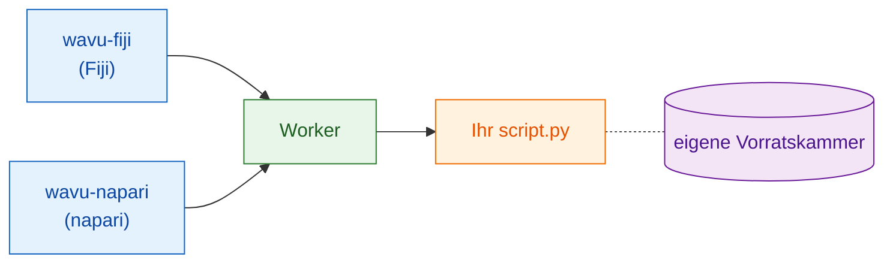

# Was ist Wavu?

## Die Idee in einfachen Worten

Sie kennen schon zwei Welten. In einem **Bildbetrachter**, Fiji oder napari,
öffnen Sie Bilder, zeichnen Regionen ein und messen. In einem
**Jupyter-Notebook** nutzen Sie Python-Werkzeuge wie Cellpose oder
scikit-image. Zwischen beiden zu wechseln heißt meist: Dateien speichern,
Programm wechseln, alles wieder laden.

Wavu ist eine **Brücke** zwischen beiden. Sie arbeiten weiter in Ihrem
Betrachter; wenn Sie Python brauchen, wählen Sie Ihr Skript, füllen ein
kleines Formular aus und klicken auf OK. Der Python-Code läuft, und die
Ergebnisse landen wieder im Betrachter, als neue Bilder, Tabellen oder
Umrisse.

{ width="720" }

Das Bild vom Restaurant hilft:

| Im Restaurant | In Wavu | Was es wirklich ist |
|---|---|---|
| Der Kellner nimmt Ihre Bestellung auf | **der Betrachter** zeigt ein Formular | wavu-fiji (Menüeinträge in Fiji) oder wavu-napari (ein Panel in napari) |
| Die Speisekarte | **PARAMS** | eine kurze Liste oben im Python-Skript |
| Die Küche | **der Worker** | ein kleines Python-Programm, das auf *Ihrem* Computer läuft |
| Ein Rezept | **Ihr Skript** | eine `.py`-Datei mit einer Funktion `run` |
| Die eigene Vorratskammer jedes Rezepts | **die Umgebung** | ein Ordner mit genau den Paketen, die dieses Skript braucht |

Weil jedes Rezept seine eigene Vorratskammer hat, kann die Installation von
PyTorch für ein Skript niemals ein anderes Skript kaputt machen. Niemand
teilt sich eine Vorratskammer, also verdirbt auch nichts.

## Eine Küche, zwei Kellner

Der Küche ist es egal, wer die Bestellung bringt. Fiji und napari sind zwei
Kellner, die mit derselben Küche dieselbe Sprache sprechen, deshalb
**funktioniert ein Skriptordner in beiden**, unverändert. Jeder Betrachter
serviert die Teller auf seine Art: Fiji öffnet Bildfenster und den ROI
Manager, napari fügt Layer hinzu.

Neugierig, wie Kellner und Küche miteinander reden? Siehe
[Architektur](architecture.md).

## Für wen ist es gedacht?

- Sie schreiben Notebooks und haben schon einmal Cellpose oder scikit-image
  benutzt.
- Sie nutzen Fiji oder napari und hätten Ihren Python-Schritt dort gern mit
  *einem Klick*.
- Sie möchten **kein** Java, keine conda-Tricks und kein Docker lernen.

## Was Wavu nicht ist

!!! warning "Nicht für große Datenmengen"
    Wavu schickt jeweils ein Bild, und es muss in den Arbeitsspeicher Ihres
    Computers passen (etwa bis 1–2 GB). Für riesige Volumen, viele Dateien
    oder ganze Objektträger-Scans (Whole-Slide-Bilder) nehmen Sie besser einen
    Batch-Workflow oder einen Rechencluster (HPC).

!!! warning "Keine Sicherheits-Sandbox"
    Die getrennten Umgebungen halten *Pakete* auseinander. Sie sperren ein
    Skript nicht ein. Ein Skript kann alles, was Ihr Benutzerkonto kann:
    Führen Sie also nur Skripte aus, denen Sie vertrauen, genau wie bei einem
    Notebook.

Wavu ersetzt auch Ihr Notebook nicht. Notebooks sind ideal zum Ausprobieren;
Wavu ist für den Moment, in dem das Rezept funktioniert und Sie es aus Ihrem
Betrachter heraus benutzen möchten, oder Kolleginnen und Kollegen es aus
ihrem benutzen lassen möchten.

## Wie sich ein Durchlauf anfühlt

1. Öffnen Sie in Ihrem Betrachter ein Bild.
2. Wählen Sie einen Skriptordner: in Fiji über
   **Plugins › Wavu › Run Python Script** (Python-Skript ausführen), in
   napari über **Start worker** im Wavu-Panel.
3. Ein Formular erscheint. Füllen Sie es aus und klicken Sie auf **OK**
   (Fiji) oder **Run** (napari).
4. Im Log laufen Meldungen durch, und ein Fortschrittsbalken bewegt sich.
5. Die Ergebnisse öffnen sich im Betrachter.

Der allererste Durchlauf eines Skripts ist langsam, weil seine
Vorratskammer (die Umgebung) gefüllt wird: Die Pakete werden einmal
heruntergeladen. Danach startet es schnell.

## In einem Satz

Mit Wavu schicken Fiji oder napari ein Bild und ein paar Einstellungen an
Ihr Python-Skript, das in seiner eigenen, aufgeräumten Umgebung läuft und die
Ergebnisse direkt zurückschickt.

[In Fiji benutzen :material-arrow-right:](../fiji/install.md){ .md-button }
[In napari benutzen :material-arrow-right:](../napari/install.md){ .md-button }
