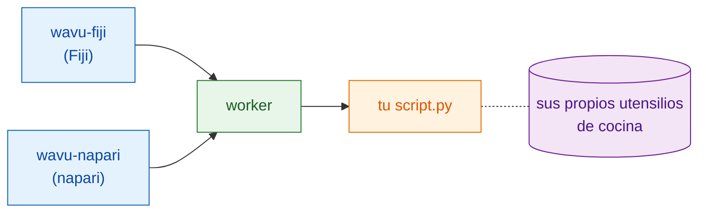

# ¿Qué es Wavu?

## La idea en palabras sencillas

Ya conoces dos mundos. En un **visor de imágenes**, Fiji o napari, abres
imágenes, dibujas regiones y mides. En un **notebook de Jupyter** ejecutas
herramientas de Python como Cellpose o scikit-image. Pasar de uno a otro suele
significar guardar archivos, cambiar de programa y volver a cargarlos.

Wavu es un **puente** entre los dos. Sigues trabajando en tu visor; cuando
necesitas Python, eliges tu script, rellenas un pequeño formulario y pulsas
OK. El código de Python se ejecuta y los resultados vuelven al visor como
imágenes, tablas o contornos nuevos.

{ width="720" }

La imagen del restaurante ayuda:

| En el restaurante | En Wavu | Qué es en realidad |
|---|---|---|
| El camarero toma tu pedido | **el visor** muestra un formulario | wavu-fiji (entradas de menú en Fiji) o wavu-napari (un panel en napari) |
| La carta | **PARAMS** | una lista corta al principio del script de Python |
| La cocina | **el worker** | un pequeño programa de Python que se ejecuta en *tu* ordenador |
| Una receta | **tu script** | un archivo `.py` con una función `run` |
| Los ingredientes | **tus imágenes** | los datos que el visor envía al script |
| Los utensilios de cocina de cada receta | **el entorno** | una carpeta con exactamente los paquetes (las herramientas) que necesita ese script |

Como cada receta tiene sus propios utensilios de cocina, instalar PyTorch
para un script nunca puede romper otro. Nadie comparte ollas ni cuchillos,
así que nada se estropea.

## Una cocina, dos camareros

A la cocina le da igual quién le lleve el pedido. Fiji y napari son dos
camareros que hablan el mismo idioma con la misma cocina, así que **una misma
carpeta de script funciona en los dos**, sin cambios. Cada visor sirve los
platos a su manera: Fiji abre ventanas de imagen y el ROI Manager, napari
añade capas.

¿Te preguntas cómo hablan los camareros con la cocina? Mira
[Arquitectura](architecture.md).

## Para quién es

- Escribes notebooks y ya has usado Cellpose o scikit-image.
- Usas Fiji o napari, y te gustaría que tu paso de Python fuera *un clic*
  allí.
- **No** quieres aprender Java, trucos de conda ni Docker.

## Lo que no es

!!! warning "No es para datos grandes"
    Wavu envía una imagen cada vez, y debe caber en la memoria de tu ordenador
    (aproximadamente hasta 1–2 GB). Para volúmenes enormes, muchos archivos o
    imágenes de portaobjetos completos (whole-slide), usa un flujo de trabajo
    por lotes o en un clúster (HPC).

!!! warning "No es un entorno aislado de seguridad"
    Los entornos separados mantienen apartados los *paquetes*. No encierran al
    script. Un script puede hacer todo lo que puede hacer tu cuenta de
    usuario, así que ejecuta solo scripts de confianza, igual que harías con
    un notebook.

Wavu tampoco sustituye a tu notebook. Los notebooks son geniales para
explorar; Wavu es para el momento en que la receta ya funciona y quieres
usarla, o que la usen tus colegas, desde su visor.

## Cómo se siente una ejecución

1. En tu visor, abre una imagen.
2. Elige una carpeta de script: **Plugins › Wavu › Run Python Script**
   (ejecutar script de Python) en Fiji, o **Start worker** (arrancar el
   worker) en el panel de Wavu en napari.
3. Aparece un formulario. Rellénalo y pulsa **OK** (Fiji) o **Run** (napari).
4. Los mensajes van apareciendo en el log y una barra de progreso avanza.
5. Los resultados se abren en el visor.

La primera ejecución de un script es lenta, porque se están preparando sus
utensilios de cocina (el entorno): los paquetes se descargan una sola vez. Después,
arranca rápido.

## En una frase

Wavu permite que Fiji o napari envíen una imagen y unos pocos ajustes a tu
script de Python, que se ejecuta en su propio entorno ordenado y devuelve los
resultados directamente.

[Usarlo en Fiji :material-arrow-right:](../fiji/install.md){ .md-button }
[Usarlo en napari :material-arrow-right:](../napari/install.md){ .md-button }
