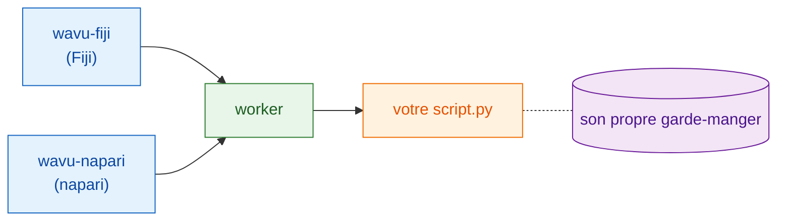

# Qu'est-ce que Wavu ?

## L'idée en mots simples { #the-idea-in-plain-words }

Vous connaissez déjà deux mondes. Dans un **visualiseur d'images**, Fiji ou
napari, vous ouvrez des images, dessinez des régions et mesurez. Dans un
**notebook Jupyter**, vous lancez des outils Python comme Cellpose ou
scikit-image. Passer de l'un à l'autre veut souvent dire enregistrer des
fichiers, changer de programme et tout recharger.

Wavu est un **pont** entre les deux. Vous continuez à travailler dans votre
visualiseur ; quand vous avez besoin de Python, vous choisissez votre script,
remplissez un petit formulaire et cliquez sur OK. Le code Python s'exécute,
et les résultats reviennent dans le visualiseur sous forme de nouvelles
images, de tableaux ou de contours.

{ width="720" }

L'image du restaurant aide :

| Au restaurant | Dans Wavu | Ce que c'est vraiment |
|---|---|---|
| Le serveur prend votre commande | **le visualiseur** affiche un formulaire | wavu-fiji (des entrées de menu dans Fiji) ou wavu-napari (un panneau dans napari) |
| La carte | **PARAMS** | une courte liste en haut du script Python |
| La cuisine | **le worker** | un petit programme Python qui tourne sur *votre* ordinateur |
| Une recette | **votre script** | un fichier `.py` avec une fonction `run` |
| Le garde-manger de chaque recette | **l'environnement** | un dossier avec exactement les paquets dont ce script a besoin |

Comme chaque recette a son propre garde-manger, installer PyTorch pour un
script ne peut jamais casser un autre script. Personne ne partage son
garde-manger, donc rien ne se gâte.

## Une cuisine, deux serveurs { #one-kitchen-two-waiters }

La cuisine se moque de savoir qui apporte la commande. Fiji et napari sont
deux serveurs qui parlent la même langue à la même cuisine : **un même
dossier de script fonctionne dans les deux**, sans modification. Chaque
visualiseur sert les assiettes à sa manière : Fiji ouvre des fenêtres
d'image et le ROI Manager, napari ajoute des calques.

Curieux de savoir comment les serveurs et la cuisine se parlent ? Voir
[Architecture](architecture.md).

## Pour qui ? { #who-it-is-for }

- Vous écrivez des notebooks et avez déjà utilisé Cellpose ou scikit-image.
- Vous utilisez Fiji ou napari, et vous aimeriez que votre étape Python s'y
  fasse en *un clic*.
- Vous ne voulez **pas** apprendre Java, les astuces de conda ou Docker.

## Ce que Wavu n'est pas { #what-it-is-not }

!!! warning "Pas pour les grosses données"
    Wavu envoie une image à la fois, et elle doit tenir dans la mémoire de
    votre ordinateur (environ 1–2 Go au maximum). Pour de très gros volumes,
    beaucoup de fichiers ou des lames entières, utilisez plutôt un traitement
    par lots ou un cluster de calcul (HPC).

!!! warning "Pas un bac à sable de sécurité"
    Les environnements séparés isolent les *paquets*. Ils n'enferment pas un
    script. Un script peut faire tout ce que votre compte utilisateur peut
    faire : n'exécutez donc que des scripts de confiance, exactement comme
    avec un notebook.

Wavu ne remplace pas non plus votre notebook. Les notebooks sont parfaits pour
explorer ; Wavu sert au moment où la recette fonctionne et où vous voulez
l'utiliser, ou la faire utiliser par vos collègues, depuis leur visualiseur.

## À quoi ressemble une exécution { #how-a-run-feels }

1. Dans votre visualiseur, ouvrez une image.
2. Choisissez un dossier de script : **Plugins › Wavu › Run Python Script**
   (lancer un script Python) dans Fiji, ou **Start worker** dans le panneau
   Wavu de napari.
3. Un formulaire apparaît. Remplissez-le et cliquez sur **OK** (Fiji) ou
   **Run** (napari).
4. Des messages défilent dans le log et une barre de progression avance.
5. Les résultats s'ouvrent dans le visualiseur.

La toute première exécution d'un script est lente, car on remplit son
garde-manger (l'environnement) : les paquets se téléchargent une seule fois.
Ensuite, il démarre vite.

## En une phrase { #in-one-sentence }

Wavu permet à Fiji ou à napari d'envoyer une image et quelques réglages à
votre script Python, qui tourne dans son propre environnement bien rangé et
renvoie directement les résultats.

[L'utiliser dans Fiji :material-arrow-right:](../fiji/install.md){ .md-button }
[L'utiliser dans napari :material-arrow-right:](../napari/install.md){ .md-button }
