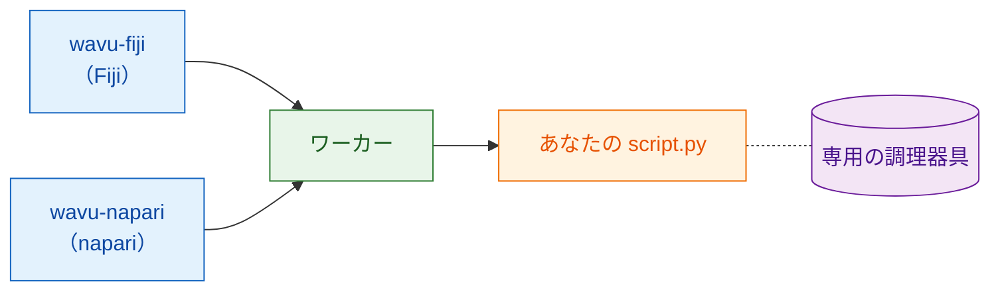

# Wavu とは？

## やさしく言うと

あなたはすでに 2 つの世界を知っています。Fiji や napari などの
**画像ビューアー** では、画像を開き、領域を描き、計測します。
**Jupyter ノートブック** では Cellpose や scikit-image などの Python ツールを
動かします。その間を行き来するには、たいていファイルを保存し、プログラムを
切り替え、また読み込む必要があります。

Wavu はこの 2 つの間に架かる **橋** です。作業はビューアーのまま続けます。
Python が必要になったら、スクリプトを選び、小さなフォームに入力して OK を
押します。Python のコードが動き、結果は新しい画像、表、輪郭として
ビューアーに戻ってきます。

{ width="720" }

レストランにたとえると分かりやすくなります。

| レストランでは | Wavu では | 実際には |
|---|---|---|
| ウェイターが注文を取る | **ビューアー** がフォームを表示する | wavu-fiji（Fiji のメニュー項目）または wavu-napari（napari のパネル） |
| メニュー表 | **PARAMS** | Python スクリプトの先頭にある短いリスト |
| 厨房 | **ワーカー** | *あなたの* コンピューターで動く小さな Python プログラム |
| レシピ | **あなたのスクリプト** | `run` 関数を持つ `.py` ファイル |
| 食材 | **あなたの画像** | ビューアーがスクリプトに送るデータ |
| レシピごとの調理器具 | **環境** | そのスクリプトに必要なパッケージ（道具）だけが入ったフォルダー |

レシピごとに調理器具が分かれているので、あるスクリプトのために PyTorch を
インストールしても、別のスクリプトが壊れることはありません。誰も鍋や包丁を
共有しないので、何もだめになりません。

## 厨房は 1 つ、ウェイターは 2 人

厨房は、誰が注文を運んでくるかを気にしません。Fiji と napari は、同じ厨房に
同じ言葉で話す 2 人のウェイターです。だから **1 つのスクリプトフォルダーが
そのまま両方で動きます**。料理の出し方はビューアーごとに違います。Fiji は
画像ウィンドウと ROI Manager を開き、napari はレイヤーを追加します。

ウェイターと厨房がどう話しているか気になりますか？
[アーキテクチャ](architecture.md) を見てください。

## 誰のためのもの？

- ノートブックを書き、Cellpose や scikit-image を使ったことがある方。
- Fiji や napari を使っていて、Python の処理をそこで *ワンクリック* に
  したい方。
- Java や conda の小技、Docker を覚えたく **ない** 方。

## できないこと

!!! warning "大きなデータ向けには作られていません"
    ふだん Wavu は画像を 1 枚まるごと送り、その画像はコンピューターのメモリに
    収まる必要があります（だいたい 1〜2 GB まで）。もっと大きな画像も、
    ローカルのコンピューターで約 50 GB までなら、
    [ストリーム解析](../workflows/large-data.md)（OME-Zarr、チャンク単位）で
    少しずつ処理できます。動きはしますが、Fiji や napari から操作するのは
    おすすめしません。それを超えるときや、ファイルがとても多いときは、
    代わりにバッチ処理や HPC のワークフローを使ってください。

!!! warning "セキュリティのサンドボックスではありません"
    環境が分かれているのは *パッケージ* を分けるためです。スクリプトを
    閉じ込めるものではありません。スクリプトはあなたのユーザーアカウントで
    できることを何でもできるので、ノートブックと同じように、信頼できる
    スクリプトだけを実行してください。

Wavu はノートブックの代わりでもありません。探索にはノートブックが最適です。
Wavu は、レシピが完成して、それをビューアーから自分で使いたいとき、あるいは
同僚に使ってもらいたいときのためのものです。

## 実行するとどんな感じ？

1. ビューアーで画像を開きます。
2. スクリプトフォルダーを選びます。Fiji では
   **Plugins › Wavu › Run Python Script**（Python スクリプトを実行）、
   napari では Wavu パネルの **Start worker**（ワーカーを起動）です。
3. フォームが出ます。入力して **OK**（Fiji）または **Run**（napari）を
   押します。
4. ログにメッセージが流れ、プログレスバーが進みます。
5. 結果がビューアーで開きます。

スクリプトの一番最初の実行は時間がかかります。調理器具（環境）を
そろえている、つまりパッケージを一度だけダウンロードしているからです。
その後はすぐに起動します。

## ひとことで言うと

Wavu を使うと、Fiji や napari は画像といくつかの設定を Python スクリプトに
送れます。スクリプトは自分専用の整った環境で動き、結果をそのまま返します。

[Fiji で使う :material-arrow-right:](../fiji/install.md){ .md-button }
[napari で使う :material-arrow-right:](../napari/install.md){ .md-button }
