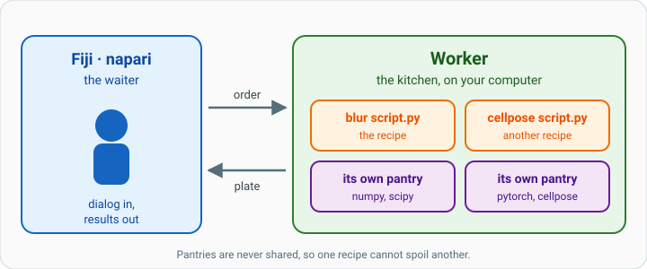
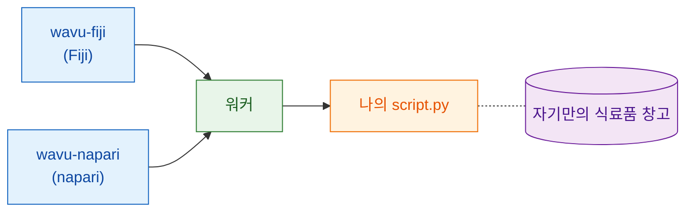

# Wavu란 무엇인가요?

## 쉬운 말로 설명하면

여러분은 이미 두 세계를 알고 있어요. Fiji나 napari 같은 **이미지 뷰어**에서는
이미지를 열고, 영역을 그리고, 측정해요. **Jupyter 노트북**에서는 Cellpose나
scikit-image 같은 Python 도구를 실행해요. 둘 사이를 오가려면 보통 파일을
저장하고, 프로그램을 바꾸고, 다시 불러와야 해요.

Wavu는 그 둘 사이의 **다리**예요. 작업은 뷰어에서 계속하고, Python이
필요하면 스크립트를 고르고, 작은 양식을 채우고, OK를 누르면 돼요.
Python 코드가 실행되고, 결과는 새 이미지, 표, 윤곽선으로 뷰어에 돌아와요.

{ width="720" }

레스토랑 그림이 도움이 돼요.

| 레스토랑에서 | Wavu에서 | 실제로는 |
|---|---|---|
| 웨이터가 주문을 받아요 | **뷰어**가 양식을 보여 줘요 | wavu-fiji(Fiji의 메뉴 항목) 또는 wavu-napari(napari의 패널) |
| 메뉴판 | **PARAMS** | Python 스크립트 맨 위의 짧은 목록 |
| 주방 | **워커(worker)** | *여러분의* 컴퓨터에서 도는 작은 Python 프로그램 |
| 레시피 | **나의 스크립트** | `run` 함수가 있는 `.py` 파일 |
| 레시피마다 있는 식료품 창고 | **환경(environment)** | 그 스크립트에 필요한 패키지만 정확히 담은 폴더 |

레시피마다 자기 창고가 있으니, 한 스크립트에 PyTorch를 설치해도 다른
스크립트가 망가질 일이 없어요. 창고를 함께 쓰지 않으니 아무것도 상하지 않아요.

## 주방 하나, 웨이터 둘

주방은 누가 주문을 가져오든 상관하지 않아요. Fiji와 napari는 같은 주방에
같은 언어로 말하는 두 웨이터예요. 그래서 **스크립트 폴더 하나가 고치지 않고도
양쪽에서 작동해요**. 요리를 내는 방식은 뷰어마다 달라요. Fiji는 이미지 창과
ROI Manager를 열고, napari는 레이어를 추가해요.

웨이터와 주방이 어떻게 대화하는지 궁금한가요?
[아키텍처](architecture.md)를 보세요.

## 누구를 위한 것인가요?

- 노트북을 쓰고, Cellpose나 scikit-image를 돌려 본 적이 있는 분.
- Fiji나 napari를 쓰고, Python 단계를 그 안에서 *클릭 한 번*으로 하고 싶은 분.
- Java, conda 요령, Docker는 배우고 싶지 **않은** 분.

## 이런 것은 아니에요

!!! warning "빅데이터용이 아니에요"
    Wavu는 이미지를 한 번에 한 장씩 보내고, 그 이미지는 컴퓨터 메모리에
    들어가야 해요(대략 1–2 GB까지). 아주 큰 볼륨, 많은 파일, 전체 슬라이드
    이미지는 배치(batch)나 HPC 워크플로를 쓰세요.

!!! warning "보안 샌드박스가 아니에요"
    환경을 나누는 것은 *패키지*를 떼어 놓을 뿐, 스크립트를 가두지는
    않아요. 스크립트는 여러분의 사용자 계정이 할 수 있는 일은 뭐든 할 수
    있으니, 노트북과 똑같이 믿을 수 있는 스크립트만 실행하세요.

Wavu가 노트북을 대신하지도 않아요. 노트북은 탐색에 좋아요. Wavu는 레시피가
완성되어 뷰어에서 직접 쓰거나 동료가 쓰게 하고 싶을 때를 위한 거예요.

## 실행은 이런 느낌이에요

1. 뷰어에서 이미지를 열어요.
2. 스크립트 폴더를 골라요. Fiji에서는
   **Plugins › Wavu › Run Python Script**(Python 스크립트 실행), napari에서는
   Wavu 패널의 **Start worker**(워커 시작)예요.
3. 양식이 나타나요. 채우고 **OK**(Fiji) 또는 **Run**(napari)을 눌러요.
4. 로그에 메시지가 올라오고 진행 표시줄이 움직여요.
5. 결과가 뷰어에서 열려요.

스크립트를 맨 처음 실행할 때는 느려요. 창고(환경)를 채우는 중이라서
패키지를 한 번 내려받거든요. 그다음부터는 빨리 시작해요.

## 한 문장으로

Wavu는 Fiji나 napari가 이미지와 몇 가지 설정을 Python 스크립트에 보내게 해
주고, 스크립트는 자기만의 깔끔한 환경에서 실행되어 결과를 바로 돌려줘요.

[Fiji에서 쓰기 :material-arrow-right:](../fiji/install.md){ .md-button }
[napari에서 쓰기 :material-arrow-right:](../napari/install.md){ .md-button }
