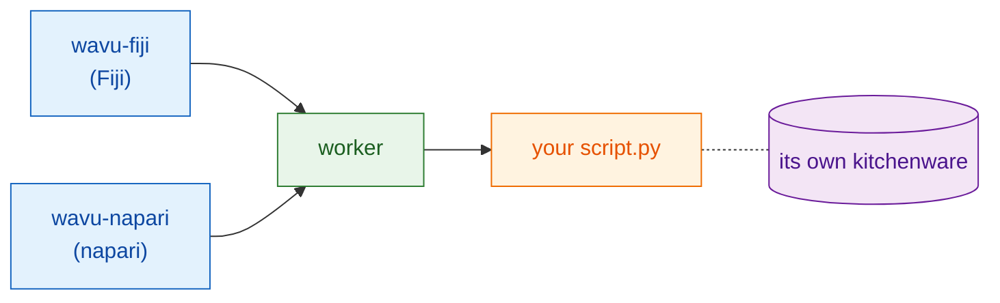

# What is Wavu?

## The idea in plain words

You already know two worlds. In an **image viewer**, Fiji or napari, you
open images, draw regions and measure. In a **Jupyter notebook** you run
Python tools such as Cellpose or scikit-image. Moving between them usually
means saving files, switching programs and loading them again.

Wavu is a **bridge** between the two. You keep working in your viewer; when
you need Python, you pick your script, fill in a small form and press OK.
The Python code runs, and the results land back in the viewer as new
images, tables or outlines.

{ width="720" }

The restaurant picture helps:

| In the restaurant | In Wavu | What it really is |
|---|---|---|
| The waiter takes your order | **the viewer** shows a form | wavu-fiji (menu items in Fiji) or wavu-napari (a panel in napari) |
| The menu card | **PARAMS** | a short list at the top of the Python script |
| The kitchen | **the worker** | a small Python program running on *your* computer |
| A recipe | **your script** | a `.py` file with a `run` function |
| The ingredients | **your images** | the data the viewer sends to the script |
| Each recipe's own kitchenware | **the environment** | a folder with exactly the packages (the tools) that script needs |

Because every recipe has its own kitchenware, installing PyTorch for one
script can never break another script. Nobody shares pots and knives, so
nothing gets spoiled.

## One kitchen, two waiters

The kitchen does not care who carries the order. Fiji and napari are two
waiters that speak the same language to the same kitchen, so **one script
folder works in both**, unchanged. Each viewer serves the plates its own
way: Fiji opens image windows and the ROI Manager, napari adds layers.

Curious how the waiters and the kitchen talk? See
[Architecture](architecture.md).

## Who it is for

- You write notebooks and have run Cellpose or scikit-image before.
- You use Fiji or napari, and you would like your Python step to be *one
  click* there.
- You do **not** want to learn Java, conda tricks or Docker.

## What it is not

!!! warning "Not made for big data"
    Normally Wavu sends one whole image at a time, and it must fit in your
    computer's memory (roughly up to 1–2 GB). Larger images, up to about
    50 GB on a local computer, can be processed piece by piece with
    [stream analysis](../workflows/large-data.md) (OME-Zarr, in chunks): it
    works, but driving it from Fiji or napari is not recommended. Beyond
    that, or for very many files, use a batch or HPC workflow instead.

!!! warning "Not a security sandbox"
    The separate environments keep *packages* apart. They do not lock a script
    in. A script can do anything your user account can do, so run only scripts
    you trust, exactly as you would with a notebook.

Wavu also does not replace your notebook. Notebooks are great for exploring;
Wavu is for the moment when the recipe works and you want to use it, or let
colleagues use it, from their viewer.

## How a run feels

1. In your viewer, open an image.
2. Pick a script folder: **Plugins › Wavu › Run Python Script** in Fiji, or
   the Wavu panel's **Start worker** in napari.
3. A form appears. Fill it in and press **OK** (Fiji) or **Run** (napari).
4. Messages scroll in the log and a progress bar moves.
5. The results open in the viewer.

The very first run of a script is slow, because its kitchenware
(environment) is being set up: the packages download once. After that, it starts quickly.

## In one sentence

Wavu lets Fiji or napari send an image and a few settings to your Python
script, which runs in its own tidy environment and sends the results
straight back.

[Use it in Fiji :material-arrow-right:](../fiji/install.md){ .md-button }
[Use it in napari :material-arrow-right:](../napari/install.md){ .md-button }
