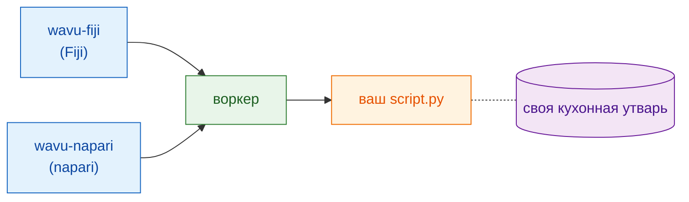

# Что такое Wavu?

## Идея простыми словами

Вы уже знаете два мира. В **просмотрщике изображений**, Fiji или napari, вы
открываете изображения, выделяете области и проводите измерения. В
**Jupyter-ноутбуке** вы запускаете Python-инструменты, например Cellpose или
scikit-image. Чтобы перейти из одного в другой, обычно приходится сохранять
файлы, переключаться между программами и снова их загружать.

Wavu — это **мост** между ними. Вы продолжаете работать в своём просмотрщике;
когда нужен Python, вы выбираете свой скрипт, заполняете небольшую форму и
нажимаете OK. Код на Python выполняется, а результаты возвращаются в
просмотрщик как новые изображения, таблицы или контуры.

{ width="720" }

Помогает картинка с рестораном:

| В ресторане | В Wavu | Что это на самом деле |
|---|---|---|
| Официант принимает заказ | **просмотрщик** показывает форму | wavu-fiji (пункты меню в Fiji) или wavu-napari (панель в napari) |
| Меню | **PARAMS** | короткий список в начале Python-скрипта |
| Кухня | **воркер (worker)** | небольшая программа на Python, работающая на *вашем* компьютере |
| Рецепт | **ваш скрипт** | файл `.py` с функцией `run` |
| Ингредиенты | **ваши изображения** | данные, которые просмотрщик отправляет скрипту |
| Своя кухонная утварь у каждого рецепта | **окружение** | папка ровно с теми пакетами (инструментами), которые нужны этому скрипту |

Раз у каждого рецепта своя кухонная утварь, установка PyTorch для одного
скрипта никогда не сломает другой. Кастрюли и ножи никто не делит, поэтому
ничего не портится.

## Одна кухня, два официанта

Кухне всё равно, кто несёт заказ. Fiji и napari — два официанта, которые
говорят с одной и той же кухней на одном языке, поэтому **одна папка скрипта
работает в обоих** без изменений. Каждый просмотрщик подаёт тарелки
по-своему: Fiji открывает окна изображений и ROI Manager, napari добавляет
слои.

Интересно, как официанты разговаривают с кухней? Смотрите
[Архитектура](architecture.md).

## Для кого это

- Вы пишете ноутбуки и уже запускали Cellpose или scikit-image.
- Вы работаете в Fiji или napari и хотели бы, чтобы ваш шаг на Python был
  там *одним щелчком*.
- Вы **не** хотите учить Java, хитрости conda или Docker.

## Чем это не является

!!! warning "Не создан для больших данных"
    Обычно Wavu передаёт по одному целому изображению, и оно должно
    помещаться в память компьютера (примерно до 1–2 ГБ). Изображения
    побольше, примерно до 50 ГБ на локальном компьютере, можно обработать по
    частям с помощью [потокового анализа](../workflows/large-data.md)
    (OME-Zarr, поблочно): это работает, но управлять им из Fiji или napari
    не рекомендуется. Для ещё больших объёмов или очень многих файлов
    используйте пакетную обработку или HPC.

!!! warning "Не песочница для безопасности"
    Отдельные окружения разделяют *пакеты*. Они не запирают скрипт. Скрипт
    может делать всё, что может ваша учётная запись, поэтому запускайте
    только те скрипты, которым доверяете, — точно так же, как с ноутбуком.

Wavu и не заменяет ноутбук. Ноутбуки отлично подходят для исследования;
Wavu нужен в тот момент, когда рецепт работает и вы хотите пользоваться им
(или дать коллегам пользоваться им) из своего просмотрщика.

## Как выглядит запуск

1. Откройте изображение в просмотрщике.
2. Выберите папку скрипта: **Plugins › Wavu › Run Python Script** в Fiji
   или **Start worker** на панели Wavu в napari.
3. Появится форма. Заполните её и нажмите **OK** (Fiji) или **Run** (napari).
4. В журнале бегут сообщения, движется индикатор прогресса.
5. Результаты открываются в просмотрщике.

Самый первый запуск скрипта медленный, потому что его кухонную утварь
(окружение) только готовят: пакеты скачиваются один раз. Дальше скрипт стартует быстро.

## Одним предложением

Wavu позволяет Fiji или napari отправить изображение и несколько настроек
вашему Python-скрипту, который работает в своём аккуратном окружении и сразу
возвращает результаты.

[Работать в Fiji :material-arrow-right:](../fiji/install.md){ .md-button }
[Работать в napari :material-arrow-right:](../napari/install.md){ .md-button }
