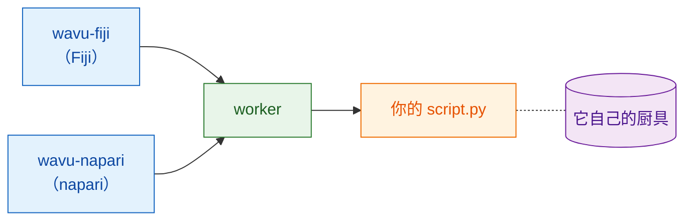

# Wavu 是什么？

## 用大白话说

你已经熟悉两个世界。在**Fiji 或 napari**里，你打开图像、
画选区、做测量。在 **Jupyter 笔记本**（notebook）里，你运行 Cellpose 或
scikit-image 这类 Python 工具。要在两者之间来回切换，通常得保存文件、
切换程序、再重新加载。

Wavu 就是连接两者的一座**桥**。你继续在 Fiji/napari 里工作；需要 Python 时，
选好你的脚本、填一个小表单、按 OK。Python 代码开始运行，结果以新的图像、
表格或轮廓回到 Fiji/napari。

{ width="720" }

拿餐厅来打比方会更好理解：

| 在餐厅里 | 在 Wavu 里 | 实际上是什么 |
|---|---|---|
| 服务员帮你点菜 | **Fiji/napari**显示表单 | wavu-fiji（Fiji 里的菜单项）或 wavu-napari（napari 里的面板） |
| 菜单 | **PARAMS** | Python 脚本顶部的一小段列表 |
| 厨房 | **worker** | 在*你自己的*电脑上运行的小型 Python 程序 |
| 一道食谱 | **你的脚本** | 一个包含 `run` 函数的 `.py` 文件 |
| 食材 | **你的图像** | Fiji/napari 发送给脚本的数据 |
| 每道食谱专用的厨具 | **环境** | 一个文件夹，正好装着该脚本需要的包（也就是工具） |

因为每道食谱都有自己的厨具，给某个脚本安装 PyTorch，绝不会弄坏另一个
脚本。谁也不跟谁共用锅和刀，所以什么都不会坏。

## 一个厨房，两位服务员

厨房不在乎是谁送来的订单。Fiji 和 napari 是两位服务员，用同一种语言和同一个
厨房沟通，所以**同一个脚本文件夹在两边都能用**，一行都不用改。每个 Fiji/napari 用
自己的方式上菜：Fiji 打开图像窗口和 ROI Manager，napari 则添加图层。

好奇服务员和厨房之间怎么沟通？请看[架构](architecture.md)。

## 适合谁用

- 你会写笔记本，也用过 Cellpose 或 scikit-image。
- 你用 Fiji 或 napari，希望在那里*点一下*就完成 Python 这一步。
- 你**不**想学 Java、conda 的各种技巧或 Docker。

## 它不是什么

!!! warning "不是为大数据而设计"
    平常 Wavu 一次传一整张图像，而且它必须能放进电脑内存（大约 1–2 GB
    以内）。更大的图像，在本机上约 50 GB 以内，可以用
    [流式分析](../workflows/large-data.md)（OME-Zarr，分块）一块一块处理：
    能用，但不建议由 Fiji 或 napari 来驱动。超过这个大小，或文件非常多时，
    请改用批处理或 HPC（高性能计算）流程。

!!! warning "不是安全沙箱"
    各自独立的环境只是把*包*分开，并不会把脚本关起来。脚本能做你的用户账号
    能做的任何事，所以只运行你信任的脚本，就像对待笔记本一样。

Wavu 也不会取代你的笔记本。笔记本很适合探索；Wavu 则用在食谱已经跑通、
你想在 Fiji/napari 里使用它（或让同事在他们的 Fiji/napari 里使用）的时候。

## 运行起来是什么感觉

1. 在 Fiji/napari 里打开一张图像。
2. 选一个脚本文件夹：在 Fiji 里用 **Plugins › Wavu › Run Python Script**
   （运行 Python 脚本），在 napari 里则用 Wavu 面板的 **Start worker**。
3. 弹出一个表单。填好后按 **OK**（Fiji）或 **Run**（napari）。
4. 消息在日志里滚动，进度条也随之前进。
5. 结果在 Fiji/napari 中打开。

脚本第一次运行会比较慢，因为正在准备它的厨具（环境）：包只需下载一次。
之后启动就很快了。

## 一句话总结

Wavu 让 Fiji 或 napari 把一张图像和几个设置交给你的 Python 脚本，脚本在
自己干净的环境中运行，再把结果直接送回来。

[在 Fiji 中使用 :material-arrow-right:](../fiji/install.md){ .md-button }
[在 napari 中使用 :material-arrow-right:](../napari/install.md){ .md-button }
