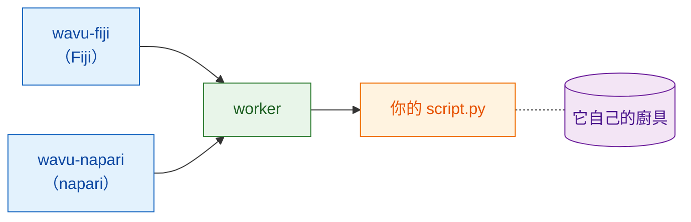

# Wavu 是什麼？

## 用白話說

你已經熟悉兩個世界。在**Fiji 或 napari**裡，你開啟影像、
圈選區域、做測量。在 **Jupyter 筆記本**（notebook）裡，你執行 Cellpose 或
scikit-image 這類 Python 工具。要在兩者之間來回，通常得存檔、切換程式、
再重新載入。

Wavu 就是兩者之間的一座**橋**。你繼續在 Fiji/napari 裡工作；需要 Python 時，
挑選你的腳本、填一個小表單、按下 OK。Python 程式碼開始執行，結果會以新的
影像、表格或輪廓回到 Fiji/napari。

{ width="720" }

用餐廳來想會比較好懂：

| 在餐廳裡 | 在 Wavu 裡 | 實際上是什麼 |
|---|---|---|
| 服務生幫你點餐 | **Fiji/napari**顯示表單 | wavu-fiji（Fiji 裡的選單項目）或 wavu-napari（napari 裡的面板） |
| 菜單 | **PARAMS** | Python 腳本最上面的一小段清單 |
| 廚房 | **worker** | 在*你自己的*電腦上執行的小型 Python 程式 |
| 一道食譜 | **你的腳本** | 一個含有 `run` 函式的 `.py` 檔案 |
| 食材 | **你的影像** | Fiji/napari 送給腳本的資料 |
| 每道食譜專用的廚具 | **環境** | 一個資料夾，剛好裝著該腳本需要的套件（也就是工具） |

因為每道食譜都有自己的廚具，替某個腳本安裝 PyTorch，永遠不會弄壞另一個
腳本。沒有人共用鍋子和刀具，所以什麼都不會壞掉。

## 一個廚房，兩位服務生

廚房不在乎是誰送來點單。Fiji 和 napari 是兩位服務生，用同一種語言和同一個
廚房溝通，所以**同一個腳本資料夾在兩邊都能用**，完全不用改。每個 Fiji/napari 用
自己的方式上菜：Fiji 會開啟影像視窗和 ROI Manager，napari 則加入圖層。

好奇服務生和廚房之間怎麼溝通？請看[架構](architecture.md)。

## 適合誰用

- 你會寫筆記本，也用過 Cellpose 或 scikit-image。
- 你用 Fiji 或 napari，希望在那裡*按一下*就完成 Python 步驟。
- 你**不**想學 Java、conda 的各種技巧或 Docker。

## 它不是什麼

!!! warning "不是為大型資料而設計"
    平常 Wavu 一次傳一整張影像，而且它必須放得進電腦的記憶體（大約 1–2 GB
    以內）。更大的影像，在本機上約 50 GB 以內，可以用
    [流式分析](../workflows/large-data.md)（OME-Zarr，分塊）一塊一塊處理：
    行得通，但不建議由 Fiji 或 napari 來驅動。超過這個大小，或檔案非常多時，
    請改用批次或 HPC（高效能運算）流程。

!!! warning "不是安全沙箱"
    各自獨立的環境只是把*套件*分開，並不會把腳本關起來。腳本能做你的使用者
    帳號能做的任何事，所以只執行你信任的腳本，就像對待筆記本一樣。

Wavu 也不會取代你的筆記本。筆記本很適合探索；Wavu 則是在食譜已經可行、
你想從 Fiji/napari 使用它（或讓同事從他們的 Fiji/napari 使用）的時候派上用場。

## 執行起來是什麼感覺

1. 在 Fiji/napari 裡開啟一張影像。
2. 挑一個腳本資料夾：在 Fiji 用 **Plugins › Wavu › Run Python Script**
   （執行 Python 腳本），在 napari 則用 Wavu 面板的 **Start worker**。
3. 出現一個表單。填好後按 **OK**（Fiji）或 **Run**（napari）。
4. 訊息在 log 中捲動，進度條也跟著前進。
5. 結果在 Fiji/napari 中開啟。

腳本的第一次執行會很慢，因為正在準備它的廚具（環境）：套件只需下載一次。
之後就能很快啟動。

## 一句話總結

Wavu 讓 Fiji 或 napari 把一張影像和幾個設定交給你的 Python 腳本，腳本在
自己整潔的環境中執行，再把結果直接送回來。

[在 Fiji 中使用 :material-arrow-right:](../fiji/install.md){ .md-button }
[在 napari 中使用 :material-arrow-right:](../napari/install.md){ .md-button }
