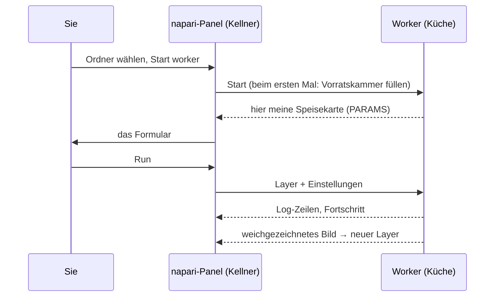

# Ihr erster Durchlauf in napari

## Die Idee in einfachen Worten

Zeit für die erste Bestellung, serviert vom napari-Kellner. Wir nehmen das
**Vorlagenskript**, ein winziges Rezept, das ein Bild weichzeichnet (ein
Gaußscher Weichzeichner). Der Weichzeichner ist absichtlich langweilig: So
können Sie den ganzen Weg verfolgen, vom Formular in die Küche und zurück,
ohne Überraschungen. Es ist genau derselbe Ordner, den Fiji-Nutzer
ausführen.



## Schritt 1: den Vorlagen-Ordner holen

Laden Sie die Vorlage als ZIP-Datei herunter und entpacken Sie sie an einem
Ort, an dem Sie sie wiederfinden, zum Beispiel in *Dokumente*:

[ZIP herunterladen](https://github.com/Oxford-Zeiss-Centre-of-Excellence/Wavu-Script-Template/archive/refs/heads/main.zip){ .md-button }

Sie erhalten einen Ordner namens `Wavu-Script-Template-main` mit `script.py`
(dem Rezept) und `pixi.toml` (der Einkaufsliste für seine Vorratskammer).
Der richtige Ordner ist der, der `pixi.toml` **direkt** enthält.

## Schritt 2: ein Bild öffnen

Starten Sie napari wie auf der [Installationsseite](install.md) und öffnen
Sie ein beliebiges 2-D-Bild, zum Beispiel
**File › Open Sample › napari builtins › Camera**. Öffnen Sie es *vor* dem
nächsten Schritt, damit das Formular es anbieten kann.

## Schritt 3: den Worker starten

1. Öffnen Sie **Plugins › Run Python Script (Wavu)**.
2. Wählen Sie unter **Script folder** den Ordner
   `Wavu-Script-Template-main`.
3. Drücken Sie **Start worker**.

!!! info "Der erste Start dauert einmalig einige Minuten"
    Das Log des Panels zeigt `Starting worker: …` und
    *(the first start installs the script's environment; this can take a few
    minutes)*, gefolgt vom Fortschritt von pixi. Hier füllt pixi die
    Vorratskammer des Skripts. Wenn Sie `Worker ready (wavu …, port …)`
    sehen, ist es fertig. Beim nächsten Mal startet der Worker in Sekunden.
    Zum Aufgeben drücken Sie **Cancel**.

## Schritt 4: das Formular ausfüllen und ausführen

Wenn der Worker bereit ist, zeigt die Liste **Script** den Eintrag `script`
und darunter die erste Zeile seiner Beschreibung, *Gaussian blur -- the Wavu
example script.* Das Formular entsteht aus den `PARAMS` des Skripts:

- **Image**: eine Liste Ihrer Image- und Labels-Layer;
- **Sigma (pixels)**: ein Zahlenfeld, `2.0`;
- **Edges**: eine Auswahlliste, `reflect`;
- **Keep the input's pixel type**: ein Kästchen, angehakt.

Prüfen Sie, dass **Image** Ihren Layer zeigt, und drücken Sie **Run**. Die
Liste folgt der Layer-Liste: Öffnen oder löschen Sie einen Layer, und sie
aktualisiert sich von selbst.

## Schritt 5: das Ergebnis ansehen

Ein neuer Image-Layer namens **blurred** erscheint über Ihrem Bild: dasselbe
Bild, weicher. Schalten Sie sein Augen-Symbol um, um zu vergleichen. Das Log
zeigt den Weg:

```text
Running script...
Blurring a (512, 512) uint8 image with sigma=2.0
Done.
```

Versuchen Sie es noch einmal mit **Sigma (pixels)** auf `8`. Diesmal geht es
sofort los, weil die Küche noch läuft und die Vorratskammer voll ist.

## Abbrechen und stoppen

- **Cancel** bittet das laufende Skript, anzuhalten. Die Vorlage prüft das
  zwischen den Ebenen, also hält sie bei einem großen Stapel schnell an; das
  Log zeigt dann `Cancelled.` Warum Skripte dabei helfen müssen:
  [Log, Fortschritt und Abbrechen](../write/logs-progress-cancel.md).
- **Stop worker** schließt die Küche. Tun Sie das, nachdem Sie `script.py`
  geändert haben, und drücken Sie dann wieder **Start worker**, um die neue
  Version zu laden.
- Wenn Sie napari schließen, stoppt auch jeder Worker, den es gestartet hat.

## Was ist gerade passiert?

- Das Panel hat `pixi.toml` im Ordner gefunden und wusste daher, dass es ein
  Skriptordner ist.
- pixi hat die eigene Umgebung dieses Ordners gebaut (in einem versteckten
  Ordner `.pixi`).
- In dieser Umgebung ist ein Worker gestartet und hat seine Speisekarte
  (`PARAMS`) geschickt, aus der das Formular wurde.
- Das Panel hat die Pixel Ihres Layers und die Einstellungen geschickt und
  das zurückgekommene Bild als neuen Layer hinzugefügt.

## Ein Worker woanders

Der Worker kann auch in einem Container oder auf einem Server laufen, ein
Foodtruck statt einer Küche nebenan. Haken Sie **Remote / container** an;
vier Felder erscheinen: **Handshake file** (Handshake-Datei, Standard
`~/.wavu/worker.json`), **Host** (leer: die Adresse aus der Handshake-Datei),
**Host folder** und **Container folder** (die zwei Namen Ihres
Datenordners). Drücken Sie dann **Connect to running worker** statt
**Start worker**. Das vollständige Rezept:
[Als Container teilen](../write/container.md).

Sie nutzen stattdessen Fiji? Dieselben Schritte dort:
[Ihr erster Durchlauf in Fiji](../fiji/first-run.md).

## In einem Satz

Skriptordner wählen, **Start worker** drücken (einmal auf die Vorratskammer
warten), das Formular ausfüllen, **Run** drücken, und das Ergebnis erscheint
als neuer Layer.

[Weiter: was Sie in napari zurückbekommen :material-arrow-right:](layers.md){ .md-button }
