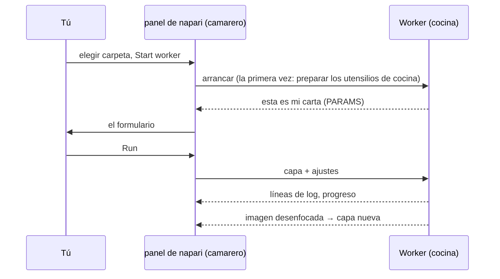

# Tu primera ejecución en napari

## La idea en palabras sencillas

Llega el primer pedido, servido por el camarero de napari. Usaremos el
**script de la plantilla**, una receta diminuta que desenfoca una imagen (un
desenfoque gaussiano). El desenfoque es aburrido a propósito: así ves el
recorrido completo, del formulario a la cocina y de vuelta, sin sorpresas.
Es exactamente la misma carpeta que ejecutan los usuarios de Fiji.



## Paso 1: consigue la carpeta de la plantilla

Descarga la plantilla como zip y descomprímela en un sitio donde la vuelvas a
encontrar, por ejemplo en *Documentos*, o, si usas VS Code, deja que clone
la plantilla por ti:

[Descargar ZIP](https://github.com/Oxford-Zeiss-Centre-of-Excellence/Wavu-Script-Template/archive/refs/heads/main.zip){ .md-button }
[Abrir la plantilla en VS Code](vscode://vscode.git/clone?url=https%3A%2F%2Fgithub.com%2FOxford-Zeiss-Centre-of-Excellence%2FWavu-Script-Template.git){ .md-button }

Obtienes una carpeta llamada `Wavu-Script-Template-main` con `script.py` (la
receta) y `pixi.toml` (la lista de sus utensilios de cocina). La carpeta
correcta es la que contiene **directamente** `pixi.toml`.

## Paso 2: abre una imagen

Arranca napari como en la [página de instalación](install.md) y abre
cualquier imagen 2-D, por ejemplo
**File › Open Sample › napari builtins › Camera**. Ábrela *antes* del
siguiente paso, para que el formulario pueda ofrecerla.

## Paso 3: arranca el worker

1. Abre **Plugins › Run Python Script (Wavu)**.
2. En **Script folder** (carpeta del script), elige la carpeta
   `Wavu-Script-Template-main`.
3. Pulsa **Start worker** (arrancar el worker).

!!! info "El primer arranque tarda unos minutos, una sola vez"
    El log del panel muestra `Starting worker: …` y
    *(the first start installs the script's environment; this can take a few
    minutes)*, seguido del progreso de pixi. Es pixi preparando los utensilios de
    cocina del script. Cuando veas `Worker ready (wavu …, port …)`, ha terminado. La
    próxima vez el worker arranca en segundos. Para abandonar, pulsa
    **Cancel**.

## Paso 4: rellena el formulario y ejecuta

Cuando el worker está listo, la lista **Script** muestra `script` y, debajo,
la primera línea de su descripción, *Gaussian blur -- the Wavu example
script.* El formulario se construye a partir de los `PARAMS` del script:

- **Image**: una lista de tus capas Image y Labels;
- **Sigma (pixels)**: un cuadro numérico, `2.0`;
- **Edges**: una lista desplegable, `reflect`;
- **Keep the input's pixel type**: una casilla, marcada.

Comprueba que **Image** muestra tu capa y pulsa **Run**. La lista sigue a la
lista de capas: abre o borra una capa y se actualiza sola.

## Paso 5: mira el resultado

Aparece una capa Image nueva llamada **blurred** encima de tu imagen: la
misma imagen, más suave. Activa y desactiva su icono del ojo para comparar.
El log muestra el recorrido:

```text
Running script...
Blurring a (512, 512) uint8 image with sigma=2.0
Done.
```

Prueba otra vez con **Sigma (pixels)** en `8`. Esta vez arranca al instante,
porque la cocina sigue abierta y los utensilios de cocina están listos.

## Cancelar y detener

- **Cancel** le pide al script en marcha que se detenga. La plantilla lo
  comprueba entre planos, así que en una pila grande se detiene rápido;
  después el log muestra `Cancelled.` Por qué los scripts tienen que
  colaborar: [Log, progreso y cancelar](../write/logs-progress-cancel.md).
- **Stop worker** cierra la cocina. Hazlo después de cambiar `script.py`, y
  luego pulsa **Start worker** otra vez para cargar la versión nueva.
- Al cerrar napari también se detienen todos los workers que arrancó.

## ¿Qué acaba de pasar?

- El panel encontró `pixi.toml` en la carpeta, así que supo que era una
  carpeta de script.
- pixi construyó el entorno propio de esa carpeta (dentro de una carpeta
  oculta `.pixi`).
- Un worker arrancó en ese entorno y envió su carta (`PARAMS`), que se
  convirtió en el formulario.
- El panel envió los píxeles de tu capa y los ajustes, y añadió la imagen
  que volvió como una capa nueva.

## Un worker en otro sitio

El worker también puede ejecutarse en un contenedor o en un servidor: la
cocina entera, empaquetada con sus utensilios y montada en otro sitio. Marca
**Remote / container**; aparecen cuatro campos: **Handshake file** (archivo
de saludo; por defecto `~/.wavu/worker.json`), **Host** (vacío: la
dirección del archivo de saludo), **Host folder** y **Container folder**
(los dos nombres de tu carpeta de datos: en el anfitrión y en el
contenedor). Después pulsa **Connect to running worker** en lugar de
**Start worker**. La receta completa:
[Compartir como contenedor](../write/container.md).

¿Usas Fiji? Los mismos pasos allí:
[Tu primera ejecución en Fiji](../fiji/first-run.md).

## En una frase

Elige una carpeta de script, pulsa **Start worker** (espera una vez a sus
utensilios de cocina), rellena el formulario, pulsa **Run** y el resultado aparece como
una capa nueva.

[Siguiente: funcionamiento interno de wavu-napari (avanzado) :material-arrow-right:](internals.md){ .md-button }
