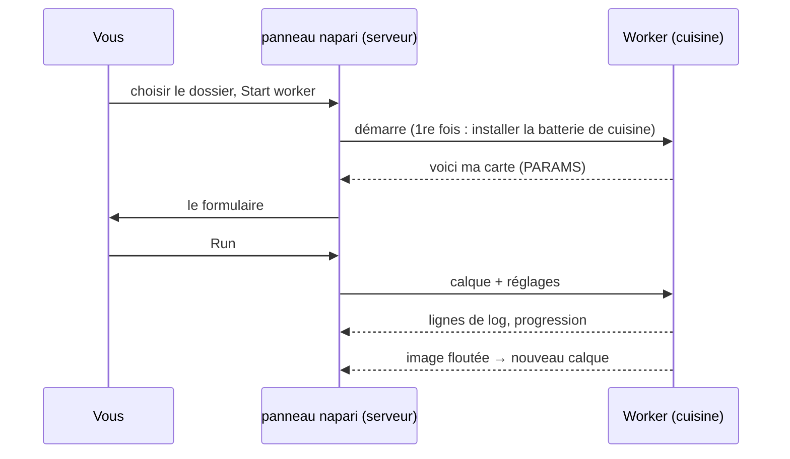

# Votre première exécution dans napari

## L'idée en mots simples

C'est l'heure de la première commande, servie par le serveur napari. Nous
utilisons le **script modèle**, une toute petite recette qui floute une
image (un flou gaussien). Le flou est volontairement banal : il vous laisse
suivre tout le trajet, du formulaire à la cuisine et retour, sans
surprises. C'est exactement le même dossier que celui des utilisateurs de
Fiji.



## Étape 1 : récupérer le dossier modèle

Téléchargez le modèle sous forme de zip et décompressez-le à un endroit où
vous le retrouverez, par exemple dans *Documents* :

[Télécharger le ZIP](https://github.com/Oxford-Zeiss-Centre-of-Excellence/Wavu-Script-Template/archive/refs/heads/main.zip){ .md-button }

Vous obtenez un dossier nommé `Wavu-Script-Template-main` avec `script.py`
(la recette) et `pixi.toml` (la liste de sa batterie de cuisine). Le
bon dossier est celui qui contient `pixi.toml` **directement**.

## Étape 2 : ouvrir une image

Démarrez napari comme sur la [page d'installation](install.md) et ouvrez
n'importe quelle image 2-D, par exemple
**File › Open Sample › napari builtins › Camera**. Ouvrez-la *avant*
l'étape suivante, pour que le formulaire puisse la proposer.

## Étape 3 : démarrer le worker

1. Ouvrez **Plugins › Run Python Script (Wavu)**.
2. Dans **Script folder** (dossier de script), choisissez le dossier
   `Wavu-Script-Template-main`.
3. Appuyez sur **Start worker** (démarrer le worker).

!!! info "Le premier démarrage prend quelques minutes, une seule fois"
    Le log du panneau affiche `Starting worker: …` et
    *(the first start installs the script's environment; this can take a few
    minutes)* (le premier démarrage installe l'environnement du script ;
    cela peut prendre quelques minutes), suivi de la progression de pixi.
    C'est pixi qui installe la batterie de cuisine du script. Quand vous voyez
    `Worker ready (wavu …, port …)`, c'est terminé. La fois suivante, le
    worker démarre en quelques secondes. Pour abandonner, appuyez sur
    **Cancel** (annuler).

## Étape 4 : remplir le formulaire et lancer

Quand le worker est prêt, la liste **Script** affiche `script` et, en
dessous, la première ligne de sa description, *Gaussian blur -- the Wavu
example script.* Le formulaire est construit à partir des `PARAMS` du
script :

- **Image** : une liste de vos calques Image et Labels ;
- **Sigma (pixels)** : une case numérique, `2.0` ;
- **Edges** (bords) : une liste déroulante, `reflect` ;
- **Keep the input's pixel type** (garder le type de pixel de l'entrée) :
  une case à cocher, cochée.

Vérifiez que **Image** affiche votre calque et appuyez sur **Run**. La
liste suit la liste des calques : ouvrez ou supprimez un calque, et elle se
met à jour toute seule.

## Étape 5 : regarder le résultat

Un nouveau calque Image nommé **blurred** apparaît au-dessus de votre
image : la même image, en plus doux. Cliquez sur son icône d'œil pour
comparer. Le log montre le trajet :

```text
Running script...
Blurring a (512, 512) uint8 image with sigma=2.0
Done.
```

Recommencez avec **Sigma (pixels)** réglé sur `8`. Cette fois, ça démarre
tout de suite, car la cuisine tourne encore et la batterie de cuisine est prête.

## Annuler et arrêter

- **Cancel** demande au script en cours de s'arrêter. Le modèle le vérifie
  entre les plans, donc sur une grosse pile il s'arrête vite ; le log
  affiche alors `Cancelled.` Pourquoi les scripts doivent y contribuer :
  [Log, progression et annulation](../write/logs-progress-cancel.md).
- **Stop worker** ferme la cuisine. Faites-le après avoir modifié
  `script.py`, puis appuyez de nouveau sur **Start worker** pour charger la
  nouvelle version.
- Fermer napari arrête aussi tous les workers qu'il a démarrés.

## Que s'est-il passé ?

- Le panneau a trouvé `pixi.toml` dans le dossier, il a donc su que c'est
  un dossier de script.
- pixi a construit l'environnement propre à ce dossier (dans un dossier
  caché `.pixi`).
- Un worker a démarré dans cet environnement et a envoyé sa carte
  (`PARAMS`), qui est devenue le formulaire.
- Le panneau a envoyé les pixels de votre calque et les réglages, puis a
  ajouté l'image revenue comme nouveau calque.

## Un worker ailleurs

Le worker peut aussi tourner dans un conteneur ou sur un serveur : toute la
cuisine, emballée avec sa batterie de cuisine et installée ailleurs. Cochez **Remote / container**
(distant / conteneur) ; quatre champs apparaissent : **Handshake file**
(fichier de poignée de main, par défaut `~/.wavu/worker.json`), **Host**
(hôte ; vide : l'adresse du fichier de poignée de main), **Host folder** et
**Container folder** (les deux noms de votre dossier de données, sur l'hôte
et dans le conteneur). Appuyez ensuite sur **Connect to running worker**
au lieu de **Start worker**. La recette complète :
[Partager sous forme de conteneur](../write/container.md).

Vous utilisez plutôt Fiji ? Les mêmes étapes là-bas :
[Votre première exécution dans Fiji](../fiji/first-run.md).

## En une phrase

Choisissez un dossier de script, appuyez sur **Start worker** (attendez une
fois que sa batterie de cuisine s'installe), remplissez le formulaire, appuyez
sur **Run**, et le résultat apparaît comme nouveau calque.

[Suite : fonctionnement interne de wavu-napari (avancé) :material-arrow-right:](internals.md){ .md-button }
