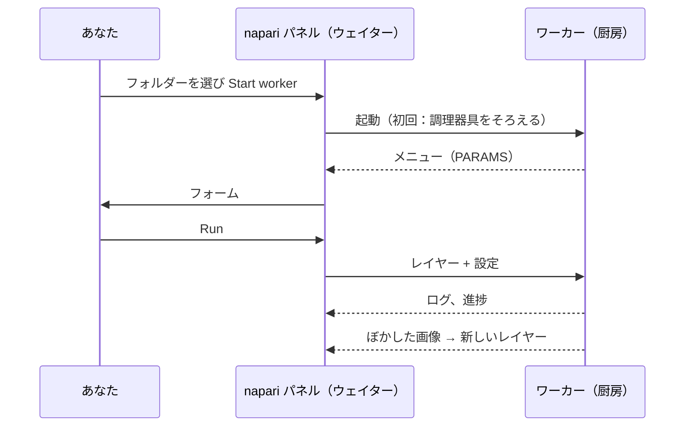

# napari での最初の実行

## やさしく言うと

最初の注文を、napari のウェイターに運んでもらいましょう。使うのは
**テンプレートスクリプト** です。画像をぼかす（ガウシアンぼかし）小さな
レシピです。ぼかしはわざと地味にしてあります。フォームから厨房へ行って
戻ってくるまでの道のりを、驚きなしにすべて見られるからです。Fiji の
ユーザーが実行するのと、まったく同じフォルダーです。



## ステップ 1：テンプレートフォルダーを手に入れる

テンプレートを zip でダウンロードし、あとで見つけられる場所（たとえば
*ドキュメント*）に展開します。VS Code を使っているなら、VS Code に
テンプレートをクローンしてもらうこともできます。

[ZIP をダウンロード](https://github.com/Oxford-Zeiss-Centre-of-Excellence/Wavu-Script-Template/archive/refs/heads/main.zip){ .md-button }
[テンプレートを VS Code で開く](vscode://vscode.git/clone?url=https%3A%2F%2Fgithub.com%2FOxford-Zeiss-Centre-of-Excellence%2FWavu-Script-Template.git){ .md-button }

`Wavu-Script-Template-main` というフォルダーができ、`script.py`（レシピ）と
`pixi.toml`（調理器具のリスト）が入っています。正しいフォルダーは、
`pixi.toml` を **直接** 含んでいるフォルダーです。

## ステップ 2：画像を開く

[インストールのページ](install.md) のとおりに napari を起動し、2 次元の
画像を何か開きます。たとえば
**File › Open Sample › napari builtins › Camera** です。フォームが画像を
選択肢に出せるように、次のステップの *前に* 開いておきます。

## ステップ 3：ワーカーを起動する

1. **Plugins › Run Python Script (Wavu)** を開きます。
2. **Script folder** で `Wavu-Script-Template-main` フォルダーを選びます。
3. **Start worker** を押します。

!!! info "最初の起動は数分かかります（一度だけ）"
    パネルのログに `Starting worker: …` と
    *(the first start installs the script's environment; this can take a few
    minutes)*（初回の起動ではスクリプトの環境をインストールします。数分
    かかることがあります）が表示され、続いて pixi の進み具合が出ます。
    pixi がスクリプトの調理器具をそろえているところです。
    `Worker ready (wavu …, port …)` が出たら完了です。次からはワーカーが
    数秒で起動します。やめたいときは **Cancel** を押します。

## ステップ 4：フォームに入力して実行する

ワーカーの準備ができると、**Script** リストに `script` が表示され、その下に
説明の 1 行目 *Gaussian blur -- the Wavu example script.* が出ます。
フォームはスクリプトの `PARAMS` から作られます。

- **Image**：Image レイヤーと Labels レイヤーのリスト
- **Sigma (pixels)**：数値の欄、`2.0`
- **Edges**：ドロップダウン、`reflect`
- **Keep the input's pixel type**：チェックボックス、チェック済み

**Image** にあなたのレイヤーが表示されていることを確かめて、**Run** を
押します。このリストはレイヤーリストに合わせて動きます。レイヤーを開いたり
削除したりすると、自動で更新されます。

## ステップ 5：結果を見る

画像の上に **blurred** という新しい Image レイヤーが現れます。同じ絵が、
やわらかくなっています。目のアイコンを切り替えて比べてみましょう。ログには
道のりが表示されます。

```text
Running script...
Blurring a (512, 512) uint8 image with sigma=2.0
Done.
```

**Sigma (pixels)** を `8` にしてもう一度試してください。今度はすぐに始まり
ます。厨房はまだ動いていて、調理器具もそろっているからです。

## キャンセルと停止

- **Cancel** は、実行中のスクリプトに止まるよう頼みます。テンプレートは
  平面ごとにそれを確認するので、大きなスタックでもすぐに止まります。ログ
  には `Cancelled.` と表示されます。なぜスクリプトの協力が必要なのかは
  [ログ、進捗、キャンセル](../write/logs-progress-cancel.md) を見てください。
- **Stop worker** は厨房を閉めます。`script.py` を変更したらこれを押し、
  もう一度 **Start worker** を押して新しいバージョンを読み込みます。
- napari を閉じると、napari が起動したワーカーもすべて止まります。

## 何が起きたのでしょう？

- パネルはフォルダーの中に `pixi.toml` を見つけ、スクリプトフォルダーだと
  わかりました。
- pixi がそのフォルダー専用の環境を（隠しフォルダー `.pixi` の中に）
  作りました。
- その環境でワーカーが起動し、メニュー（`PARAMS`）を送りました。それが
  フォームになりました。
- パネルはレイヤーのピクセルと設定を送り、戻ってきた画像を新しいレイヤー
  として追加しました。

## ほかの場所にあるワーカー

ワーカーはコンテナやサーバーの上でも動かせます。厨房を調理器具ごと
まるごと荷造りして、別の場所に設置したものです。**Remote / container** にチェックを入れると、
4 つの欄が現れます。**Handshake file**（ハンドシェイクファイル。既定は
`~/.wavu/worker.json`）、**Host**（ホスト。空ならハンドシェイクファイルの
アドレス）、**Host folder** と **Container folder**（データフォルダーの
2 つの名前）です。そして **Start worker** の代わりに
**Connect to running worker** を押します。詳しい手順は
[コンテナとして共有する](../write/container.md) にあります。

Fiji を使いますか？ 同じ手順は
[最初の実行](../fiji/first-run.md) にあります。

## ひとことで言うと

スクリプトフォルダーを選び、**Start worker** を押し（調理器具のために一度だけ
待ちます）、フォームに入力して **Run** を押せば、結果が新しいレイヤーとして
現れます。

[次へ：wavu-napari の内部（上級） :material-arrow-right:](internals.md){ .md-button }
