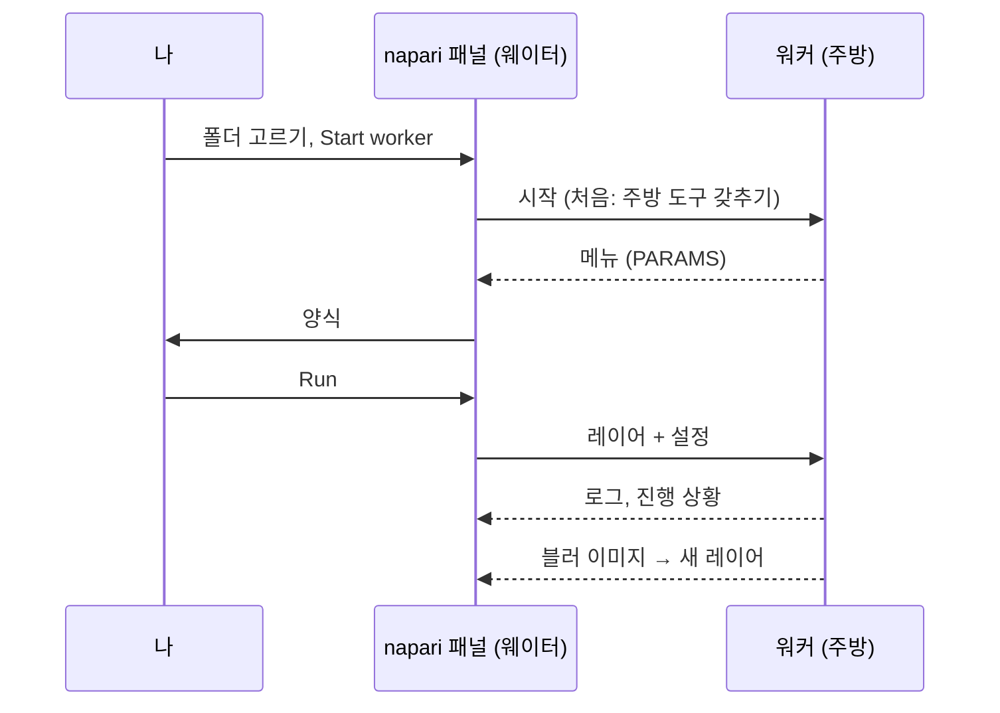

# napari에서 첫 실행

## 쉬운 말로 설명하면

이제 napari 웨이터가 첫 주문을 받을 차례예요. **템플릿 스크립트**를 써요.
이미지를 흐리게 하는(가우시안 블러) 아주 작은 레시피예요. 블러는 일부러
지루하게 골랐어요. 양식에서 주방까지 갔다 오는 전체 여정을 깜짝 놀랄 일
없이 지켜볼 수 있거든요. Fiji 사용자가 실행하는 바로 그 폴더예요.



## 1단계: 템플릿 폴더 받기

템플릿을 zip으로 내려받아 다시 찾기 쉬운 곳, 예를 들어 *문서* 폴더에
압축을 푸세요.

[ZIP 내려받기](https://github.com/Oxford-Zeiss-Centre-of-Excellence/Wavu-Script-Template/archive/refs/heads/main.zip){ .md-button }

`Wavu-Script-Template-main`이라는 폴더가 생기고, 그 안에 `script.py`(레시피)와
`pixi.toml`(그 주방 도구 목록)이 있어요. 올바른 폴더는
`pixi.toml`을 **바로** 담고 있는 폴더예요.

## 2단계: 이미지 열기

[설치 페이지](install.md)처럼 napari를 시작하고 아무 2차원 이미지나 여세요.
예를 들면 **File › Open Sample › napari builtins › Camera**예요. 양식이 그
이미지를 고를 수 있도록 다음 단계 *전에* 여세요.

## 3단계: 워커 시작하기

1. **Plugins › Run Python Script (Wavu)**를 여세요.
2. **Script folder**에서 `Wavu-Script-Template-main` 폴더를 고르세요.
3. **Start worker**를 누르세요.

!!! info "첫 시작은 몇 분 걸려요(한 번만)"
    패널 로그에 `Starting worker: …`와
    *(the first start installs the script's environment; this can take a few
    minutes)*가 나오고, 이어서 pixi의 진행 상황이 나와요. pixi가 스크립트의
    주방 도구를 갖추는 중이에요. `Worker ready (wavu …, port …)`가 보이면
    끝난 거예요. 다음부터는 워커가 몇 초 만에 시작해요. 그만두려면
    **Cancel**을 누르세요.

## 4단계: 양식을 채우고 실행하기

워커가 준비되면 **Script** 목록에 `script`가 나오고, 그 아래에 설명의 첫 줄
*Gaussian blur -- the Wavu example script.*가 나와요. 양식은 스크립트의
`PARAMS`로 만들어져요.

- **Image**: Image와 Labels 레이어 목록
- **Sigma (pixels)**: 숫자 상자, `2.0`
- **Edges**: 드롭다운, `reflect`
- **Keep the input's pixel type**: 체크박스, 체크됨

**Image**에 여러분의 레이어가 보이는지 확인하고 **Run**을 누르세요. 이
목록은 레이어 목록을 따라가요. 레이어를 열거나 지우면 저절로 바뀌어요.

## 5단계: 결과 보기

**blurred**라는 새 Image 레이어가 이미지 위에 나타나요. 같은 그림인데 더
부드러워요. 눈 아이콘을 켜고 끄며 비교해 보세요. 로그에는 여정이 보여요.

```text
Running script...
Blurring a (512, 512) uint8 image with sigma=2.0
Done.
```

**Sigma (pixels)**를 `8`로 바꿔 다시 해 보세요. 이번에는 바로 시작해요.
주방이 아직 돌고 있고 주방 도구도 준비되어 있으니까요.

## 취소와 중지

- **Cancel**은 실행 중인 스크립트에 멈춰 달라고 요청해요. 템플릿은 평면
  사이마다 이걸 확인하니까, 큰 스택에서도 금방 멈춰요. 그러면 로그에
  `Cancelled.`가 나와요. 왜 스크립트가 도와야 하는지:
  [로그, 진행 상황, 취소](../write/logs-progress-cancel.md).
- **Stop worker**는 주방을 닫아요. `script.py`를 고친 뒤에 이걸 누르고,
  **Start worker**를 다시 눌러 새 버전을 불러오세요.
- napari를 닫아도 napari가 시작한 워커는 모두 멈춰요.

## 방금 무슨 일이 있었나요?

- 패널이 폴더에서 `pixi.toml`을 찾아서, 이게 스크립트 폴더라는 걸 알았어요.
- pixi가 그 폴더만의 환경을 만들었어요(숨겨진 `.pixi` 폴더 안에).
- 워커가 그 환경에서 시작해서 메뉴(`PARAMS`)를 보냈고, 그게 양식이 됐어요.
- 패널이 레이어의 픽셀과 설정을 보내고, 돌아온 이미지를 새 레이어로
  추가했어요.

## 다른 곳에 있는 워커

워커는 컨테이너나 서버에서도 실행할 수 있어요. 주방 도구까지 꾸려 넣은
주방 전체를 다른 곳에 차린 셈이에요. **Remote / container**를 체크하면 입력란 네 개가 나타나요.
**Handshake file**(핸드셰이크 파일, 기본값 `~/.wavu/worker.json`),
**Host**(호스트, 비워 두면 핸드셰이크 파일의 주소), **Host folder**(호스트
폴더)와 **Container folder**(컨테이너 폴더, 데이터 폴더의 두 이름)예요.
그다음 **Start worker** 대신 **Connect to running worker**를 누르세요.
전체 방법: [컨테이너로 공유하기](../write/container.md).

Fiji를 쓰나요? 같은 단계를 Fiji에서:
[Fiji에서 첫 실행](../fiji/first-run.md).

## 한 문장으로

스크립트 폴더를 고르고, **Start worker**를 누르고(주방 도구를 갖추는 동안 한
번만 기다리고), 양식을 채우고, **Run**을 누르면 결과가 새 레이어로 나타나요.

[다음: wavu-napari 내부 구조 (고급) :material-arrow-right:](internals.md){ .md-button }
