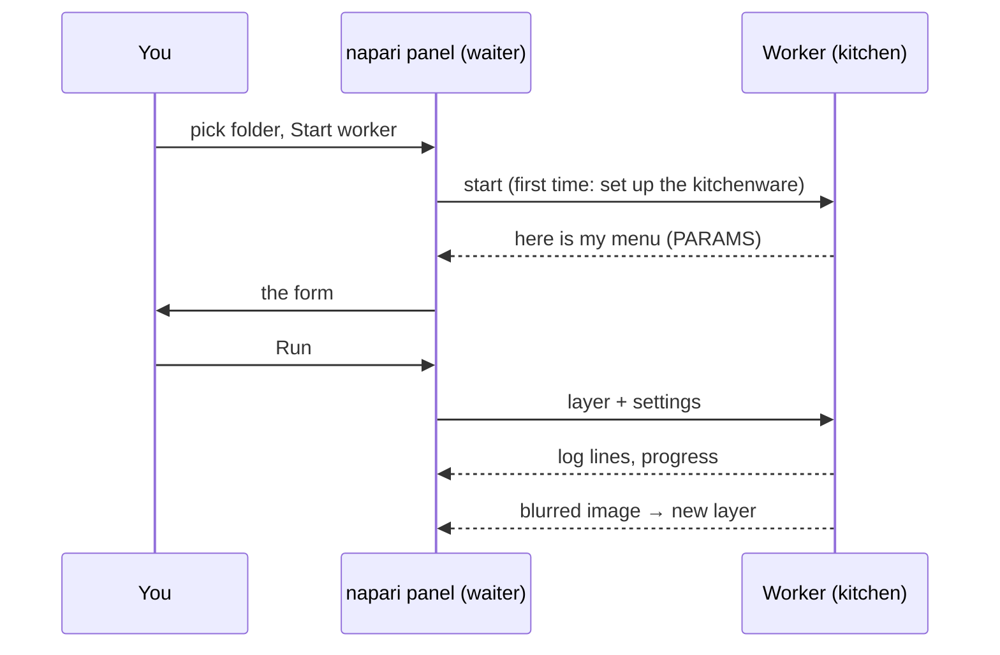

# Your first run in napari

## The idea in plain words

Time for the first order, served by the napari waiter. We use the
**template script**, a tiny recipe that blurs an image (a Gaussian blur).
The blur is boring on purpose: it lets you watch the whole trip, from form
to kitchen and back, without surprises. It is the very same folder Fiji
users run.



## Step 1: get the template folder

Download the template as a zip and unzip it somewhere you can find it again,
for example in *Documents*, or, if you use VS Code, let it clone the template
for you:

[Download ZIP](https://github.com/Oxford-Zeiss-Centre-of-Excellence/Wavu-Script-Template/archive/refs/heads/main.zip){ .md-button }
[Open the template in VS Code](vscode://vscode.git/clone?url=https%3A%2F%2Fgithub.com%2FOxford-Zeiss-Centre-of-Excellence%2FWavu-Script-Template.git){ .md-button }

You get a folder called `Wavu-Script-Template-main` with `script.py` (the
recipe) and `pixi.toml` (the list of its kitchenware). The right folder
is the one that **directly** contains `pixi.toml`.

## Step 2: open an image

Start napari as on the [install page](install.md) and open any 2-D image,
for example **File › Open Sample › napari builtins › Camera**. Open it
*before* the next step, so the form can offer it.

## Step 3: start the worker

1. Open **Plugins › Run Python Script (Wavu)**.
2. In **Script folder**, choose the `Wavu-Script-Template-main` folder.
3. Press **Start worker**.

!!! info "The first start takes a few minutes, once"
    The panel's log shows `Starting worker: …` and
    *(the first start installs the script's environment; this can take a few
    minutes)*, followed by pixi's progress. This is pixi setting up the
    script's kitchenware. When you see `Worker ready (wavu …, port …)`, it is
    done. Next time the worker starts in seconds. To give up, press
    **Cancel**.

## Step 4: fill in the form and run

When the worker is ready, the **Script** list shows `script` and, below it,
the first line of its description, *Gaussian blur -- the Wavu example
script.* The form is built from the script's `PARAMS`:

- **Image**: a list of your Image and Labels layers;
- **Sigma (pixels)**: a number box, `2.0`;
- **Edges**: a drop-down, `reflect`;
- **Keep the input's pixel type**: a checkbox, ticked.

Check that **Image** shows your layer and press **Run**. The list follows
the layer list: open or delete a layer and it updates by itself.

## Step 5: look at the result

A new Image layer called **blurred** appears on top of your image: the same
picture, softer. Toggle its eye icon to compare. The log shows the trip:

```text
Running script...
Blurring a (512, 512) uint8 image with sigma=2.0
Done.
```

Try again with **Sigma (pixels)** set to `8`. This time it starts at once,
because the kitchen is still running and the kitchenware is ready.

## Cancel and stop

- **Cancel** asks the running script to stop. The template checks for it
  between planes, so on a big stack it stops quickly; the log then shows
  `Cancelled.` Why scripts have to help:
  [Logs, progress and cancel](../write/logs-progress-cancel.md).
- **Stop worker** shuts the kitchen down. Do this after you change
  `script.py`, then press **Start worker** again to load the new version.
- Closing napari also stops every worker it started.

## What just happened?

- The panel found `pixi.toml` in the folder, so it knew this is a script
  folder.
- pixi built that folder's own environment (in a hidden `.pixi` folder).
- A worker started in that environment and sent its menu (`PARAMS`), which
  became the form.
- The panel sent your layer's pixels and the settings, and added the image
  that came back as a new layer.

## A worker somewhere else

The worker can also run in a container or on a server: the whole kitchen,
packed up with its kitchenware and set up somewhere else. Tick **Remote / container**; four fields
appear: **Handshake file** (default `~/.wavu/worker.json`), **Host**
(empty: the address in the handshake file), **Host folder** and
**Container folder** (your data folder's two names). Then press
**Connect to running worker** instead of **Start worker**. The full
recipe: [Share as a container](../write/container.md).

Using Fiji instead? The same steps there:
[Your first run in Fiji](../fiji/first-run.md).

## In one sentence

Pick a script folder, press **Start worker** (wait once for its kitchenware),
fill in the form, press **Run**, and the result appears as a new layer.

[Next: wavu-napari internals (advanced) :material-arrow-right:](internals.md){ .md-button }
