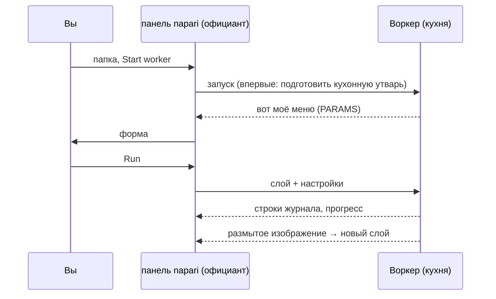

# Первый запуск в napari

## Идея простыми словами

Пора сделать первый заказ, и обслужит его официант napari. Мы используем
**скрипт-шаблон** — крошечный рецепт, который размывает изображение
(гауссово размытие). Размытие нарочно скучное: оно позволяет проследить
весь путь, от формы до кухни и обратно, без сюрпризов. Это та же самая
папка, которую запускают пользователи Fiji.



## Шаг 1: получите папку шаблона

Скачайте шаблон в виде zip и распакуйте туда, где вы его потом найдёте,
например в *Документы*, или, если вы пользуетесь VS Code, пусть он сам
клонирует шаблон:

[Скачать ZIP](https://github.com/Oxford-Zeiss-Centre-of-Excellence/Wavu-Script-Template/archive/refs/heads/main.zip){ .md-button }
[Открыть шаблон в VS Code](vscode://vscode.git/clone?url=https%3A%2F%2Fgithub.com%2FOxford-Zeiss-Centre-of-Excellence%2FWavu-Script-Template.git){ .md-button }

Вы получите папку `Wavu-Script-Template-main` с `script.py` (рецепт) и
`pixi.toml` (список его кухонной утвари). Нужная папка — та, в которой
`pixi.toml` лежит **непосредственно**.

## Шаг 2: откройте изображение

Запустите napari, как на [странице установки](install.md), и откройте
любое двумерное изображение, например **File › Open Sample › napari
builtins › Camera**. Откройте его *до* следующего шага, чтобы форма могла
его предложить.

## Шаг 3: запустите воркер

1. Откройте **Plugins › Run Python Script (Wavu)**.
2. В поле **Script folder** выберите папку `Wavu-Script-Template-main`.
3. Нажмите **Start worker**.

!!! info "Первый запуск занимает несколько минут, один раз"
    В журнале панели появятся `Starting worker: …` и
    *(the first start installs the script's environment; this can take a few
    minutes)*, а затем прогресс pixi. Это pixi готовит кухонную утварь скрипта.
    Когда вы увидите `Worker ready (wavu …, port …)`, всё готово. В
    следующий раз воркер запустится за секунды. Чтобы прервать, нажмите
    **Cancel**.

## Шаг 4: заполните форму и запустите

Когда воркер готов, в списке **Script** появится `script`, а под ним —
первая строка его описания, *Gaussian blur -- the Wavu example script.*
Форма строится из `PARAMS` скрипта:

- **Image**: список ваших слоёв Image и Labels;
- **Sigma (pixels)**: числовое поле, `2.0`;
- **Edges**: выпадающий список, `reflect`;
- **Keep the input's pixel type**: флажок, отмечен.

Проверьте, что в **Image** выбран ваш слой, и нажмите **Run**. Список
следует за списком слоёв: откройте или удалите слой, и он обновится сам.

## Шаг 5: посмотрите на результат

Поверх вашего изображения появится новый слой Image с именем **blurred**:
та же картинка, только мягче. Переключайте значок глаза, чтобы сравнить.
Журнал показывает путь:

```text
Running script...
Blurring a (512, 512) uint8 image with sigma=2.0
Done.
```

Попробуйте ещё раз со значением **Sigma (pixels)** `8`. На этот раз всё
начнётся сразу, потому что кухня ещё работает и кухонная утварь готова.

## Отмена и остановка

- **Cancel** просит работающий скрипт остановиться. Шаблон проверяет это
  между плоскостями, поэтому на большом стеке он останавливается быстро;
  затем в журнале появляется `Cancelled.` Почему скрипт должен помогать:
  [Журнал, прогресс и отмена](../write/logs-progress-cancel.md).
- **Stop worker** закрывает кухню. Делайте это после изменения
  `script.py`, а затем снова нажмите **Start worker**, чтобы загрузить
  новую версию.
- Закрытие napari тоже останавливает все запущенные им воркеры.

## Что сейчас произошло?

- Панель нашла в папке `pixi.toml` и поняла, что это папка скрипта.
- pixi собрал собственное окружение этой папки (в скрытой папке `.pixi`).
- В этом окружении запустился воркер и прислал своё меню (`PARAMS`),
  которое стало формой.
- Панель отправила пиксели вашего слоя и настройки, а вернувшееся
  изображение добавила как новый слой.

## Воркер где-то ещё

Воркер может работать и в контейнере или на сервере: вся кухня целиком,
упакованная вместе с утварью и установленная где-то ещё. Отметьте **Remote / container**; появятся четыре поля:
**Handshake file** (файл рукопожатия, по умолчанию `~/.wavu/worker.json`),
**Host** (хост; пусто — адрес из файла рукопожатия), **Host folder** и
**Container folder** (два имени вашей папки с данными: на хосте и в
контейнере). Затем нажмите **Connect to running worker** вместо **Start
worker**. Полный рецепт: [Поделиться в виде контейнера](../write/container.md).

Пользуетесь Fiji? Те же шаги там:
[Первый запуск в Fiji](../fiji/first-run.md).

## Одним предложением

Выберите папку скрипта, нажмите **Start worker** (один раз подождите, пока
готовится кухонная утварь), заполните форму, нажмите **Run** — и результат
появится как новый слой.

[Далее: внутреннее устройство wavu-napari (для продвинутых) :material-arrow-right:](internals.md){ .md-button }
