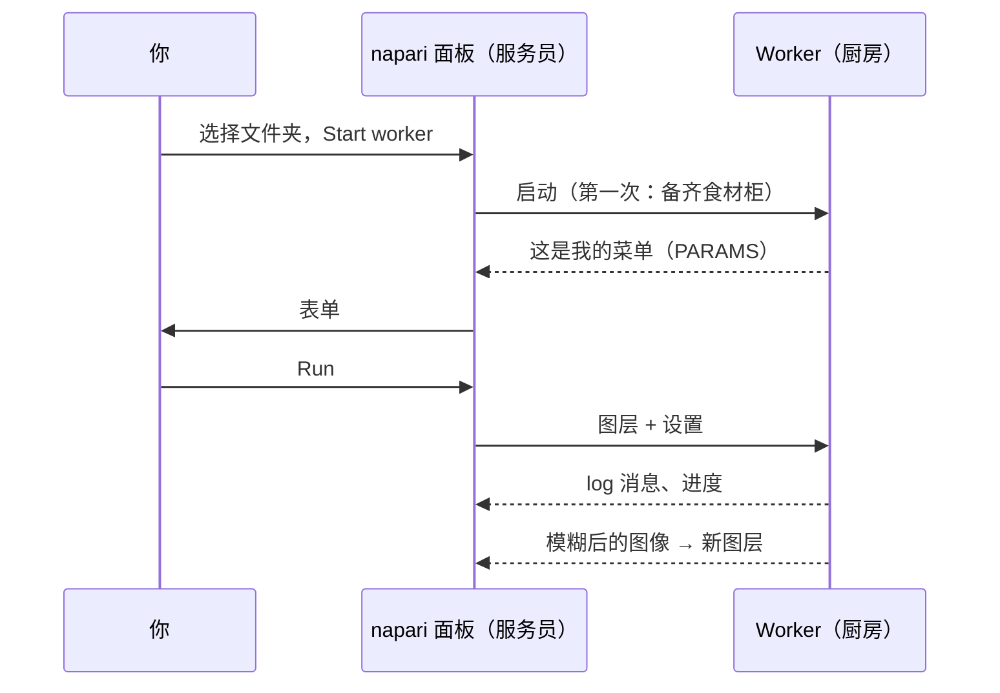

# 在 napari 中第一次运行

## 用大白话说

该点第一道菜了，这次由 napari 这位服务员上菜。我们会用**模板脚本**：一道把
图像模糊化（高斯模糊）的小食谱。模糊本身故意做得很无聊：这样你就能看清整个
流程，从表单到厨房再回来，不会有任何意外。它和 Fiji 用户运行的是同一个
文件夹。



## 第 1 步：获取模板文件夹

把模板下载为 zip 文件，解压到一个你之后找得到的地方，例如*文档*文件夹：

[下载 ZIP](https://github.com/Oxford-Zeiss-Centre-of-Excellence/Wavu-Script-Template/archive/refs/heads/main.zip){ .md-button }

你会得到一个名为 `Wavu-Script-Template-main` 的文件夹，里面有 `script.py`
（食谱）和 `pixi.toml`（它的食材柜的购物清单）。正确的文件夹是**直接**
包含 `pixi.toml` 的那一层。

## 第 2 步：打开一张图像

按[安装页面](install.md)的方法启动 napari，打开任意一张 2D 图像，例如
**File › Open Sample › napari builtins › Camera**。请在下一步*之前*打开，
这样表单才能把它列出来。

## 第 3 步：启动 worker

1. 打开 **Plugins › Run Python Script (Wavu)**。
2. 在 **Script folder**（脚本文件夹）中选择 `Wavu-Script-Template-main`
   文件夹。
3. 按下 **Start worker**（启动 worker）。

!!! info "第一次启动要等几分钟，仅此一次"
    面板的 log 会显示 `Starting worker: …` 和
    *(the first start installs the script's environment; this can take a few
    minutes)*，接着是 pixi 的进度。这是 pixi 在备齐脚本的食材柜。看到
    `Worker ready (wavu …, port …)` 就说明完成了。下次 worker 几秒内就能
    启动。想放弃的话，按 **Cancel**（取消）。

## 第 4 步：填写表单并运行

worker 就绪后，**Script** 列表会显示 `script`，下方是它说明的第一行
*Gaussian blur -- the Wavu example script.* 表单是根据脚本的 `PARAMS`
生成的：

- **Image**：列出你的 Image 和 Labels 图层；
- **Sigma (pixels)**：数字框，`2.0`；
- **Edges**：下拉菜单，`reflect`；
- **Keep the input's pixel type**：复选框，已勾选。

确认 **Image** 显示的是你的图层，然后按 **Run**（运行）。这个列表会跟着
图层列表变：打开或删除图层时，它会自动更新。

## 第 5 步：查看结果

一个名为 **blurred** 的新 Image 图层会出现在你的图像上方：同一张图，只是更
柔和。切换它的眼睛图标来对比。log 会显示整个流程：

```text
Running script...
Blurring a (512, 512) uint8 image with sigma=2.0
Done.
```

把 **Sigma (pixels)** 改成 `8` 再试一次。这次会立刻开始，因为厨房还开着，
食材柜也是满的。

## 取消与停止

- **Cancel** 会请正在运行的脚本停下来。模板会在每个平面之间检查它，所以在
  大的图像栈上也能很快停下；log 随后会显示 `Cancelled.` 为什么脚本必须配合：
  [日志、进度和取消](../write/logs-progress-cancel.md)。
- **Stop worker** 会关掉厨房。修改 `script.py` 之后要这样做，然后再按一次
  **Start worker** 加载新版本。
- 关闭 napari 也会停止它启动的所有 worker。

## 刚才发生了什么？

- 面板在文件夹里找到了 `pixi.toml`，因此知道这是一个脚本文件夹。
- pixi 为这个文件夹建立了专属的环境（放在隐藏的 `.pixi` 文件夹里）。
- 一个 worker 在这个环境中启动，并发来它的菜单（`PARAMS`），菜单就变成了
  表单。
- 面板发送你图层的像素和设置，再把传回来的图像添加为新图层。

## 在别处的 worker

worker 也可以在容器或服务器上运行，就像一辆餐车，而不是隔壁的厨房。勾选
**Remote / container**（远程／容器），会出现四个输入框：**Handshake file**
（握手文件，默认 `~/.wavu/worker.json`）、**Host**（主机，留空：使用握手
文件里的地址）、**Host folder**（主机文件夹）和 **Container folder**
（容器文件夹）（也就是你的数据文件夹的两个名字）。然后按
**Connect to running worker**，而不是 **Start worker**。完整做法：
[以容器形式分享](../write/container.md)。

改用 Fiji？那里的步骤一样：
[在 Fiji 中第一次运行](../fiji/first-run.md)。

## 一句话总结

选一个脚本文件夹，按 **Start worker**（等它的食材柜备齐一次），填好表单，
按 **Run**，结果就会以新图层的形式出现。

[下一步：在 napari 中会得到什么 :material-arrow-right:](layers.md){ .md-button }
