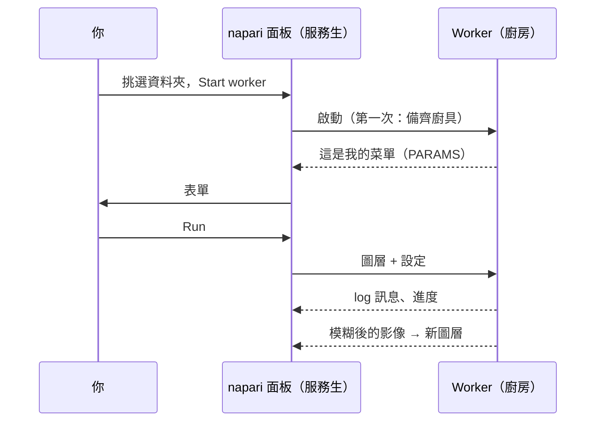

# 在 napari 中第一次執行

## 用白話說

該點第一道菜了，這次由 napari 這位服務生上菜。我們會用**範本腳本**：一道把
影像模糊化（高斯模糊）的小食譜。模糊本身故意做得很無聊：這樣你就能看清整趟
旅程，從表單到廚房再回來，不會有任何意外。它和 Fiji 使用者執行的是同一個
資料夾。



## 步驟 1：取得範本資料夾

把範本下載成 zip 檔，解壓縮到你之後找得到的地方，例如*文件*資料夾：

[下載 ZIP](https://github.com/Oxford-Zeiss-Centre-of-Excellence/Wavu-Script-Template/archive/refs/heads/main.zip){ .md-button }

你會得到一個叫 `Wavu-Script-Template-main` 的資料夾，裡面有 `script.py`
（食譜）和 `pixi.toml`（它的廚具清單）。正確的資料夾是**直接**
包含 `pixi.toml` 的那一層。

## 步驟 2：開啟一張影像

照[安裝頁面](install.md)的方式啟動 napari，開啟任意一張 2D 影像，例如
**File › Open Sample › napari builtins › Camera**。請在下一步*之前*開啟，
這樣表單才能把它列出來。

## 步驟 3：啟動 worker

1. 開啟 **Plugins › Run Python Script (Wavu)**。
2. 在 **Script folder**（腳本資料夾）中選擇 `Wavu-Script-Template-main`
   資料夾。
3. 按下 **Start worker**（啟動 worker）。

!!! info "第一次啟動要等幾分鐘，只有一次"
    面板的 log 會顯示 `Starting worker: …` 和
    *(the first start installs the script's environment; this can take a few
    minutes)*，接著是 pixi 的進度。這是 pixi 在補齊腳本的廚具。看到
    `Worker ready (wavu …, port …)` 就代表完成了。下次 worker 幾秒內就能
    啟動。想放棄的話，按 **Cancel**（取消）。

## 步驟 4：填寫表單並執行

worker 準備好後，**Script** 清單會顯示 `script`，下方是它說明的第一行
*Gaussian blur -- the Wavu example script.* 表單是根據腳本的 `PARAMS`
建立的：

- **Image**：列出你的 Image 和 Labels 圖層；
- **Sigma (pixels)**：數字框，`2.0`；
- **Edges**：下拉選單，`reflect`；
- **Keep the input's pixel type**：勾選框，已勾選。

確認 **Image** 顯示的是你的圖層，然後按 **Run**（執行）。這個清單會跟著
圖層清單走：開啟或刪除圖層時，它會自己更新。

## 步驟 5：查看結果

一個叫 **blurred** 的新 Image 圖層會出現在你的影像上方：同一張圖，只是更
柔和。切換它的眼睛圖示來比較。log 會顯示這趟旅程：

```text
Running script...
Blurring a (512, 512) uint8 image with sigma=2.0
Done.
```

把 **Sigma (pixels)** 改成 `8` 再試一次。這次會馬上開始，因為廚房還開著，
廚具也都備齊了。

## 取消與停止

- **Cancel** 會請執行中的腳本停下來。範本會在每個平面之間檢查它，所以在大型
  堆疊上也能很快停下；log 接著會顯示 `Cancelled.` 為什麼腳本必須配合：
  [Log、進度與取消](../write/logs-progress-cancel.md)。
- **Stop worker** 會關掉廚房。修改 `script.py` 之後要這樣做，然後再按一次
  **Start worker** 載入新版本。
- 關閉 napari 也會停止它啟動的所有 worker。

## 剛才發生了什麼？

- 面板在資料夾裡找到 `pixi.toml`，所以知道這是一個腳本資料夾。
- pixi 為這個資料夾建立了專屬的環境（放在隱藏的 `.pixi` 資料夾裡）。
- 一個 worker 在這個環境中啟動，並送出它的菜單（`PARAMS`），菜單就變成了
  表單。
- 面板送出你圖層的像素和設定，再把傳回來的影像加成新圖層。

## 在別處的 worker

worker 也可以在容器或伺服器上執行，也就是把整個廚房連同廚具打包，搬到別處架起來。勾選
**Remote / container**（遠端／容器），會出現四個欄位：**Handshake file**
（交握檔案，預設 `~/.wavu/worker.json`）、**Host**（主機，留空：使用交握
檔案裡的位址）、**Host folder**（主機資料夾）和 **Container folder**
（容器資料夾）（也就是你資料資料夾的兩個名字）。接著按
**Connect to running worker**，而不是 **Start worker**。完整做法：
[以容器分享](../write/container.md)。

改用 Fiji？那裡的步驟一樣：
[在 Fiji 中第一次執行](../fiji/first-run.md)。

## 一句話總結

挑一個腳本資料夾，按 **Start worker**（等它的廚具補齊一次），填好表單，
按 **Run**，結果就會以新圖層出現。

[下一步：wavu-napari 內部構造（進階） :material-arrow-right:](internals.md){ .md-button }
