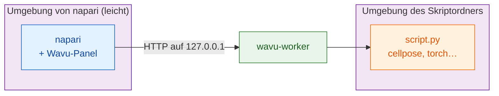

# wavu-napari installieren

## Die Idee in einfachen Worten

In napari ist Wavu ein **zweiter Kellner** für dieselbe Küche. Es ist ein
Panel, das seitlich am napari-Fenster angedockt ist: Sie wählen einen
Skriptordner, füllen ein Formular aus, drücken **Run** (ausführen), und die
Ergebnisse erscheinen als Layer (Ebenen).

Hier gibt es **zwei Sätze Küchengeräte**, und sie getrennt zu halten, ist
der ganze Trick:

- **Die Küchengeräte von napari** umfassen napari selbst, Qt und das
  Wavu-Panel. Sie sind klein und ändern sich nie, wenn Sie ein Skript
  hinzufügen.
- **Die Küchengeräte jedes Skripts** umfassen, was *dieses* Skript braucht
  (Cellpose, PyTorch, scikit-image…), gebaut aus der `pixi.toml` in seinem
  Ordner.

Die Installation von PyTorch für ein Skript kann napari also nie kaputt
machen, und ein napari-Update kann nie Ihr Skript kaputt machen.



## Was Sie brauchen

- **pixi**, installiert von [pixi.sh](https://pixi.sh) (ein Befehl; die
  Seite zeigt ihn für Ihr System). Prüfen Sie in einem neuen Terminal mit
  `pixi --version`.
- **Git**, von [git-scm.com](https://git-scm.com), um Wavu herunterzuladen.

Python oder napari installieren Sie nicht selbst: Beides erledigt pixi.

## Schritt 1: Wavu herunterladen

Öffnen Sie ein Terminal in dem Ordner, in dem Sie Ihre Projekte aufbewahren,
und führen Sie aus:

```sh
git clone https://github.com/Oxford-Zeiss-Centre-of-Excellence/Wavu.git
cd Wavu
```

## Schritt 2: napari starten

```sh
pixi run -e napari napari
```

`-e napari` wählt die **napari-Umgebung** von Wavu: napari plus das
Wavu-Panel. Beim ersten Mal lädt pixi sie herunter, was einmalig einige
Minuten dauert. Beim nächsten Mal öffnet sich napari in Sekunden. Starten
Sie napari immer mit diesem Befehl aus dem Ordner `Wavu`; nur so wird das
Panel gefunden.

## Schritt 3: das Wavu-Panel öffnen

Wählen Sie in napari **Plugins › Run Python Script (Wavu)**. Seitlich am
Fenster dockt ein Panel an, mit:

- einem Feld **Script folder** (Skriptordner) und den Knöpfen
  **Start worker** (Worker starten) und **Connect to running worker** (mit
  laufendem Worker verbinden);
- einem Kästchen **Remote / container** (entfernt / Container) für einen
  Worker, der woanders läuft (Sie können es vorerst ignorieren);
- einer Liste **Script** und einem leeren Formular (gefüllt, sobald ein
  Worker läuft);
- **Run** und **Cancel** (abbrechen), einem Fortschrittsbalken, einem
  Log-Feld und **Stop worker** (Worker stoppen).

Das ist die ganze Installation.

## Aktualisieren

Führen Sie im Ordner `Wavu` den Befehl `git pull` aus und starten Sie napari
dann mit demselben Befehl neu. pixi aktualisiert die Umgebung von napari bei
Bedarf.

## Auch Fiji-Nutzer?

Dieselben Skriptordner funktionieren in beiden Betrachtern. Der Kellner von
Fiji wird anders installiert (eine ZIP-Datei, kein Terminal): siehe
[Wavu in Fiji installieren](../fiji/install.md).

## In einem Satz

Wavu klonen, `pixi run -e napari napari` ausführen und
**Plugins › Run Python Script (Wavu)** öffnen: napari behält seine eigenen
kleinen Küchengeräte, und jedes Skript bringt seine eigenen mit.

[Weiter: Ihr erster Durchlauf in napari :material-arrow-right:](first-run.md){ .md-button }
