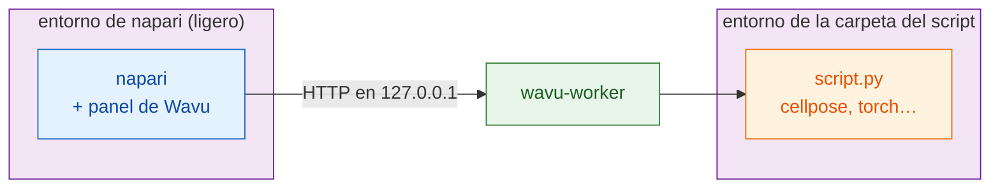

# Instalar wavu-napari

## Por qué existe Wavu { #why-this-exists }

- **Un solo entorno para todo acaba rompiéndose.** Instala con `pip` un plugin
  de Cellpose en el entorno de napari y puede traer otra versión de PyTorch,
  NumPy o Qt; el siguiente plugin fija otras, y napari o la herramienta de un
  colega deja de arrancar. Mezclar `conda` y `pip` en un mismo entorno lo
  empeora.
- **Python dentro de Fiji es aún más difícil.** El lenguaje de scripts propio
  de Fiji es Jython (Python 2.7, sin NumPy). Puentes como PyImageJ obligan a
  ajustar a mano las versiones de Java, conda y paquetes en cada máquina.
- **La respuesta de Wavu:** el visor se mantiene pequeño y limpio, y cada
  script se ejecuta en **su propio entorno pixi**, construido a partir de su
  propio `pixi.lock`. Los scripts no comparten paquetes, así que no pueden
  romperse entre sí ni romper napari o Fiji, y la misma carpeta se instala
  igual en todos los ordenadores.

## La idea en palabras sencillas

En napari, Wavu es un **segundo camarero** para la misma cocina. Es un panel
acoplado al lado de la ventana de napari: eliges una carpeta de script,
rellenas un formulario, pulsas **Run** (Ejecutar) y los resultados aparecen
como capas.

Aquí hay **dos despensas**, y mantenerlas separadas es todo el truco:

- **La despensa de napari** contiene napari, Qt y el panel de Wavu. Es
  pequeña y no cambia nunca cuando añades un script.
- **La despensa de cada script** contiene lo que necesita *ese* script
  (Cellpose, PyTorch, scikit-image…), construida a partir del `pixi.toml` de
  su carpeta.

Así, instalar PyTorch para un script nunca puede romper napari, y una
actualización de napari nunca puede romper tu script.



## Lo que necesitas

- **pixi**, instalado desde [pixi.sh](https://pixi.sh) (un solo comando; la
  página te lo muestra para tu sistema). Compruébalo en una terminal nueva
  con `pixi --version`.
- **Git**, desde [git-scm.com](https://git-scm.com), para descargar Wavu.

No instalas Python ni napari por tu cuenta: pixi se encarga de los dos.

## Paso 1: descarga Wavu

Abre una terminal en la carpeta donde guardas tus proyectos y ejecuta:

```sh
git clone https://github.com/Oxford-Zeiss-Centre-of-Excellence/Wavu.git
cd Wavu
```

## Paso 2: arranca napari

```sh
pixi run -e napari napari
```

`-e napari` elige el **entorno napari** de Wavu: napari más el panel de
Wavu. La primera vez, pixi lo descarga, lo que tarda unos minutos, una sola
vez. La próxima vez napari se abre en segundos. Arranca siempre napari con
este comando desde la carpeta `Wavu`; así es como se encuentra el panel.

## Paso 3: abre el panel de Wavu

En napari, elige **Plugins › Run Python Script (Wavu)** (ejecutar un script
de Python). Se acopla un panel al lado de la ventana con:

- un campo **Script folder** (carpeta del script) y los botones
  **Start worker** (arrancar el worker) y **Connect to running worker**
  (conectar con un worker en marcha);
- una casilla **Remote / container** (remoto / contenedor), para un worker
  que se ejecuta en otro sitio (por ahora puedes ignorarla);
- una lista **Script** y un formulario vacío (se rellena cuando hay un
  worker en marcha);
- **Run** y **Cancel** (Ejecutar y Cancelar), una barra de progreso, un
  cuadro de log y **Stop worker** (detener el worker).

Esa es toda la instalación.

## Actualizar

En la carpeta `Wavu`, ejecuta `git pull` y vuelve a arrancar napari con el
mismo comando. pixi actualiza el entorno de napari si hace falta.

## ¿También usas Fiji?

Las mismas carpetas de script funcionan en los dos visores. El camarero de
Fiji se instala de otra forma (un zip, sin terminal): mira
[Instalar Wavu en Fiji](../fiji/install.md).

## En una frase

Clona Wavu, ejecuta `pixi run -e napari napari` y abre
**Plugins › Run Python Script (Wavu)**: napari tiene su propia despensa
pequeña, y cada script trae la suya.

[Siguiente: tu primera ejecución en napari :material-arrow-right:](first-run.md){ .md-button }
