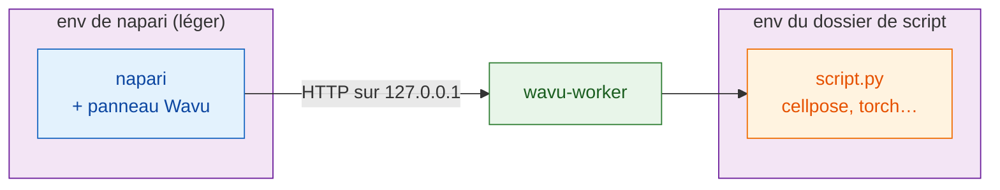

# Installer wavu-napari

## L'idée en mots simples

Dans napari, Wavu est un **second serveur** pour la même cuisine. C'est un
panneau ancré sur le côté de la fenêtre napari : vous choisissez un dossier
de script, remplissez un formulaire, appuyez sur **Run** (lancer), et les
résultats apparaissent sous forme de calques.

Il y a ici **deux batteries de cuisine**, et les garder séparées, c'est
tout le secret :

- **La batterie de cuisine de napari** contient napari lui-même, Qt et le
  panneau Wavu. Elle est petite et ne change jamais quand vous ajoutez un
  script.
- **La batterie de cuisine de chaque script** contient ce dont *ce* script a besoin
  (Cellpose, PyTorch, scikit-image…), construit à partir du `pixi.toml` de
  son dossier.

Installer PyTorch pour un script ne peut donc jamais casser napari, et une
mise à jour de napari ne peut jamais casser votre script.



## Ce qu'il vous faut

- **pixi**, installé depuis [pixi.sh](https://pixi.sh) (une seule commande ;
  la page l'affiche pour votre système). Vérifiez dans un nouveau terminal
  avec `pixi --version`.
- **Git**, depuis [git-scm.com](https://git-scm.com), pour télécharger Wavu.

Vous n'installez ni Python ni napari vous-même : pixi s'occupe des deux.

## Étape 1 : télécharger Wavu

Ouvrez un terminal dans le dossier où vous rangez vos projets et lancez :

```sh
git clone https://github.com/Oxford-Zeiss-Centre-of-Excellence/Wavu.git
cd Wavu
```

Ou laissez VS Code le cloner et l'ouvrir, puis utilisez son terminal
(**Terminal › New Terminal**) pour les étapes suivantes :

[Ouvrir le dépôt Wavu dans VS Code](vscode://vscode.git/clone?url=https%3A%2F%2Fgithub.com%2FOxford-Zeiss-Centre-of-Excellence%2FWavu.git){ .md-button }

## Étape 2 : démarrer napari

```sh
pixi run -e napari napari
```

`-e napari` choisit l'**environnement napari** de Wavu : napari plus le
panneau Wavu. La première fois, pixi le télécharge, ce qui prend quelques
minutes, une seule fois. Ensuite, napari s'ouvre en quelques secondes.
Démarrez toujours napari avec cette commande depuis le dossier `Wavu` :
c'est ainsi que le panneau est trouvé.

## Étape 3 : ouvrir le panneau Wavu

Dans napari, choisissez **Plugins › Run Python Script (Wavu)**. Un panneau
s'ancre sur le côté de la fenêtre, avec :

- un champ **Script folder** (dossier de script) et les boutons
  **Start worker** (démarrer le worker) et **Connect to running worker**
  (se connecter à un worker en cours d'exécution) ;
- une case **Remote / container** (distant / conteneur), pour un worker qui
  tourne ailleurs (vous pouvez l'ignorer pour l'instant) ;
- une liste **Script** et un formulaire vide (rempli dès qu'un worker
  tourne) ;
- **Run** et **Cancel** (annuler), une barre de progression, une zone de
  log et **Stop worker** (arrêter le worker).

C'est toute l'installation.

## Mettre à jour

Dans le dossier `Wavu`, lancez `git pull`, puis redémarrez napari avec la
même commande. pixi met à jour l'environnement de napari si nécessaire.

## Vous utilisez aussi Fiji ?

Les mêmes dossiers de script fonctionnent dans les deux visualiseurs. Le
serveur de Fiji s'installe autrement (un zip, pas de terminal) : voir
[Installer Wavu dans Fiji](../fiji/install.md).

## En une phrase

Clonez Wavu, lancez `pixi run -e napari napari` et ouvrez
**Plugins › Run Python Script (Wavu)** : napari garde sa petite
batterie de cuisine à lui, et chaque script apporte la sienne.

[Suite : votre première exécution dans napari :material-arrow-right:](first-run.md){ .md-button }
