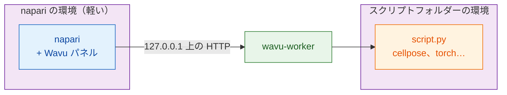

# wavu-napari をインストールする

## やさしく言うと

napari では、Wavu は同じ厨房に仕える **2 人目のウェイター** です。napari の
ウィンドウの横にドッキングするパネルで、スクリプトフォルダーを選び、
フォームに入力して **Run**（実行）を押すと、結果がレイヤーとして現れます。

ここには **調理器具が 2 そろい** あります。この 2 つを分けておくことが、
しくみのすべてです。

- **napari の調理器具** には、napari 本体、Qt、Wavu パネルが入っています。
  小さく、スクリプトを追加しても変わりません。
- **スクリプトごとの調理器具** には、*そのスクリプト* が必要とするもの
  （Cellpose、PyTorch、scikit-image など）が入っています。フォルダーの
  `pixi.toml` から作られます。

だから、あるスクリプトのために PyTorch をインストールしても napari が
壊れることはなく、napari を更新してもスクリプトが壊れることはありません。



## 必要なもの

- **pixi**：[pixi.sh](https://pixi.sh) からインストールします（コマンド
  1 つです。ページにあなたのシステム用のコマンドが表示されます）。新しい
  ターミナルで `pixi --version` を実行して確認します。
- **Git**：[git-scm.com](https://git-scm.com) から。Wavu のダウンロードに
  使います。

Python や napari を自分でインストールする必要はありません。どちらも pixi
がやってくれます。

## ステップ 1：Wavu をダウンロードする

プロジェクトを置いているフォルダーでターミナルを開き、次を実行します。

```sh
git clone https://github.com/Oxford-Zeiss-Centre-of-Excellence/Wavu.git
cd Wavu
```

または、VS Code にクローンして開いてもらい、次のステップはその
ターミナル（**Terminal › New Terminal**）で行います。

[Wavu リポジトリを VS Code で開く](vscode://vscode.git/clone?url=https%3A%2F%2Fgithub.com%2FOxford-Zeiss-Centre-of-Excellence%2FWavu.git){ .md-button }

## ステップ 2：napari を起動する

```sh
pixi run -e napari napari
```

`-e napari` は Wavu の **napari 環境**（napari と Wavu パネル）を選びます。
初回は pixi がそれをダウンロードするので数分かかりますが、一度だけです。
次からは napari が数秒で開きます。napari はいつも `Wavu` フォルダーから
このコマンドで起動してください。そうすることでパネルが見つかります。

## ステップ 3：Wavu パネルを開く

napari で **Plugins › Run Python Script (Wavu)** を選びます。ウィンドウの
横にパネルがドッキングし、次のものが並びます。

- **Script folder**（スクリプトフォルダー）欄と、**Start worker**（ワーカーを
  起動）と **Connect to running worker**（実行中のワーカーに接続）のボタン
- **Remote / container**（リモート / コンテナ）チェックボックス。ほかの
  場所で動いているワーカー用です（今は無視してかまいません）
- **Script** リストと空のフォーム（ワーカーが動くと埋まります）
- **Run** と **Cancel**（キャンセル）、進捗バー、ログ欄、**Stop worker**
  （ワーカーを停止）

インストールはこれで全部です。

## 更新

`Wavu` フォルダーで `git pull` を実行し、同じコマンドで napari をもう一度
起動します。必要なら pixi が napari の環境を更新します。

## Fiji も使いますか？

同じスクリプトフォルダーがどちらのビューアーでも動きます。Fiji のウェイター
はインストール方法が違います（zip 1 つ、ターミナル不要）。
[Fiji に Wavu をインストールする](../fiji/install.md) を見てください。

## ひとことで言うと

Wavu を clone して `pixi run -e napari napari` を実行し、
**Plugins › Run Python Script (Wavu)** を開きます。napari は自分の小さな
調理器具一式を持ち、スクリプトはそれぞれ自分の調理器具を持ってきます。

[次へ：napari での最初の実行 :material-arrow-right:](first-run.md){ .md-button }
