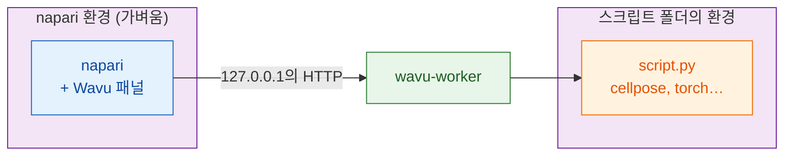

# wavu-napari 설치하기

## 쉬운 말로 설명하면

napari에서 Wavu는 같은 주방을 쓰는 **두 번째 웨이터**예요. napari 창 옆에
붙는 패널이에요. 스크립트 폴더를 고르고, 양식을 채우고, **Run**(실행)을
누르면 결과가 레이어로 나타나요.

여기에는 **주방 도구가 두 벌** 있고, 이 둘을 떼어 놓는 것이 핵심이에요.

- **napari의 주방 도구**에는 napari 자체, Qt, Wavu 패널이 들어 있어요.
  작고, 스크립트를 추가해도 바뀌지 않아요.
- **각 스크립트의 주방 도구**에는 *그* 스크립트에 필요한 것(Cellpose,
  PyTorch, scikit-image…)이 들어 있고, 폴더의 `pixi.toml`로 만들어져요.

그래서 한 스크립트를 위해 PyTorch를 설치해도 napari가 망가질 일이 없고,
napari를 업데이트해도 스크립트가 망가질 일이 없어요.



## 필요한 것

- **pixi**: [pixi.sh](https://pixi.sh)에서 설치해요(명령 하나, 페이지가
  여러분의 시스템에 맞는 명령을 보여 줘요). 새 터미널에서
  `pixi --version`으로 확인하세요.
- **Git**: Wavu를 내려받는 데 써요. [git-scm.com](https://git-scm.com)에서
  받으세요.

Python이나 napari를 직접 설치할 필요는 없어요. 둘 다 pixi가 해 줘요.

## 1단계: Wavu 내려받기

프로젝트를 보관하는 폴더에서 터미널을 열고 다음을 실행하세요.

```sh
git clone https://github.com/Oxford-Zeiss-Centre-of-Excellence/Wavu.git
cd Wavu
```

## 2단계: napari 시작하기

```sh
pixi run -e napari napari
```

`-e napari`는 Wavu의 **napari 환경**, 곧 napari와 Wavu 패널을 골라요.
처음에는 pixi가 그것을 내려받느라 몇 분 걸려요(한 번만). 다음부터는
napari가 몇 초 만에 열려요. napari는 항상 `Wavu` 폴더에서 이 명령으로
시작하세요. 그래야 패널을 찾을 수 있어요.

## 3단계: Wavu 패널 열기

napari에서 **Plugins › Run Python Script (Wavu)**를 고르세요. 창 옆에
패널이 붙고, 다음이 들어 있어요.

- **Script folder**(스크립트 폴더) 입력란과 **Start worker**(워커 시작),
  **Connect to running worker**(실행 중인 워커에 연결) 버튼
- 다른 곳에서 실행 중인 워커를 위한 **Remote / container**(원격 /
  컨테이너) 체크박스(지금은 무시해도 돼요)
- **Script**(스크립트) 목록과 빈 양식(워커가 실행되면 채워져요)
- **Run**과 **Cancel**(취소), 진행 막대, 로그 상자, **Stop worker**(워커
  중지)

설치는 이게 전부예요.

## 업데이트하기

`Wavu` 폴더에서 `git pull`을 실행한 다음, 같은 명령으로 napari를 다시
시작하세요. 필요하면 pixi가 napari 환경을 업데이트해요.

## Fiji도 쓰나요?

같은 스크립트 폴더가 두 뷰어에서 모두 동작해요. Fiji의 웨이터는 설치
방법이 달라요(zip 하나, 터미널 없음).
[Fiji에 Wavu 설치하기](../fiji/install.md)를 보세요.

## 한 문장으로

Wavu를 clone하고, `pixi run -e napari napari`를 실행하고,
**Plugins › Run Python Script (Wavu)**를 열면 돼요. napari는 자기만의 작은
주방 도구를 갖고, 스크립트마다 자기 주방 도구를 가져와요.

[다음: napari에서 첫 실행 :material-arrow-right:](first-run.md){ .md-button }
