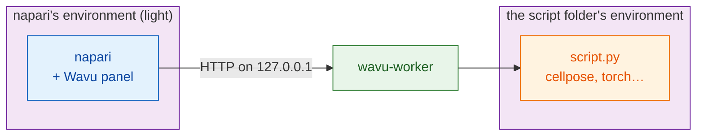

# Install wavu-napari

## Why this exists { #why-this-exists }

- **One environment for everything breaks.** `pip install` a Cellpose plugin
  into napari's environment and it can pull in a different PyTorch, NumPy or
  Qt; the next plugin pins other versions, and napari or a colleague's tool
  stops starting. Mixing `conda` and `pip` in one environment makes it worse.
- **Python inside Fiji is harder still.** Fiji's own scripting is Jython
  (Python 2.7, no NumPy). Bridges such as PyImageJ mean matching Java,
  conda and package versions by hand on every machine.
- **Wavu's answer:** the viewer stays small and clean, and every script runs
  in **its own pixi environment**, built from its own `pixi.lock`. Scripts
  never share packages, so they cannot break each other, napari or Fiji, and
  the same folder installs identically on every computer.

## The idea in plain words

In napari, Wavu is a **second waiter** for the same kitchen. It is a panel
docked at the side of the napari window: you pick a script folder, fill in a
form, press **Run**, and the results appear as layers.

There are **two pantries** here, and keeping them apart is the whole trick:

- **napari's pantry** holds napari itself, Qt and the Wavu panel. It is
  small and never changes when you add a script.
- **Each script's pantry** holds what *that* script needs (Cellpose,
  PyTorch, scikit-image…), built from the `pixi.toml` in its folder.

So installing PyTorch for one script can never break napari, and a napari
update can never break your script.



## What you need

- **pixi**, installed from [pixi.sh](https://pixi.sh) (one command; the page
  shows it for your system). Check in a new terminal with `pixi --version`.
- **Git**, from [git-scm.com](https://git-scm.com), to download Wavu.

You do not install Python or napari yourself: pixi does both.

## Step 1: download Wavu

Open a terminal in the folder where you keep your projects and run:

```sh
git clone https://github.com/Oxford-Zeiss-Centre-of-Excellence/Wavu.git
cd Wavu
```

## Step 2: start napari

```sh
pixi run -e napari napari
```

`-e napari` picks Wavu's **napari environment**: napari plus the Wavu panel.
The first time, pixi downloads it, which takes a few minutes, once. Next
time napari opens in seconds. Always start napari with this command from
the `Wavu` folder; that is how the panel is found.

## Step 3: open the Wavu panel

In napari, choose **Plugins › Run Python Script (Wavu)**. A panel docks at
the side of the window with:

- a **Script folder** field and the buttons **Start worker** and
  **Connect to running worker**;
- a **Remote / container** checkbox, for a worker running elsewhere (you
  can ignore it for now);
- a **Script** list and an empty form (filled once a worker runs);
- **Run** and **Cancel**, a progress bar, a log box, and **Stop worker**.

That is the whole installation.

## Updating

In the `Wavu` folder, run `git pull`, then start napari again with the same
command. pixi updates napari's environment if needed.

## Fiji user too?

The same script folders work in both viewers. Fiji's waiter is installed
differently (one zip, no terminal): see
[Install Wavu in Fiji](../fiji/install.md).

## In one sentence

Clone Wavu, run `pixi run -e napari napari`, and open
**Plugins › Run Python Script (Wavu)**: napari keeps its own small pantry,
and every script brings its own.

[Next: your first run in napari :material-arrow-right:](first-run.md){ .md-button }
