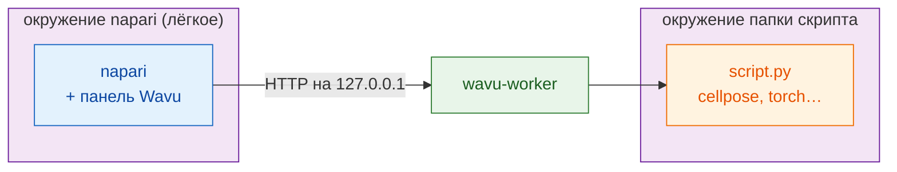

# Установка wavu-napari

## Зачем нужен Wavu { #why-this-exists }

- **Одно окружение на всё рано или поздно ломается.** Поставьте через `pip`
  плагин Cellpose в окружение napari — он может притянуть другую версию
  PyTorch, NumPy или Qt; следующий плагин закрепит свои версии, и napari или
  инструмент коллеги перестанет запускаться. Смешивание `conda` и `pip` в
  одном окружении делает только хуже.
- **Python внутри Fiji ещё сложнее.** Встроенный скриптовый язык Fiji —
  Jython (Python 2.7, без NumPy). Мосты вроде PyImageJ требуют вручную
  согласовывать версии Java, conda и пакетов на каждом компьютере.
- **Ответ Wavu:** просмотрщик остаётся маленьким и чистым, а каждый скрипт
  работает в **своём собственном окружении pixi**, собранном по своему
  `pixi.lock`. Скрипты не делят пакеты, поэтому не могут сломать друг друга,
  napari или Fiji, а одна и та же папка устанавливается одинаково на любом
  компьютере.

## Идея простыми словами

В napari Wavu — это **второй официант** той же кухни. Это панель,
пристыкованная сбоку окна napari: вы выбираете папку скрипта, заполняете
форму, нажимаете **Run** (запустить), и результаты появляются в виде слоёв.

Здесь **две кладовые**, и весь фокус в том, чтобы держать их раздельно:

- **Кладовая napari** хранит сам napari, Qt и панель Wavu. Она небольшая и
  не меняется, когда вы добавляете скрипт.
- **Кладовая каждого скрипта** хранит то, что нужно *этому* скрипту
  (Cellpose, PyTorch, scikit-image…), и собирается из `pixi.toml` в его
  папке.

Поэтому установка PyTorch для одного скрипта никогда не сломает napari, а
обновление napari никогда не сломает ваш скрипт.



## Что понадобится

- **pixi**, установленный с [pixi.sh](https://pixi.sh) (одна команда;
  страница покажет её для вашей системы). Проверьте в новом терминале
  командой `pixi --version`.
- **Git** с [git-scm.com](https://git-scm.com), чтобы скачать Wavu.

Python и napari вы сами не устанавливаете: это делает pixi.

## Шаг 1: скачайте Wavu

Откройте терминал в папке, где вы храните проекты, и выполните:

```sh
git clone https://github.com/Oxford-Zeiss-Centre-of-Excellence/Wavu.git
cd Wavu
```

## Шаг 2: запустите napari

```sh
pixi run -e napari napari
```

`-e napari` выбирает **окружение napari** из Wavu: napari плюс панель Wavu.
В первый раз pixi его скачивает, это занимает несколько минут, один раз.
В следующий раз napari откроется за секунды. Всегда запускайте napari этой
командой из папки `Wavu`: именно так находится панель.

## Шаг 3: откройте панель Wavu

В napari выберите **Plugins › Run Python Script (Wavu)**. Сбоку окна
появится панель, на которой есть:

- поле **Script folder** (папка скрипта) и кнопки **Start worker**
  (запустить воркер) и **Connect to running worker** (подключиться к
  работающему воркеру);
- флажок **Remote / container** (удалённо / контейнер) для воркера,
  работающего где-то ещё (пока его можно не трогать);
- список **Script** и пустая форма (она заполнится, когда заработает
  воркер);
- **Run** и **Cancel** (отмена), индикатор прогресса, поле журнала и
  **Stop worker** (остановить воркер).

Вот и вся установка.

## Обновление

В папке `Wavu` выполните `git pull`, затем снова запустите napari той же
командой. При необходимости pixi обновит окружение napari.

## Вы ещё и пользователь Fiji?

Одни и те же папки скриптов работают в обоих просмотрщиках. Официант Fiji
устанавливается иначе (один zip, без терминала): смотрите
[Установка Wavu в Fiji](../fiji/install.md).

## Одним предложением

Клонируйте Wavu, выполните `pixi run -e napari napari` и откройте
**Plugins › Run Python Script (Wavu)**: у napari своя маленькая кладовая, а
каждый скрипт приносит свою.

[Далее: первый запуск в napari :material-arrow-right:](first-run.md){ .md-button }
