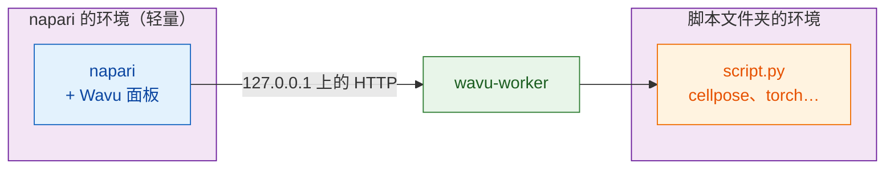

# 安装 wavu-napari

## 用大白话说

在 napari 里，Wavu 是同一个厨房的**第二位服务员**。它是一个停靠在 napari
窗口侧边的面板：你选一个脚本文件夹、填好表单、按下 **Run**（运行），结果就会
以图层的形式出现。

这里有**两套厨具**，把它们分开，就是全部的诀窍：

- **napari 的厨具**里装的是 napari 本身、Qt 和 Wavu 面板。它很小，而且
  不会因为你添加脚本而改变。
- **每个脚本的厨具**里装的是*那个*脚本需要的东西（Cellpose、PyTorch、
  scikit-image……），按照它文件夹里的 `pixi.toml` 建立。

所以给某个脚本安装 PyTorch，绝不会弄坏 napari；napari 升级，也绝不会弄坏
你的脚本。



## 你需要准备

- **pixi**，从 [pixi.sh](https://pixi.sh) 安装（一条命令；网页会显示适合
  你系统的那一条）。在新的终端里用 `pixi --version` 检查。
- **Git**，从 [git-scm.com](https://git-scm.com) 获取，用来下载 Wavu。

Python 和 napari 都不用你自己安装：pixi 会把两者都装好。

## 第 1 步：下载 Wavu

在你存放项目的文件夹里打开终端，运行：

```sh
git clone https://github.com/Oxford-Zeiss-Centre-of-Excellence/Wavu.git
cd Wavu
```

或者让 VS Code 把它克隆（clone）下来并打开，接下来的步骤就用它的终端
（**Terminal › New Terminal**）：

[在 VS Code 中打开 Wavu 仓库](vscode://vscode.git/clone?url=https%3A%2F%2Fgithub.com%2FOxford-Zeiss-Centre-of-Excellence%2FWavu.git){ .md-button }

## 第 2 步：启动 napari

```sh
pixi run -e napari napari
```

`-e napari` 会选用 Wavu 的 **napari 环境**：napari 加上 Wavu 面板。第一次
运行时，pixi 会下载它，需要几分钟，仅此一次。下次 napari 几秒内就能打开。
请始终在 `Wavu` 文件夹里用这条命令启动 napari；面板就是这样被找到的。

## 第 3 步：打开 Wavu 面板

在 napari 中选择 **Plugins › Run Python Script (Wavu)**（运行 Python 脚本）。
窗口侧边会停靠一个面板，里面有：

- 一个 **Script folder**（脚本文件夹）输入框，以及 **Start worker**（启动
  worker）和 **Connect to running worker**（连接到正在运行的 worker）两个按钮；
- 一个 **Remote / container**（远程／容器）复选框，用于在别处运行的
  worker（现在可以先不管它）；
- 一个 **Script** 列表和一张空白表单（worker 运行后才会填上）；
- **Run** 和 **Cancel**（取消）、一个进度条、一个 log 框，以及
  **Stop worker**（停止 worker）。

安装就这样完成了。

## 更新

在 `Wavu` 文件夹里运行 `git pull`，再用同一条命令重新启动 napari。如有需要，
pixi 会更新 napari 的环境。

## 也用 Fiji 吗？

同样的脚本文件夹在 Fiji 和 napari 里都能用。Fiji 这位服务员的安装方式不同
（一个 zip 文件，不用终端）：请看
[在 Fiji 中安装 Wavu](../fiji/install.md)。

## 一句话总结

clone Wavu、运行 `pixi run -e napari napari`，再打开
**Plugins › Run Python Script (Wavu)**：napari 有自己的一小套厨具，每个脚本
也各自带着自己的。

[下一步：在 napari 中第一次运行 :material-arrow-right:](first-run.md){ .md-button }
