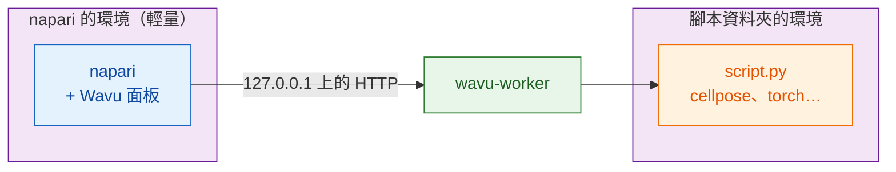

# 安裝 wavu-napari

## 用白話說

在 napari 裡，Wavu 是同一間廚房的**第二位服務生**。它是一個停駐在 napari
視窗側邊的面板：你挑一個腳本資料夾、填好表單、按下 **Run**（執行），結果就會
以圖層的形式出現。

這裡有**兩套廚具**，把它們分開，就是整個訣竅所在：

- **napari 的廚具**裡放的是 napari 本身、Qt 和 Wavu 面板。它很小，而且
  不會因為你新增腳本而改變。
- **每個腳本的廚具**裡放的是*那個*腳本需要的東西（Cellpose、PyTorch、
  scikit-image……），依照它資料夾裡的 `pixi.toml` 建立。

所以為某個腳本安裝 PyTorch，絕對不會弄壞 napari；napari 更新，也絕對不會
弄壞你的腳本。



## 你需要準備

- **pixi**，從 [pixi.sh](https://pixi.sh) 安裝（一行指令；網頁會顯示適合
  你系統的那一行）。在新的終端機裡用 `pixi --version` 檢查。
- **Git**，從 [git-scm.com](https://git-scm.com) 取得，用來下載 Wavu。

Python 和 napari 都不用你自己安裝：pixi 會兩樣都處理好。

## 步驟 1：下載 Wavu

在你存放專案的資料夾裡開啟終端機，執行：

```sh
git clone https://github.com/Oxford-Zeiss-Centre-of-Excellence/Wavu.git
cd Wavu
```

或者讓 VS Code 把它複製（clone）下來並開啟，接下來的步驟就用它的終端機
（**Terminal › New Terminal**）：

[在 VS Code 中開啟 Wavu 儲存庫](vscode://vscode.git/clone?url=https%3A%2F%2Fgithub.com%2FOxford-Zeiss-Centre-of-Excellence%2FWavu.git){ .md-button }

## 步驟 2：啟動 napari

```sh
pixi run -e napari napari
```

`-e napari` 會選用 Wavu 的 **napari 環境**：napari 加上 Wavu 面板。第一次
執行時，pixi 會下載它，要花幾分鐘，只有一次。下次 napari 幾秒內就會開啟。
請一律在 `Wavu` 資料夾裡用這個指令啟動 napari；面板就是這樣被找到的。

## 步驟 3：開啟 Wavu 面板

在 napari 中選擇 **Plugins › Run Python Script (Wavu)**（執行 Python 腳本）。
視窗側邊會停駐一個面板，裡面有：

- 一個 **Script folder**（腳本資料夾）欄位，以及 **Start worker**（啟動
  worker）和 **Connect to running worker**（連線到執行中的 worker）兩個按鈕；
- 一個 **Remote / container**（遠端／容器）勾選框，用於在別處執行的
  worker（現在可以先不管它）；
- 一個 **Script** 清單和一張空白表單（worker 執行後才會填上）；
- **Run** 和 **Cancel**（取消）、一條進度列、一個 log 框，以及
  **Stop worker**（停止 worker）。

安裝就這樣完成了。

## 更新

在 `Wavu` 資料夾裡執行 `git pull`，再用同一個指令重新啟動 napari。需要的話，
pixi 會更新 napari 的環境。

## 也用 Fiji 嗎？

同樣的腳本資料夾在 Fiji 和 napari 裡都能用。Fiji 這位服務生的安裝方式不同
（一個 zip 檔，不用終端機）：請看
[在 Fiji 中安裝 Wavu](../fiji/install.md)。

## 一句話總結

clone Wavu、執行 `pixi run -e napari napari`，再開啟
**Plugins › Run Python Script (Wavu)**：napari 保有自己的一小套廚具，每個腳本
也各自帶著自己的。

[下一步：在 napari 中第一次執行 :material-arrow-right:](first-run.md){ .md-button }
