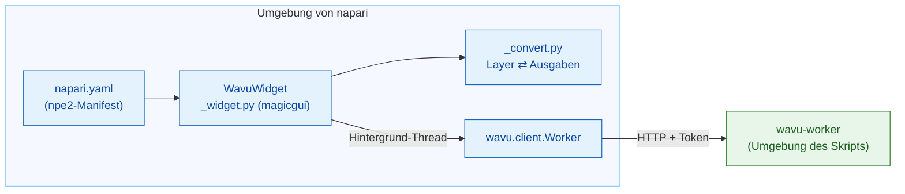

# Interna von wavu-napari (für Fortgeschrittene)

!!! abstract "Für Neugierige und für Maintainer"
    Sie brauchen diese Seite nicht, um Wavu in napari zu benutzen. Sie
    erklärt, wie der napari-Kellner gebaut ist. Der Worker und sein
    Protokoll stehen auf [Architektur](../model/architecture.md).

## Die Idee in einfachen Worten

Der Fiji-Kellner musste die Sprache der Küche von Grund auf lernen, in
Groovy. Der napari-Kellner spricht Python, wie die Küche, also stellt er
einfach den fertigen Dolmetscher ein: **`wavu.client`**. Damit bleiben dem
Panel nur zwei Aufgaben: aus `PARAMS` ein Formular machen und aus Ausgaben
Layer.



## Das Paket

Der Code liegt im Wavu-Repository unter `napari/`: das Python-Paket
`wavu-napari` (Modul `napari_wavu`). Es hängt von `wavu` (dem Kern, aus dem
Wurzelverzeichnis des Repositorys), `magicgui`, `qtpy` und `numpy` ab;
`roifile` (für Umrisse) und `pandas` (für Tabellen) sind optionale Extras.
Die pixi-Umgebung `napari` installiert beide Pakete aus Ihrem Klon, sodass
ein `git pull` das napari-Panel und den Kern zusammen aktualisiert.

| Datei | Rolle |
|---|---|
| `napari.yaml` | das **npe2-Manifest**: ein Befehl, `napari_wavu._widget:WavuWidget`, angezeigt als Widget **Run Python Script** des Plugins **Wavu**; ein einzelnes Widget führt napari als **Plugins › Run Python Script (Wavu)** |
| `_widget.py` | das Dock-Widget: Ordner, Knöpfe, Remote-/Container-Felder, Formular, Log |
| `_convert.py` | Layer zu Eingaben und Ausgaben zu Layern; kein Qt, daher leicht zu testen |

napari findet das Manifest über den Entry Point `napari.manifest` in
`pyproject.toml`.

## Das Dock-Widget

`WavuWidget` ist ein magicgui-`Container`. Jeder `PARAMS`-Eintrag wird zu
einem magicgui-Widget:

| `PARAMS`-Typ | Widget |
|---|---|
| `image` | `ComboBox` der Image- und Labels-Layer des Betrachters |
| `float` | `FloatSpinBox` (Schritt 0.1) |
| `int` | `SpinBox` |
| `bool` | `CheckBox` |
| `choice` | `ComboBox` der `choices` |
| `str` | `LineEdit` |

Die Beschriftungen kommen aus `label` in `PARAMS` oder aus dem Schlüssel
(`min_size` wird zu *Min size*), genau wie der Worker sie ausfüllt. Die
`image`-Auswahllisten holen ihre Einträge aus einer Funktion, und das Panel
ruft `reset_choices()` auf, wenn Layer eingefügt oder entfernt werden, also
folgen sie der Layer-Liste. Fiji baut dasselbe Formular als `GenericDialog`:
vergleichen Sie [Interna von wavu-fiji](../fiji/internals.md).

## Worker

- **Start worker** ruft `wavu.client.Worker.start(folder, on_log=…,
  cancel=…)` auf. Das führt `pixi run --manifest-path <folder>/pixi.toml
  wavu-worker --script-dir <folder>` aus, ohne die eigenen `PIXI_*`- und
  `CONDA_*`-Variablen von napari. Das ist hier wichtig: napari läuft selbst
  unter `pixi run -e napari`, und ohne die Bereinigung könnte der
  Kindprozess die Umgebung von napari statt der des Skripts übernehmen.
- pixi wird über `WAVU_PIXI` gefunden, dann `PIXI_EXE` (das `pixi run`
  setzt), dann `~/.wavu/bin`, `PATH` und `~/.pixi/bin`.
- Das Panel hält einen Worker pro Ordner und verwendet ihn wieder, solange
  er lebt. Das stdin des Workers ist eine Pipe von napari, also endet er,
  wenn napari endet.
- **Connect to running worker** ruft `Worker.connect()` auf, das
  `~/.wavu/worker.json` liest, `/health` prüft und die Skripte des Workers
  lädt; das Log nennt das `script_dir` des Workers. Ist
  **Remote / container** angehakt, übergibt es stattdessen die vier Felder:
  `handshake`, `host` (leer heißt: der `host` aus der Datei; `0.0.0.0` wird
  zu `127.0.0.1`), `host_prefix` und `worker_prefix`. Geben Sie beide Ordner
  an oder keinen. Mit beiden übersetzen `Worker.to_worker` / `from_worker`
  Pfade in die jeweilige Richtung, und große Eingaben werden nach
  `<host folder>/.wavu-tmp` geschrieben, damit der Container sie lesen kann.
  Siehe [Als Container teilen](../write/container.md).
- **Stop worker** ruft `Worker.stop()` auf: `POST /shutdown`, Pipe
  schließen, warten und den Worker beenden, falls er hängt.

## Threads und Signale

Das Starten eines Workers kann Minuten dauern und ein Durchlauf noch länger,
also darf keins von beiden napari blockieren. `_background` verpackt den
Aufruf in `napari.qt.threading.create_worker`. Die verpackte Aufgabe gibt
`(ok, value)` zurück, statt eine Ausnahme auszulösen, damit ein Fehler nie
in die Ereignisschleife von Qt entkommt; er wird im Log und als
napari-Benachrichtigung angezeigt. Während eine Aufgabe läuft, sind die
Knöpfe deaktiviert und nur **Cancel** ist aktiv.

Callbacks wie `on_log` und `on_progress` werden im Hintergrund-Thread
aufgerufen, wo Widgets nicht angefasst werden dürfen. Sie laufen über ein
kleines `QObject` mit zwei Qt-Signalen, `log(str)` und `progress(float)`; Qt
liefert das Signal im GUI-Thread aus, der das Log-Feld und den
Fortschrittsbalken aktualisiert.

**Cancel** setzt ein `threading.Event`. Beim Starten prüft `Worker.start`
es und beendet pixi; während eines Durchlaufs sendet `Worker.run`
`POST /jobs/<id>/cancel`, und das Skript hält an, wenn es das nächste Mal
`ctx.cancelled()` prüft. Das resultierende `JobCancelled` gilt nicht als
Fehler: Das Log sagt nur `Cancelled.`, ohne Benachrichtigung.

## Layer-Umwandlung

`_convert.py` enthält die Regeln aus
[Was Sie zurückgeben können](../write/outputs.md) (Tab napari):

- `layer_input(layer)`: Daten (Ebene mit voller Auflösung, dask berechnet),
  der Titel, `pixel_um` aus gleichen letzten zwei `scale`-Werten in
  Mikrometern oder Pixeln, `axes="YXS"` für RGB.
- `output_layers(outputs, defaults)`: napari-Layer-Datentupel
  `(data, kwargs, "image" | "labels" | "shapes")` plus Log-Zeilen.
  `defaults` enthält das `pixel_um` der Eingabe.
- `image_layer` entscheidet zwischen Labels und Image (der `napari`-Hinweis
  in `meta`, sonst Integer-dtype und ein Name, der auf
  `label|mask|seg|instance` passt) und setzt `scale`, `rgb` und
  `channel_axis`.
- `roi_polygons` liest eine RoiSet-ZIP mit `roifile` und dreht (x, y) in
  die Reihenfolge (Zeile, Spalte) von napari um.
- `table_rows` macht aus einem DataFrame oder einer Liste von dicts Zeilen
  für ein `QTableWidget`, das das Widget mit
  `viewer.window.add_dock_widget` andockt.

## Tests

Die Tests laufen ohne OpenGL-Canvas, also funktionieren sie auf der CI und
unter Windows mit Qt offscreen. `conftest.py` stellt ein `ViewerModel`
bereit (das Layer-Modell von napari, ohne Fenster) plus ein Ersatzfenster,
das angedockte Widgets aufzeichnet. `test_widget.py` startet einen echten
Worker, aber mit einfachem `python -m wavu.worker` über
`Worker.start(command=…)`, der `tests/scripts` bedient. `test_pixi.py`
(markiert mit `pixi_env`, standardmäßig übersprungen) geht über ein echtes
`pixi run` im Vorlagenordner von Wavu.

```sh
pixi run -e napari test-napari              # Umwandlungs- und Widget-Tests
pixi run -e napari test-napari-integration  # ein echter Worker über pixi
```

## Ein Skript aus napari debuggen

Das Panel hat kein Kästchen *Debug*. Führen Sie stattdessen im Skriptordner
`pixi run debug` aus (ein abgekoppelter Worker mit debugpy auf Port 5678 und
einer Handshake-Datei), hängen Sie VS Code mit **Attach to Wavu worker** an
und drücken Sie dann im Panel **Connect to running worker**. Siehe
[In VS Code debuggen](../help/debug-in-vscode.md).

## In einem Satz

wavu-napari ist ein npe2-Plugin, dessen magicgui-Panel `wavu.client` in
Hintergrund-Threads steuert, aus `PARAMS` Widgets und aus Ausgaben Layer
macht, wobei die Umwandlung Qt-frei bleibt, damit sie sich an einem
`ViewerModel` testen lässt.
