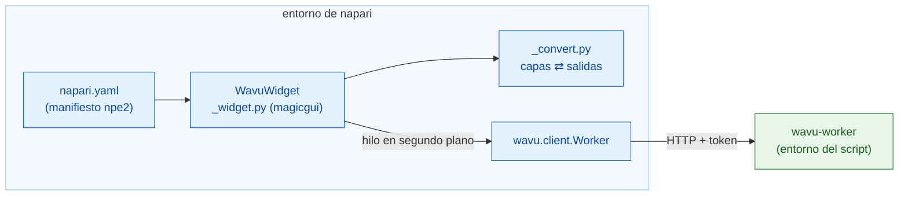

# Funcionamiento interno de wavu-napari (avanzado)

!!! abstract "Para curiosos y para quienes lo mantienen"
    No necesitas esta página para usar Wavu en napari. Explica cómo está
    hecho el camarero de napari. El worker y su protocolo están en
    [Arquitectura](../model/architecture.md).

## La idea en palabras sencillas

El camarero de Fiji tuvo que aprender el idioma de la cocina desde cero, en
Groovy. El camarero de napari habla Python, como la cocina, así que
simplemente contrata al intérprete ya hecho: **`wavu.client`**. Al panel le
quedan solo dos tareas: convertir `PARAMS` en un formulario y convertir las
salidas en capas.



## El paquete

El código vive en el repositorio de Wavu, en `napari/`: el paquete de Python
`wavu-napari` (módulo `napari_wavu`). Depende de `wavu` (el núcleo, desde la
raíz del repositorio), `magicgui`, `qtpy` y `numpy`; `roifile` (para los
contornos) y `pandas` (para las tablas) son extras opcionales. El entorno
pixi `napari` instala los dos paquetes desde tu clon, así que un `git pull`
actualiza a la vez el panel de napari y el núcleo.

| Archivo | Función |
|---|---|
| `napari.yaml` | el **manifiesto npe2**: un comando, `napari_wavu._widget:WavuWidget`, mostrado como el widget **Run Python Script** del plugin **Wavu**; napari muestra un widget solitario como **Plugins › Run Python Script (Wavu)** |
| `_widget.py` | el widget acoplable: carpeta, botones, campos remoto / contenedor, formulario, log |
| `_convert.py` | de capas a entradas y de salidas a capas; sin Qt, así que es fácil de probar |

napari encuentra el manifiesto a través del entry point `napari.manifest` de
`pyproject.toml`.

## El widget acoplable

`WavuWidget` es un `Container` de magicgui. Cada entrada de `PARAMS` se
convierte en un widget de magicgui:

| Tipo en `PARAMS` | Widget |
|---|---|
| `image` | `ComboBox` con las capas Image y Labels del visor |
| `float` | `FloatSpinBox` (paso 0.1) |
| `int` | `SpinBox` |
| `bool` | `CheckBox` |
| `choice` | `ComboBox` con las `choices` |
| `str` | `LineEdit` |

Las etiquetas vienen de `label` en `PARAMS`, o de la clave (`min_size` se
convierte en *Min size*), igual que las rellena el worker. Las listas
desplegables `image` toman sus opciones de una función, y el panel llama a
`reset_choices()` cuando se insertan o eliminan capas, así que siguen a la
lista de capas. Fiji construye el mismo formulario como un `GenericDialog`:
compara con el [funcionamiento interno de wavu-fiji](../fiji/internals.md).

## Workers

- **Start worker** llama a `wavu.client.Worker.start(folder, on_log=…,
  cancel=…)`. Eso ejecuta `pixi run --manifest-path <folder>/pixi.toml
  wavu-worker --script-dir <folder>` quitando las variables `PIXI_*` y
  `CONDA_*` del propio napari. Aquí esto importa: napari se ejecuta bajo
  `pixi run -e napari`, y sin esa limpieza el proceso hijo podría coger el
  entorno de napari en lugar del del script.
- pixi se busca en `WAVU_PIXI`, luego en `PIXI_EXE` (que define
  `pixi run`), luego en `~/.wavu/bin`, `PATH` y `~/.pixi/bin`.
- El panel mantiene un worker por carpeta y lo reutiliza mientras siga vivo.
  La stdin del worker es una tubería desde napari, así que termina cuando
  termina napari.
- **Connect to running worker** llama a `Worker.connect()`, que lee
  `~/.wavu/worker.json`, comprueba `/health` y carga los scripts del worker;
  el log indica el `script_dir` del worker. Con **Remote / container**
  marcado, pasa en su lugar los cuatro campos: `handshake`, `host` (vacío
  significa el `host` del archivo; `0.0.0.0` se convierte en `127.0.0.1`),
  `host_prefix` y `worker_prefix`. Indica las dos carpetas o ninguna. Con
  las dos, `Worker.to_worker` / `from_worker` traducen las rutas en cada
  sentido, y las entradas grandes se escriben en `<host folder>/.wavu-tmp`,
  para que el contenedor pueda leerlas. Mira
  [Compartir como contenedor](../write/container.md).
- **Stop worker** llama a `Worker.stop()`: `POST /shutdown`, cierra la
  tubería, espera y lo mata si se queda atascado.

## Hilos y señales

Arrancar un worker puede tardar minutos y una ejecución puede tardar más,
así que ninguna de las dos puede bloquear napari. `_background` envuelve la
llamada en `napari.qt.threading.create_worker`. La tarea envuelta devuelve
`(ok, value)` en lugar de lanzar una excepción, así que un error nunca se
escapa al bucle de eventos de Qt; se muestra en el log y como notificación
de napari. Mientras una tarea está en marcha, los botones se desactivan y
solo queda activo **Cancel**.

Los callbacks como `on_log` y `on_progress` se llaman en el hilo en segundo
plano, donde no se permite tocar los widgets. Pasan por un pequeño `QObject`
con dos señales de Qt, `log(str)` y `progress(float)`; Qt entrega la señal en
el hilo de la interfaz, que actualiza el cuadro de log y la barra de
progreso.

**Cancel** activa un `threading.Event`. Durante el arranque, `Worker.start`
lo comprueba y mata pixi; durante una ejecución, `Worker.run` envía
`POST /jobs/<id>/cancel`, y el script se detiene la próxima vez que
comprueba `ctx.cancelled()`. El `JobCancelled` resultante no se trata como
un error: el log solo dice `Cancelled.`, sin notificación.

## Conversión de capas

`_convert.py` contiene las reglas de
[Lo que recibes en napari](layers.md):

- `layer_input(layer)`: los datos (nivel de resolución completa, dask
  calculado), el título, `pixel_um` a partir de los dos últimos valores de
  `scale` iguales en micrómetros o píxeles, `axes="YXS"` para RGB.
- `output_layers(outputs, defaults)`: tuplas de datos de capa de napari
  `(data, kwargs, "image" | "labels" | "shapes")` más líneas de log.
  `defaults` lleva el `pixel_um` de la entrada.
- `image_layer` decide entre Labels e Image (la pista `napari` en `meta`, o
  si no, dtype entero y un nombre que encaje con `label|mask|seg|instance`),
  y fija `scale`, `rgb` y `channel_axis`.
- `roi_polygons` lee un zip de RoiSet con `roifile` y pasa (x, y) a
  (fila, columna) de napari.
- `table_rows` convierte un DataFrame o una lista de dicts en filas para un
  `QTableWidget`, que el widget acopla con `viewer.window.add_dock_widget`.

## Pruebas

Las pruebas se ejecutan sin lienzo OpenGL, así que funcionan en CI y en
Windows con Qt offscreen. `conftest.py` proporciona un `ViewerModel` (el
modelo de capas de napari, sin ventana) más una ventana sustituta que
registra los widgets acoplados. `test_widget.py` arranca un worker real,
pero con `python -m wavu.worker` simple a través de
`Worker.start(command=…)`, sirviendo `tests/scripts`. `test_pixi.py`
(marcado `pixi_env`, omitido por defecto) pasa por un `pixi run` real en la
carpeta de la plantilla de Wavu.

```sh
pixi run -e napari test-napari              # pruebas de conversión + widget
pixi run -e napari test-napari-integration  # un worker real a través de pixi
```

## Depurar un script desde napari

El panel no tiene casilla *Debug*. En su lugar, en la carpeta del script
ejecuta `pixi run debug` (un worker independiente con debugpy en el puerto
5678 y un archivo de saludo), conecta VS Code con
**Attach to Wavu worker** y luego pulsa **Connect to running worker** en el
panel. Mira [Depurar en VS Code](../help/debug-in-vscode.md).

## En una frase

wavu-napari es un plugin npe2 cuyo panel de magicgui maneja `wavu.client`
en hilos en segundo plano, convierte `PARAMS` en widgets y las salidas en
capas, con la conversión libre de Qt para poder probarla sobre un
`ViewerModel`.
