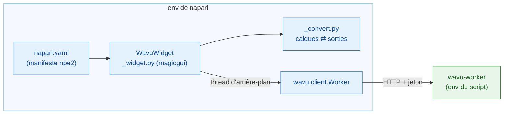

# Fonctionnement interne de wavu-napari (avancé)

!!! abstract "Pour les curieux et pour les mainteneurs"
    Vous n'avez pas besoin de cette page pour utiliser Wavu dans napari.
    Elle explique comment le serveur napari est construit. Le worker et son
    protocole sont décrits dans [Architecture](../model/architecture.md).

## L'idée en mots simples

Le serveur de Fiji a dû apprendre la langue de la cuisine de zéro, en
Groovy. Le serveur napari parle Python, comme la cuisine, alors il engage
simplement l'interprète prêt à l'emploi : **`wavu.client`**. Il ne reste au
panneau que deux tâches : transformer `PARAMS` en formulaire, et
transformer les sorties en calques.



## Le paquet

Le code se trouve dans le dépôt Wavu sous `napari/` : le paquet Python
`wavu-napari` (module `napari_wavu`). Il dépend de `wavu` (le cœur, à la
racine du dépôt), de `magicgui`, `qtpy` et `numpy` ; `roifile` (pour les
contours) et `pandas` (pour les tableaux) sont des extras optionnels.
L'environnement pixi `napari` installe les deux paquets depuis votre clone :
un `git pull` met donc à jour ensemble le panneau de napari et le cœur.

| Fichier | Rôle |
|---|---|
| `napari.yaml` | le **manifeste npe2** : une commande, `napari_wavu._widget:WavuWidget`, affichée comme le widget **Run Python Script** du plugin **Wavu** ; napari présente un widget seul sous **Plugins › Run Python Script (Wavu)** |
| `_widget.py` | le widget ancré : dossier, boutons, champs distant / conteneur, formulaire, log |
| `_convert.py` | des calques vers les entrées et des sorties vers les calques ; sans Qt, donc facile à tester |

napari trouve le manifeste grâce au point d'entrée `napari.manifest` dans
`pyproject.toml`.

## Le widget ancré

`WavuWidget` est un `Container` magicgui. Chaque entrée de `PARAMS` devient
un widget magicgui :

| Type `PARAMS` | Widget |
|---|---|
| `image` | `ComboBox` des calques Image et Labels du visualiseur |
| `float` | `FloatSpinBox` (pas de 0,1) |
| `int` | `SpinBox` |
| `bool` | `CheckBox` |
| `choice` | `ComboBox` des `choices` |
| `str` | `LineEdit` |

Les libellés viennent de `label` dans `PARAMS`, ou de la clé (`min_size`
devient *Min size*), exactement comme le worker les remplit. Les listes
déroulantes `image` prennent leurs choix dans une fonction, et le panneau
appelle `reset_choices()` quand des calques sont ajoutés ou supprimés : elles
suivent donc la liste des calques. Fiji construit le même formulaire sous
forme de `GenericDialog` : comparez avec
[Fonctionnement interne de wavu-fiji](../fiji/internals.md).

## Les workers

- **Start worker** appelle `wavu.client.Worker.start(folder, on_log=…,
  cancel=…)`. Cela lance `pixi run --manifest-path <folder>/pixi.toml
  wavu-worker --script-dir <folder>` après avoir retiré les variables
  `PIXI_*` et `CONDA_*` de napari. C'est important ici : napari tourne
  lui-même sous `pixi run -e napari`, et sans ce nettoyage l'enfant pourrait
  prendre l'environnement de napari au lieu de celui du script.
- pixi est trouvé via `WAVU_PIXI`, puis `PIXI_EXE` (que `pixi run`
  définit), puis `~/.wavu/bin`, `PATH` et `~/.pixi/bin`.
- Le panneau garde un worker par dossier et le réutilise tant qu'il est en
  vie. Le stdin du worker est un tube venant de napari : il s'arrête donc
  en même temps que napari.
- **Connect to running worker** appelle `Worker.connect()`, qui lit
  `~/.wavu/worker.json`, vérifie `/health` et charge les scripts du worker ;
  le log indique le `script_dir` du worker. Quand **Remote / container**
  est coché, il transmet plutôt les quatre champs : `handshake`, `host`
  (vide signifie le `host` du fichier ; `0.0.0.0` devient `127.0.0.1`),
  `host_prefix` et `worker_prefix`. Donnez les deux dossiers ou aucun. Avec
  les deux, `Worker.to_worker` / `from_worker` traduisent les chemins dans
  chaque sens, et les grosses entrées sont écrites dans
  `<host folder>/.wavu-tmp`, pour que le conteneur puisse les lire. Voir
  [Partager sous forme de conteneur](../write/container.md).
- **Stop worker** appelle `Worker.stop()` : `POST /shutdown`, fermeture du
  tube, attente, et arrêt forcé s'il est bloqué.

## Threads et signaux

Démarrer un worker peut prendre des minutes, et une exécution plus encore :
ni l'un ni l'autre ne doit bloquer napari. `_background` enveloppe l'appel
dans `napari.qt.threading.create_worker`. La tâche enveloppée renvoie
`(ok, value)` au lieu de lever une exception : une erreur ne s'échappe donc
jamais dans la boucle d'événements de Qt ; elle s'affiche dans le log et en
notification napari. Pendant qu'une tâche tourne, les boutons sont
désactivés et seul **Cancel** est actif.

Les fonctions de rappel comme `on_log` et `on_progress` sont appelées sur le
thread d'arrière-plan, où il est interdit de toucher aux widgets. Elles
passent par un petit `QObject` doté de deux signaux Qt, `log(str)` et
`progress(float)` ; Qt livre le signal sur le thread de l'interface, qui
met à jour la zone de log et la barre de progression.

**Cancel** lève un `threading.Event`. Pendant le démarrage, `Worker.start`
le vérifie et arrête pixi ; pendant une exécution, `Worker.run` envoie
`POST /jobs/<id>/cancel`, et le script s'arrête à sa prochaine vérification
de `ctx.cancelled()`. Le `JobCancelled` qui en résulte n'est pas traité
comme une erreur : le log indique simplement `Cancelled.`, sans
notification.

## Conversion des calques

`_convert.py` contient les règles de
[Ce que vous pouvez renvoyer](../write/outputs.md) (onglet napari) :

- `layer_input(layer)` : les données (niveau en pleine résolution, dask
  calculé), le titre, `pixel_um` à partir de deux dernières valeurs `scale`
  égales en micromètres ou en pixels, `axes="YXS"` pour le RVB.
- `output_layers(outputs, defaults)` : des tuples de données de calque
  napari `(data, kwargs, "image" | "labels" | "shapes")` plus des lignes de
  log. `defaults` porte le `pixel_um` de l'entrée.
- `image_layer` choisit entre Labels et Image (l'indication `napari` dans
  `meta`, sinon un dtype entier et un nom qui correspond à
  `label|mask|seg|instance`), et définit `scale`, `rgb` et `channel_axis`.
- `roi_polygons` lit un zip RoiSet avec `roifile` et transforme (x, y) en
  (ligne, colonne) de napari.
- `table_rows` transforme un DataFrame ou une liste de dicts en lignes pour
  un `QTableWidget`, que le widget ancre avec
  `viewer.window.add_dock_widget`.

## Tests

Les tests tournent sans canevas OpenGL : ils fonctionnent donc en CI et sous
Windows avec Qt hors écran (*offscreen*). `conftest.py` fournit un
`ViewerModel` (le modèle de calques de napari, sans fenêtre) plus une
fausse fenêtre qui enregistre les widgets ancrés. `test_widget.py` démarre
un vrai worker, mais avec un simple `python -m wavu.worker` via
`Worker.start(command=…)`, qui sert `tests/scripts`. `test_pixi.py` (marqué
`pixi_env`, ignoré par défaut) passe par un vrai `pixi run` dans le dossier
modèle de Wavu.

```sh
pixi run -e napari test-napari              # tests de conversion + du widget
pixi run -e napari test-napari-integration  # un vrai worker via pixi
```

## Déboguer un script depuis napari

Le panneau n'a pas de case *Debug*. À la place, dans le dossier de script,
lancez `pixi run debug` (un worker détaché avec debugpy sur le port 5678 et
un fichier de poignée de main), rattachez VS Code avec
**Attach to Wavu worker**, puis appuyez sur **Connect to running worker**
dans le panneau. Voir [Déboguer dans VS Code](../help/debug-in-vscode.md).

## En une phrase

wavu-napari est un plugin npe2 dont le panneau magicgui pilote
`wavu.client` sur des threads d'arrière-plan, transforme `PARAMS` en
widgets et les sorties en calques, avec une conversion sans Qt pour pouvoir
la tester sur un `ViewerModel`.
