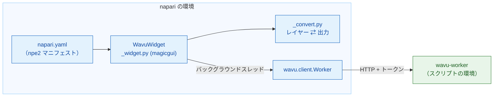

# wavu-napari の内部（上級）

!!! abstract "興味のある方と、メンテナーの方へ"
    napari で Wavu を使うのに、このページは必要ありません。napari の
    ウェイターがどう作られているかを説明します。ワーカーとそのプロトコルに
    ついては [アーキテクチャ](../model/architecture.md) を見てください。

## やさしく言うと

Fiji のウェイターは、厨房の言葉を Groovy でいちから覚えなければなりません
でした。napari のウェイターは厨房と同じ Python を話すので、出来合いの通訳
である **`wavu.client`** を雇うだけです。そのため、パネルの仕事は 2 つだけ
になります。`PARAMS` をフォームにすることと、出力をレイヤーにすることです。



## パッケージ

コードは Wavu リポジトリの `napari/` の下にあります。Python パッケージ
`wavu-napari`（モジュール名 `napari_wavu`）です。依存するのは `wavu`
（コア。リポジトリのルートから）、`magicgui`、`qtpy`、`numpy` で、
`roifile`（輪郭用）と `pandas`（表用）は任意の追加パッケージです。pixi の
`napari` 環境は、両方のパッケージをあなたの clone からインストールします。
だから `git pull` 1 回で、napari のパネルとコアが一緒に更新されます。

| ファイル | 役割 |
|---|---|
| `napari.yaml` | **npe2 マニフェスト**：コマンドは 1 つ、`napari_wavu._widget:WavuWidget`。プラグイン **Wavu** のウィジェット **Run Python Script** として表示されます。ウィジェットが 1 つだけなので、napari は **Plugins › Run Python Script (Wavu)** として並べます |
| `_widget.py` | ドックウィジェット：フォルダー、ボタン、リモート / コンテナの欄、フォーム、ログ |
| `_convert.py` | レイヤーから入力へ、出力からレイヤーへ。Qt を使わないので、テストしやすい |

napari は、`pyproject.toml` の `napari.manifest` エントリーポイントを通して
マニフェストを見つけます。

## ドックウィジェット

`WavuWidget` は magicgui の `Container` です。`PARAMS` の各項目が、magicgui
のウィジェット 1 つになります。

| `PARAMS` の型 | ウィジェット |
|---|---|
| `image` | ビューアーの Image と Labels レイヤーの `ComboBox` |
| `float` | `FloatSpinBox`（刻み 0.1） |
| `int` | `SpinBox` |
| `bool` | `CheckBox` |
| `choice` | `choices` の `ComboBox` |
| `str` | `LineEdit` |

ラベルは `PARAMS` の `label` から、なければキーから作られます（`min_size` は
*Min size* になります）。ワーカーが埋めるのと同じやり方です。`image` の
ドロップダウンは選択肢を関数から受け取り、レイヤーが追加・削除されると
パネルが `reset_choices()` を呼ぶので、レイヤーリストに合わせて動きます。
Fiji は同じフォームを `GenericDialog` として作ります。
[wavu-fiji の内部](../fiji/internals.md) と比べてみてください。

## ワーカー

- **Start worker** は `wavu.client.Worker.start(folder, on_log=…,
  cancel=…)` を呼びます。これは napari 自身の `PIXI_*` と `CONDA_*` 変数を
  取り除いたうえで `pixi run --manifest-path <folder>/pixi.toml
  wavu-worker --script-dir <folder>` を実行します。ここではこれが重要です。
  napari 自体が `pixi run -e napari` の下で動いているので、掃除をしないと、
  子プロセスがスクリプトの環境ではなく napari の環境を拾ってしまうことが
  あります。
- pixi は `WAVU_PIXI`、次に `PIXI_EXE`（`pixi run` が設定します）、次に
  `~/.wavu/bin`、`PATH`、`~/.pixi/bin` の順に探します。
- パネルはフォルダーごとに 1 つのワーカーを持ち、生きている間は使い回し
  ます。ワーカーの stdin は napari からのパイプなので、napari が終わると
  ワーカーも終わります。
- **Connect to running worker** は `Worker.connect()` を呼びます。これは
  `~/.wavu/worker.json` を読み、`/health` を確認し、ワーカーのスクリプトを
  読み込みます。ログにはワーカーの `script_dir` が表示されます。
  **Remote / container** にチェックがあると、代わりに 4 つの欄の値を
  渡します。`handshake`、`host`（空ならファイルの `host`。`0.0.0.0` は
  `127.0.0.1` になります）、`host_prefix`、`worker_prefix` です。
  フォルダーは 2 つとも指定するか、どちらも指定しないかにします。両方
  あれば、`Worker.to_worker` / `from_worker` がパスを双方向に変換し、
  大きな入力は `<host folder>/.wavu-tmp` に書き出されるので、コンテナから
  読めます。[コンテナとして共有する](../write/container.md) を見てください。
- **Stop worker** は `Worker.stop()` を呼びます。`POST /shutdown` を送り、
  パイプを閉じて待ち、止まらなければ強制終了します。

## スレッドとシグナル

ワーカーの起動には数分、実行にはもっとかかることがあるので、どちらも
napari を止めてはいけません。`_background` は呼び出しを
`napari.qt.threading.create_worker` で包みます。包まれたタスクは例外を
出す代わりに `(ok, value)` を返すので、エラーが Qt のイベントループに漏れる
ことはありません。エラーはログと napari の通知に表示されます。タスクの
実行中はボタンが無効になり、**Cancel** だけが押せます。

`on_log` や `on_progress` などのコールバックはバックグラウンドスレッドで
呼ばれますが、そこではウィジェットに触れてはいけません。そこで、2 つの Qt
シグナル `log(str)` と `progress(float)` を持つ小さな `QObject` を通します。
Qt はシグナルを GUI スレッドで届け、そこでログ欄と進捗バーが更新されます。

**Cancel** は `threading.Event` をセットします。起動中は `Worker.start` が
それを確認して pixi を強制終了します。実行中は `Worker.run` が
`POST /jobs/<id>/cancel` を送り、スクリプトは次に `ctx.cancelled()` を
確認したときに止まります。その結果の `JobCancelled` はエラーとして扱われ
ません。ログに `Cancelled.` と出るだけで、通知はありません。

## レイヤーの変換

`_convert.py` は、[napari で戻ってくるもの](layers.md) のルールを持って
います。

- `layer_input(layer)`：データ（最高解像度のレベル。dask は計算済み）、
  タイトル、`scale` の最後の 2 つの値が等しく単位がマイクロメートルか
  ピクセルなら `pixel_um`、RGB なら `axes="YXS"`。
- `output_layers(outputs, defaults)`：napari のレイヤーデータのタプル
  `(data, kwargs, "image" | "labels" | "shapes")` とログの行。`defaults` は
  入力の `pixel_um` を運びます。
- `image_layer` は Labels か Image かを決め（`meta` の `napari` ヒント、
  なければ整数の dtype と `label|mask|seg|instance` に合う名前）、`scale`、
  `rgb`、`channel_axis` を設定します。
- `roi_polygons` は `roifile` で RoiSet の zip を読み、(x, y) を napari の
  (行, 列) に入れ替えます。
- `table_rows` は DataFrame や dict のリストを `QTableWidget` の行に変えます。
  ウィジェットはそれを `viewer.window.add_dock_widget` でドッキングします。

## テスト

テストは OpenGL のキャンバスなしで動くので、CI でも、Qt をオフスクリーンに
した Windows でも動きます。`conftest.py` は `ViewerModel`（napari の
レイヤーモデル。ウィンドウなし）と、ドッキングされたウィジェットを記録する
代わりのウィンドウを用意します。`test_widget.py` は本物のワーカーを起動
しますが、`Worker.start(command=…)` を通して素の `python -m wavu.worker` で
`tests/scripts` を提供します。`test_pixi.py`（`pixi_env` の印付き。既定では
スキップ）は、Wavu のテンプレートフォルダーで本物の `pixi run` を通します。

```sh
pixi run -e napari test-napari              # 変換 + ウィジェットのテスト
pixi run -e napari test-napari-integration  # pixi を通した本物のワーカー
```

## napari からスクリプトをデバッグする

パネルには *Debug* チェックボックスがありません。代わりに、スクリプト
フォルダーで `pixi run debug`（ポート 5678 の debugpy とハンドシェイク
ファイル付きの、切り離されたワーカー）を実行し、VS Code を
**Attach to Wavu worker** でアタッチしてから、パネルで
**Connect to running worker** を押します。
[VS Code でデバッグする](../help/debug-in-vscode.md) を見てください。

## ひとことで言うと

wavu-napari は npe2 プラグインです。その magicgui パネルがバックグラウンド
スレッドで `wavu.client` を動かし、`PARAMS` をウィジェットに、出力を
レイヤーに変えます。変換部分は Qt を使わないので、`ViewerModel` でテスト
できます。
