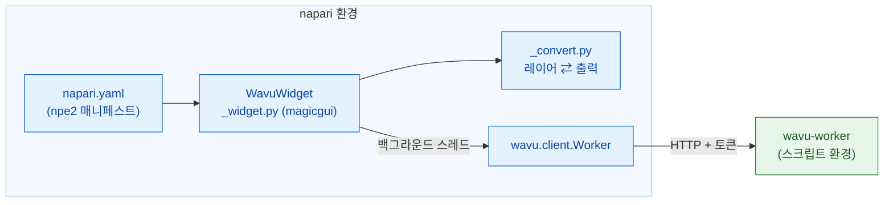

# wavu-napari 내부 구조 (고급)

!!! abstract "궁금한 분과 유지 관리하는 분을 위해"
    napari에서 Wavu를 쓰는 데 이 페이지는 필요 없어요. napari 웨이터가
    어떻게 만들어졌는지 설명해요. 워커와 그 프로토콜은
    [아키텍처](../model/architecture.md)에 있어요.

## 쉬운 말로 설명하면

Fiji 웨이터는 주방의 언어를 Groovy로 처음부터 배워야 했어요. napari
웨이터는 주방처럼 Python을 말하니까, 미리 만들어 둔 통역사
**`wavu.client`**를 그냥 고용해요. 그래서 패널에 남은 일은 두 가지뿐이에요.
`PARAMS`를 양식으로 바꾸고, 출력을 레이어로 바꾸는 일이에요.



## 패키지

코드는 Wavu 저장소의 `napari/` 아래에 있어요. Python 패키지
`wavu-napari`(모듈 `napari_wavu`)예요. `wavu`(저장소 루트의 코어),
`magicgui`, `qtpy`, `numpy`에 의존하고, `roifile`(윤곽선용)과
`pandas`(표용)는 선택 extra예요. pixi의 `napari` 환경은 두 패키지를 모두
여러분의 clone에서 설치해요. 그래서 `git pull` 한 번으로 napari 패널과
코어가 함께 업데이트돼요.

| 파일 | 역할 |
|---|---|
| `napari.yaml` | **npe2 매니페스트**: 명령 하나 `napari_wavu._widget:WavuWidget`이 플러그인 **Wavu**의 위젯 **Run Python Script**로 보여요. napari는 위젯이 하나뿐이면 **Plugins › Run Python Script (Wavu)**로 나열해요 |
| `_widget.py` | 도크 위젯: 폴더, 버튼, 원격 / 컨테이너 입력란, 양식, 로그 |
| `_convert.py` | 레이어를 입력으로, 출력을 레이어로. Qt가 없어서 테스트하기 쉬워요 |

napari는 `pyproject.toml`의 `napari.manifest` 엔트리 포인트로 매니페스트를
찾아요.

## 도크 위젯

`WavuWidget`은 magicgui `Container`예요. `PARAMS` 항목 하나가 magicgui 위젯
하나가 돼요.

| `PARAMS` 타입 | 위젯 |
|---|---|
| `image` | 뷰어의 Image와 Labels 레이어 `ComboBox` |
| `float` | `FloatSpinBox`(단계 0.1) |
| `int` | `SpinBox` |
| `bool` | `CheckBox` |
| `choice` | `choices`의 `ComboBox` |
| `str` | `LineEdit` |

레이블은 `PARAMS`의 `label`에서, 없으면 키에서 와요(`min_size`는
*Min size*가 돼요). 워커가 채우는 방식과 똑같아요. `image` 드롭다운은
함수에서 선택지를 받고, 레이어가 추가되거나 지워지면 패널이
`reset_choices()`를 불러서 레이어 목록을 따라가요. Fiji는 같은 양식을
`GenericDialog`로 만들어요. [wavu-fiji 내부 구조](../fiji/internals.md)와
비교해 보세요.

## 워커

- **Start worker**는 `wavu.client.Worker.start(folder, on_log=…,
  cancel=…)`를 불러요. 이게 napari 자신의 `PIXI_*`와 `CONDA_*` 변수를 지운
  상태로 `pixi run --manifest-path <folder>/pixi.toml
  wavu-worker --script-dir <folder>`를 실행해요. 여기서는 이게 중요해요.
  napari 자체가 `pixi run -e napari` 아래에서 돌기 때문에, 정리하지 않으면
  자식 프로세스가 스크립트 환경 대신 napari 환경을 집어 들 수 있어요.
- pixi는 `WAVU_PIXI`, 그다음 `PIXI_EXE`(`pixi run`이 설정해요), 그다음
  `~/.wavu/bin`, `PATH`, `~/.pixi/bin` 순서로 찾아요.
- 패널은 폴더마다 워커 하나를 두고, 살아 있는 동안 다시 써요. 워커의
  stdin은 napari에서 오는 파이프라서, napari가 끝나면 워커도 끝나요.
- **Connect to running worker**는 `Worker.connect()`를 불러요. 이 함수는
  `~/.wavu/worker.json`을 읽고, `/health`를 확인하고, 워커의 스크립트를
  불러와요. 로그에는 워커의 `script_dir`이 나와요. **Remote / container**가
  체크되어 있으면 대신 네 입력란을 넘겨요. `handshake`, `host`(비우면
  파일의 `host`, `0.0.0.0`은 `127.0.0.1`이 돼요), `host_prefix`,
  `worker_prefix`예요. 폴더는 둘 다 주거나 둘 다 비우세요. 둘 다 주면
  `Worker.to_worker` / `from_worker`가 경로를 양방향으로 변환하고, 큰 입력은
  컨테이너가 읽을 수 있도록 `<host folder>/.wavu-tmp`에 써요.
  [컨테이너로 공유하기](../write/container.md)를 보세요.
- **Stop worker**는 `Worker.stop()`을 불러요. `POST /shutdown`을 보내고,
  파이프를 닫고, 기다리고, 멈춰 있으면 강제로 끝내요.

## 스레드와 시그널

워커를 시작하는 데 몇 분이 걸릴 수 있고 실행은 더 걸릴 수 있으니, 둘 다
napari를 막으면 안 돼요. `_background`가 호출을 `napari.qt.threading.
create_worker`로 감싸요. 감싼 작업은 예외를 던지는 대신 `(ok, value)`를
돌려줘서, 오류가 Qt 이벤트 루프로 새어 나가지 않아요. 오류는 로그와 napari
알림으로 보여요. 작업이 도는 동안에는 버튼이 꺼지고 **Cancel**만 켜져요.

`on_log`, `on_progress` 같은 콜백은 백그라운드 스레드에서 불리는데, 거기서는
위젯을 건드리면 안 돼요. 그래서 Qt 시그널 두 개 `log(str)`와
`progress(float)`를 가진 작은 `QObject`를 거쳐요. Qt가 시그널을 GUI
스레드로 전달하고, 거기서 로그 상자와 진행 막대를 업데이트해요.

**Cancel**은 `threading.Event`를 설정해요. 시작 중에는 `Worker.start`가
이걸 확인하고 pixi를 끝내요. 실행 중에는 `Worker.run`이
`POST /jobs/<id>/cancel`을 보내고, 스크립트는 다음에 `ctx.cancelled()`를
확인할 때 멈춰요. 그 결과로 나오는 `JobCancelled`는 오류로 다루지 않아요.
로그에 `Cancelled.`만 나오고 알림은 없어요.

## 레이어 변환

`_convert.py`에는 [napari에서 돌려받는 것](layers.md)의 규칙이 들어 있어요.

- `layer_input(layer)`: 데이터(최고 해상도 단계, dask는 계산해서), 제목,
  마지막 두 `scale` 값이 같고 단위가 마이크로미터나 픽셀이면 `pixel_um`,
  RGB면 `axes="YXS"`.
- `output_layers(outputs, defaults)`: napari 레이어 데이터 튜플
  `(data, kwargs, "image" | "labels" | "shapes")`와 로그 줄. `defaults`는
  입력의 `pixel_um`을 담아요.
- `image_layer`는 Labels인지 Image인지 정하고(`meta`의 `napari` 힌트,
  없으면 정수 dtype과 `label|mask|seg|instance`에 맞는 이름), `scale`,
  `rgb`, `channel_axis`를 설정해요.
- `roi_polygons`는 `roifile`로 RoiSet zip을 읽고 (x, y)를 napari의
  (행, 열)로 뒤집어요.
- `table_rows`는 DataFrame이나 dict의 리스트를 `QTableWidget`의 행으로
  바꾸고, 위젯이 이걸 `viewer.window.add_dock_widget`으로 붙여요.

## 테스트

테스트는 OpenGL 캔버스 없이 돌아가서, CI에서도, Qt offscreen을 쓰는
Windows에서도 동작해요. `conftest.py`는 `ViewerModel`(창 없는 napari의 레이어
모델)과, 붙인 위젯을 기록하는 대역 창을 줘요. `test_widget.py`는 진짜 워커를
시작하지만, `Worker.start(command=…)`를 통해 평범한 `python -m wavu.worker`로
`tests/scripts`를 서비스해요. `test_pixi.py`(`pixi_env` 표시, 기본으로는
건너뜀)는 Wavu 템플릿 폴더에서 진짜 `pixi run`을 거쳐요.

```sh
pixi run -e napari test-napari              # 변환 + 위젯 테스트
pixi run -e napari test-napari-integration  # pixi를 거치는 진짜 워커
```

## napari에서 스크립트 디버그하기

패널에는 *Debug* 체크박스가 없어요. 대신 스크립트 폴더에서
`pixi run debug`(포트 5678의 debugpy와 핸드셰이크 파일을 갖춘 분리된
워커)를 실행하고, VS Code를 **Attach to Wavu worker**로 연결한 다음, 패널에서
**Connect to running worker**를 누르세요.
[VS Code에서 디버그하기](../help/debug-in-vscode.md)를 보세요.

## 한 문장으로

wavu-napari는 npe2 플러그인이에요. magicgui 패널이 백그라운드 스레드에서
`wavu.client`를 움직이고, `PARAMS`를 위젯으로, 출력을 레이어로 바꾸며,
변환 코드는 Qt 없이 두어서 `ViewerModel`로 테스트할 수 있어요.
