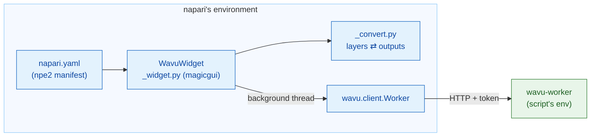

# wavu-napari internals (advanced)

!!! abstract "For the curious and for maintainers"
    You do not need this page to use Wavu in napari. It explains how the
    napari waiter is built. The worker and its protocol are on
    [Architecture](../model/architecture.md).

## The idea in plain words

The Fiji waiter had to learn the kitchen's language from scratch, in Groovy.
The napari waiter speaks Python, like the kitchen, so it simply hires the
ready-made interpreter: **`wavu.client`**. That leaves the panel only two
jobs: turn `PARAMS` into a form, and turn outputs into layers.



## The package

The code lives in the Wavu repository under `napari/`: the Python package
`wavu-napari` (module `napari_wavu`). It depends on `wavu` (the core, from
the repository root), `magicgui`, `qtpy` and `numpy`; `roifile` (for
outlines) and `pandas` (for tables) are optional extras. The pixi `napari`
environment installs both packages from your clone, so a `git pull` updates
napari's panel and the core together.

| File | Role |
|---|---|
| `napari.yaml` | the **npe2 manifest**: one command, `napari_wavu._widget:WavuWidget`, shown as the widget **Run Python Script** of the plugin **Wavu**; napari lists a lone widget as **Plugins › Run Python Script (Wavu)** |
| `_widget.py` | the dock widget: folder, buttons, remote / container fields, form, log |
| `_convert.py` | layers to inputs and outputs to layers; no Qt, so it is easy to test |

napari finds the manifest through the `napari.manifest` entry point in
`pyproject.toml`.

## The dock widget

`WavuWidget` is a magicgui `Container`. Each `PARAMS` entry becomes one
magicgui widget:

| `PARAMS` type | Widget |
|---|---|
| `image` | `ComboBox` of the viewer's Image and Labels layers |
| `float` | `FloatSpinBox` (step 0.1) |
| `int` | `SpinBox` |
| `bool` | `CheckBox` |
| `choice` | `ComboBox` of `choices` |
| `str` | `LineEdit` |

Labels come from `label` in `PARAMS`, or from the key (`min_size` becomes
*Min size*), just as the worker fills them in. The `image` drop-downs take
their choices from a function, and the panel calls `reset_choices()` when
layers are inserted or removed, so they follow the layer list. Fiji builds the same form as
a `GenericDialog`: compare [wavu-fiji internals](../fiji/internals.md).

## Workers

- **Start worker** calls `wavu.client.Worker.start(folder, on_log=…,
  cancel=…)`. That runs `pixi run --manifest-path <folder>/pixi.toml
  wavu-worker --script-dir <folder>` with napari's own `PIXI_*` and
  `CONDA_*` variables removed. This matters here: napari itself runs under
  `pixi run -e napari`, and without the scrubbing the child could pick up
  napari's environment instead of the script's.
- pixi is found through `WAVU_PIXI`, then `PIXI_EXE` (which `pixi run` sets),
  then `~/.wavu/bin`, `PATH` and `~/.pixi/bin`.
- The panel keeps one worker per folder and reuses it while it is alive.
  The worker's stdin is a pipe from napari, so it ends when napari does.
- **Connect to running worker** calls `Worker.connect()`, which reads
  `~/.wavu/worker.json`, checks `/health` and loads the worker's scripts;
  the log names the worker's `script_dir`. With **Remote / container**
  ticked, it passes the four fields instead: `handshake`, `host` (empty
  means the `host` in the file; `0.0.0.0` becomes `127.0.0.1`),
  `host_prefix` and `worker_prefix`. Give both folders or neither. With
  both, `Worker.to_worker` / `from_worker` translate paths in each
  direction, and large inputs are written to `<host folder>/.wavu-tmp`, so
  the container can read them. See [Share as a container](../write/container.md).
- **Stop worker** calls `Worker.stop()`: `POST /shutdown`, close the pipe,
  wait, and kill it if stuck.

## Threads and signals

Starting a worker can take minutes and a run can take longer, so neither may
block napari. `_background` wraps the call in `napari.qt.threading.
create_worker`. The wrapped task returns `(ok, value)` instead of raising,
so an error never escapes into Qt's event loop; it is shown in the log and
as a napari notification. While a task runs, the buttons are disabled and
only **Cancel** is enabled.

Callbacks such as `on_log` and `on_progress` are called on the background
thread, where touching widgets is not allowed. They go through a small
`QObject` with two Qt signals, `log(str)` and `progress(float)`; Qt delivers
the signal on the GUI thread, which updates the log box and progress bar.

**Cancel** sets a `threading.Event`. During start-up `Worker.start` checks it
and kills pixi; during a run, `Worker.run` sends `POST /jobs/<id>/cancel`,
and the script stops when it next checks `ctx.cancelled()`. The resulting
`JobCancelled` is not treated as an error: the log just says `Cancelled.`,
with no notification.

## Layer conversion

`_convert.py` holds the rules from [What you get back in napari](layers.md):

- `layer_input(layer)`: data (full-resolution level, dask computed), the
  title, `pixel_um` from equal last-two `scale` values in micrometres or
  pixels, `axes="YXS"` for RGB.
- `output_layers(outputs, defaults)`: napari layer data tuples
  `(data, kwargs, "image" | "labels" | "shapes")` plus log lines. `defaults`
  carries the input's `pixel_um`.
- `image_layer` decides Labels versus Image (the `napari` hint in `meta`,
  else integer dtype and a name matching `label|mask|seg|instance`), sets
  `scale`, `rgb` and `channel_axis`.
- `roi_polygons` reads a RoiSet zip with `roifile` and flips (x, y) to
  napari's (row, column).
- `table_rows` turns a DataFrame or list of dicts into rows for a
  `QTableWidget`, which the widget docks with `viewer.window.add_dock_widget`.

## Tests

The tests run without an OpenGL canvas, so they work on CI and on Windows
with Qt offscreen. `conftest.py` gives a `ViewerModel` (napari's layer
model, no window) plus a stand-in window that records docked widgets.
`test_widget.py` starts a real worker, but with plain
`python -m wavu.worker` through `Worker.start(command=…)`, serving
`tests/scripts`. `test_pixi.py` (marked `pixi_env`, skipped by default)
goes through real `pixi run` in Wavu's template folder.

```sh
pixi run -e napari test-napari              # conversion + widget tests
pixi run -e napari test-napari-integration  # a real worker through pixi
```

## Debugging a script from napari

The panel has no *Debug* checkbox. Instead, in the script folder run
`pixi run debug` (a detached worker with debugpy on port 5678 and a
handshake file), attach VS Code with **Attach to Wavu worker**, then press
**Connect to running worker** in the panel. See
[Debug in VS Code](../help/debug-in-vscode.md).

## In one sentence

wavu-napari is an npe2 plugin whose magicgui panel drives `wavu.client` on
background threads, turns `PARAMS` into widgets and turns outputs into
layers, with the conversion kept Qt-free so it can be tested on a
`ViewerModel`.
