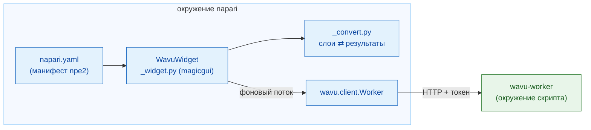

# Внутреннее устройство wavu-napari (для продвинутых)

!!! abstract "Для любопытных и для разработчиков"
    Эта страница не нужна, чтобы пользоваться Wavu в napari. Она объясняет,
    как устроен официант napari. Воркер и его протокол описаны на странице
    [Архитектура](../model/architecture.md).

## Идея простыми словами

Официанту Fiji пришлось учить язык кухни с нуля, на Groovy. Официант
napari говорит на Python, как и кухня, поэтому он просто нанимает готового
переводчика: **`wavu.client`**. У панели остаются только две задачи:
превратить `PARAMS` в форму и превратить результаты в слои.



## Пакет

Код лежит в репозитории Wavu в папке `napari/`: Python-пакет
`wavu-napari` (модуль `napari_wavu`). Он зависит от `wavu` (ядро, из корня
репозитория), `magicgui`, `qtpy` и `numpy`; `roifile` (для контуров) и
`pandas` (для таблиц) — необязательные дополнения. pixi-окружение `napari`
устанавливает оба пакета из вашего клона, поэтому `git pull` обновляет
панель napari и ядро вместе.

| Файл | Роль |
|---|---|
| `napari.yaml` | **манифест npe2**: одна команда, `napari_wavu._widget:WavuWidget`, показанная как виджет **Run Python Script** плагина **Wavu**; единственный виджет napari показывает как **Plugins › Run Python Script (Wavu)** |
| `_widget.py` | док-виджет: папка, кнопки, поля remote / container, форма, журнал |
| `_convert.py` | слои во входные данные и результаты в слои; без Qt, поэтому легко тестируется |

napari находит манифест через точку входа `napari.manifest` в
`pyproject.toml`.

## Док-виджет

`WavuWidget` — это `Container` из magicgui. Каждая запись `PARAMS`
становится одним виджетом magicgui:

| Тип в `PARAMS` | Виджет |
|---|---|
| `image` | `ComboBox` со слоями Image и Labels просмотрщика |
| `float` | `FloatSpinBox` (шаг 0.1) |
| `int` | `SpinBox` |
| `bool` | `CheckBox` |
| `choice` | `ComboBox` из `choices` |
| `str` | `LineEdit` |

Подписи берутся из `label` в `PARAMS` или из ключа (`min_size` становится
*Min size*), так же как их заполняет воркер. Выпадающие списки `image`
получают варианты из функции, а панель вызывает `reset_choices()`, когда
слои добавляются или удаляются, поэтому они следуют за списком слоёв. Fiji
строит ту же форму как `GenericDialog`: сравните с
[внутренним устройством wavu-fiji](../fiji/internals.md).

## Воркеры

- **Start worker** вызывает `wavu.client.Worker.start(folder, on_log=…,
  cancel=…)`. Это выполняет `pixi run --manifest-path <folder>/pixi.toml
  wavu-worker --script-dir <folder>`, удалив собственные переменные
  `PIXI_*` и `CONDA_*` napari. Здесь это важно: napari сам работает под
  `pixi run -e napari`, и без очистки дочерний процесс мог бы подхватить
  окружение napari вместо окружения скрипта.
- pixi ищется через `WAVU_PIXI`, затем `PIXI_EXE` (её задаёт `pixi run`),
  затем `~/.wavu/bin`, `PATH` и `~/.pixi/bin`.
- Панель держит один воркер на папку и использует его повторно, пока он
  жив. stdin воркера — канал от napari, поэтому он завершается вместе с
  napari.
- **Connect to running worker** вызывает `Worker.connect()`, который
  читает `~/.wavu/worker.json`, проверяет `/health` и загружает скрипты
  воркера; журнал называет `script_dir` воркера. Если отмечен **Remote /
  container**, вместо этого передаются четыре поля: `handshake`, `host`
  (пусто — значит `host` из файла; `0.0.0.0` становится `127.0.0.1`),
  `host_prefix` и `worker_prefix`. Укажите обе папки или ни одной. Если
  указаны обе, `Worker.to_worker` / `from_worker` переводят пути в каждую
  сторону, а большие входные данные записываются в
  `<host folder>/.wavu-tmp`, чтобы контейнер мог их прочитать. Смотрите
  [Поделиться в виде контейнера](../write/container.md).
- **Stop worker** вызывает `Worker.stop()`: `POST /shutdown`, закрыть
  канал, подождать и убить процесс, если он завис.

## Потоки и сигналы

Запуск воркера может занять минуты, а выполнение — ещё дольше, поэтому ни
то, ни другое не должно блокировать napari. `_background` оборачивает
вызов в `napari.qt.threading.create_worker`. Обёрнутая задача возвращает
`(ok, value)` вместо того, чтобы выбрасывать исключение, поэтому ошибка
никогда не попадает в цикл событий Qt; она показывается в журнале и как
уведомление napari. Пока задача выполняется, кнопки отключены и доступна
только **Cancel**.

Обратные вызовы, такие как `on_log` и `on_progress`, вызываются в фоновом
потоке, где трогать виджеты нельзя. Они проходят через небольшой
`QObject` с двумя сигналами Qt, `log(str)` и `progress(float)`; Qt
доставляет сигнал в поток GUI, который обновляет поле журнала и индикатор
прогресса.

**Cancel** устанавливает `threading.Event`. Во время запуска
`Worker.start` проверяет его и убивает pixi; во время выполнения
`Worker.run` отправляет `POST /jobs/<id>/cancel`, и скрипт
останавливается, когда в следующий раз проверит `ctx.cancelled()`.
Возникающее `JobCancelled` не считается ошибкой: журнал просто пишет
`Cancelled.`, без уведомления.

## Преобразование слоёв

`_convert.py` содержит правила со страницы
[Что можно вернуть](../write/outputs.md) (вкладка napari):

- `layer_input(layer)`: данные (уровень полного разрешения, dask
  вычислен), заголовок, `pixel_um` из равных двух последних значений
  `scale` в микрометрах или пикселях, `axes="YXS"` для RGB.
- `output_layers(outputs, defaults)`: кортежи данных слоёв napari
  `(data, kwargs, "image" | "labels" | "shapes")` плюс строки журнала.
  `defaults` несёт `pixel_um` входного изображения.
- `image_layer` решает, Labels это или Image (подсказка `napari` в `meta`,
  иначе целочисленный dtype и имя, совпадающее с
  `label|mask|seg|instance`), и задаёт `scale`, `rgb` и `channel_axis`.
- `roi_polygons` читает zip-файл RoiSet с помощью `roifile` и
  переставляет (x, y) в (строка, столбец) napari.
- `table_rows` превращает DataFrame или список словарей в строки для
  `QTableWidget`, который виджет пристыковывает через
  `viewer.window.add_dock_widget`.

## Тесты

Тесты работают без холста OpenGL, поэтому идут на CI и на Windows с Qt в
режиме offscreen. `conftest.py` даёт `ViewerModel` (модель слоёв napari,
без окна) плюс подставное окно, которое записывает пристыкованные виджеты.
`test_widget.py` запускает настоящий воркер, но простым
`python -m wavu.worker` через `Worker.start(command=…)`, обслуживающий
`tests/scripts`. `test_pixi.py` (помечен `pixi_env`, по умолчанию
пропускается) проходит через настоящий `pixi run` в папке шаблона Wavu.

```sh
pixi run -e napari test-napari              # тесты преобразования + виджета
pixi run -e napari test-napari-integration  # настоящий воркер через pixi
```

## Отладка скрипта из napari

У панели нет флажка *Debug*. Вместо этого выполните в папке скрипта
`pixi run debug` (отсоединённый воркер с debugpy на порту 5678 и файлом
рукопожатия), подключите VS Code через **Attach to Wavu worker**, а затем
нажмите **Connect to running worker** на панели. Смотрите
[Отладка в VS Code](../help/debug-in-vscode.md).

## Одним предложением

wavu-napari — это плагин npe2, чья панель на magicgui управляет
`wavu.client` в фоновых потоках, превращает `PARAMS` в виджеты, а
результаты — в слои, причём преобразование не зависит от Qt, чтобы его
можно было тестировать на `ViewerModel`.
