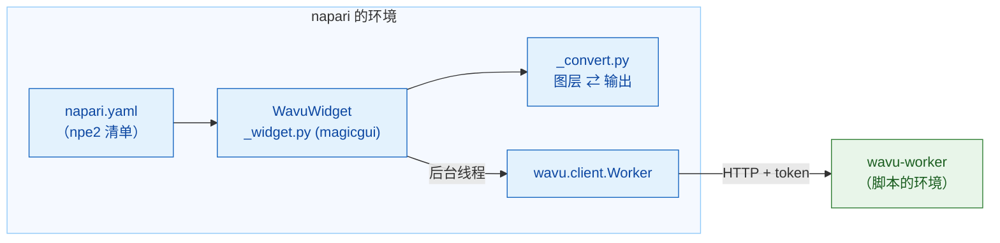

# wavu-napari 内部实现（进阶）

!!! abstract "写给好奇者和维护者"
    在 napari 里使用 Wavu 不需要读这一页。它介绍 napari 这位服务员是怎么实现的。
    worker 和它的协议请看[架构](../model/architecture.md)。

## 用大白话说

Fiji 这位服务员得用 Groovy 从头学会厨房的语言。napari 这位服务员和厨房一样
说 Python，所以它直接请来一位现成的翻译：**`wavu.client`**。这样面板就只剩
两件事：把 `PARAMS` 变成表单，以及把输出变成图层。



## 这个包

代码位于 Wavu 仓库的 `napari/` 下：Python 包 `wavu-napari`（模块
`napari_wavu`）。它依赖 `wavu`（核心，来自仓库根目录）、`magicgui`、`qtpy`
和 `numpy`；`roifile`（用于轮廓）和 `pandas`（用于表格）是可选的额外依赖。
pixi 的 `napari` 环境会从你克隆的仓库安装这两个包，所以一次 `git pull` 就能
同时更新 napari 的面板和核心。

| 文件 | 作用 |
|---|---|
| `napari.yaml` | **npe2 清单**（manifest）：一个命令 `napari_wavu._widget:WavuWidget`，显示为插件 **Wavu** 的部件 **Run Python Script**；只有一个部件时，napari 会把它列为 **Plugins › Run Python Script (Wavu)** |
| `_widget.py` | 停靠部件：文件夹、按钮、远程／容器字段、表单、日志 |
| `_convert.py` | 把图层转成输入、把输出转成图层；不依赖 Qt，所以很容易测试 |

napari 通过 `pyproject.toml` 里的 `napari.manifest` 入口点找到这份清单。

## 停靠部件

`WavuWidget` 是一个 magicgui `Container`。每个 `PARAMS` 条目会变成一个
magicgui 部件：

| `PARAMS` 类型 | 部件 |
|---|---|
| `image` | 列出 napari 中 Image 和 Labels 图层的 `ComboBox` |
| `float` | `FloatSpinBox`（步长 0.1） |
| `int` | `SpinBox` |
| `bool` | `CheckBox` |
| `choice` | 列出 `choices` 的 `ComboBox` |
| `str` | `LineEdit` |

标签文字来自 `PARAMS` 里的 `label`，否则用键名（`min_size` 会变成
*Min size*），和 worker 的做法一样。`image` 下拉框的选项来自一个函数，
每当有图层插入或删除时，面板都会调用 `reset_choices()`，所以选项会跟着图层
列表更新。Fiji 则用 `GenericDialog` 构建同样的表单：可以对照
[wavu-fiji 内部实现](../fiji/internals.md)。

## Worker

- **Start worker**（启动 worker）会调用 `wavu.client.Worker.start(folder, on_log=…,
  cancel=…)`。它会运行 `pixi run --manifest-path <folder>/pixi.toml
  wavu-worker --script-dir <folder>`，并先去掉 napari 自己的 `PIXI_*` 和
  `CONDA_*` 变量。这一点在这里很关键：napari 本身就在 `pixi run -e napari`
  下运行，如果不清理，子进程可能会用上 napari 的环境，而不是脚本的环境。
- 查找 pixi 的顺序是 `WAVU_PIXI`，然后是 `PIXI_EXE`（由 `pixi run` 设置），
  再然后是 `~/.wavu/bin`、`PATH` 和 `~/.pixi/bin`。
- 面板为每个文件夹保留一个 worker，只要它还活着就复用。worker 的 stdin 是一条
  来自 napari 的管道，所以 napari 退出时它也会退出。
- **Connect to running worker**（连接正在运行的 worker）会调用 `Worker.connect()`，
  它读取 `~/.wavu/worker.json`、检查 `/health`，并加载 worker 的脚本；日志里会
  写出 worker 的 `script_dir`。勾选 **Remote / container**（远程／容器）时，
  它改为传入四个字段：`handshake`、`host`（留空表示使用文件里的 `host`；
  `0.0.0.0` 会变成 `127.0.0.1`）、`host_prefix` 和 `worker_prefix`。两个文件夹
  要么都填，要么都不填。都填时，`Worker.to_worker` / `from_worker` 会双向转换
  路径，大的输入会写到 `<host folder>/.wavu-tmp`，让容器能读到。参见
  [以容器形式分享](../write/container.md)。
- **Stop worker**（停止 worker）会调用 `Worker.stop()`：`POST /shutdown`、关闭
  管道、等待，卡住的话就强制结束它。

## 线程与信号

启动 worker 可能要好几分钟，一次运行可能更久，所以两者都不能卡住 napari。
`_background` 把调用包装进 `napari.qt.threading.create_worker`。被包装的任务
返回 `(ok, value)`，而不是抛出异常，所以错误永远不会跑进 Qt 的事件循环；
它会显示在日志里，并以 napari 通知的形式出现。任务运行期间，按钮都会被禁用，
只有 **Cancel**（取消）可用。

`on_log`、`on_progress` 这类回调是在后台线程上被调用的，而在那里不允许操作
部件。所以它们会经过一个小小的 `QObject`，上面有两个 Qt 信号：`log(str)` 和
`progress(float)`；Qt 会在 GUI 线程上投递信号，由它更新日志框和进度条。

**Cancel** 会设置一个 `threading.Event`。启动期间，`Worker.start` 会检查它并
结束 pixi；运行期间，`Worker.run` 会发送 `POST /jobs/<id>/cancel`，脚本在下次
检查 `ctx.cancelled()` 时停下。随之产生的 `JobCancelled` 不算错误：日志只会
写 `Cancelled.`，不会弹出通知。

## 图层转换

`_convert.py` 实现了[在 napari 中会得到什么](layers.md)里的规则：

- `layer_input(layer)`：数据（全分辨率那一层，dask 会先计算出来）、标题、
  `pixel_um`（取自最后两个相等的 `scale` 值，单位为微米或像素），RGB 则为
  `axes="YXS"`。
- `output_layers(outputs, defaults)`：napari 的图层数据元组
  `(data, kwargs, "image" | "labels" | "shapes")`，外加日志行。`defaults`
  携带输入的 `pixel_um`。
- `image_layer` 决定是 Labels 还是 Image（看 `meta` 里的 `napari` 提示，否则
  看是否为整数 dtype 且名称匹配 `label|mask|seg|instance`），并设置
  `scale`、`rgb` 和 `channel_axis`。
- `roi_polygons` 用 `roifile` 读取 RoiSet zip，并把 (x, y) 翻转成 napari 的
  (row, column)。
- `table_rows` 把 DataFrame 或由 dict 组成的 list 转成 `QTableWidget` 的行，
  部件再用 `viewer.window.add_dock_widget` 把表格停靠上去。

## 测试

测试不需要 OpenGL 画布，所以在 CI 上、以及在 Windows 上用 Qt offscreen
模式都能运行。`conftest.py` 提供一个 `ViewerModel`（napari 的图层模型，没有
窗口），外加一个记录停靠部件的替身窗口。`test_widget.py` 会启动真正的
worker，但它是通过 `Worker.start(command=…)` 用普通的
`python -m wavu.worker` 启动，服务 `tests/scripts`。`test_pixi.py`（标记为
`pixi_env`，默认跳过）则会在 Wavu 的模板文件夹里真正走一遍 `pixi run`。

```sh
pixi run -e napari test-napari              # 转换 + 部件测试
pixi run -e napari test-napari-integration  # 通过 pixi 启动真正的 worker
```

## 从 napari 调试脚本

面板上没有 *Debug* 复选框。你可以在脚本文件夹里运行 `pixi run debug`（一个独立
的 worker，debugpy 在端口 5678 上，并带有握手文件），用
**Attach to Wavu worker** 把 VS Code 附加上去，再点击面板上的
**Connect to running worker**。参见[在 VS Code 里调试](../help/debug-in-vscode.md)。

## 一句话总结

wavu-napari 是一个 npe2 插件，它的 magicgui 面板在后台线程上驱动
`wavu.client`，把 `PARAMS` 变成部件、把输出变成图层，而转换部分不依赖 Qt，
因此可以在 `ViewerModel` 上测试。
