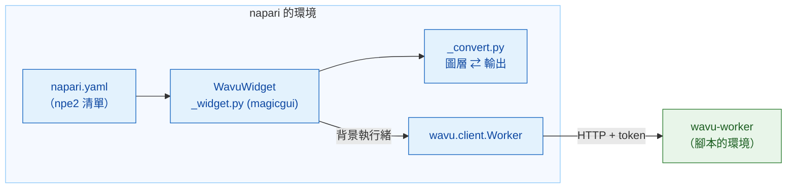

# wavu-napari 內部構造（進階）

!!! abstract "給好奇的人和維護者"
    在 napari 裡使用 Wavu 不需要讀這一頁。它說明 napari 這位服務生是怎麼做出來的。
    worker 和它的協定請看[架構](../model/architecture.md)。

## 用白話說

Fiji 這位服務生得用 Groovy 從頭學會廚房的語言。napari 這位服務生和廚房一樣
說 Python，所以它直接請來一位現成的翻譯：**`wavu.client`**。這樣面板就只剩
兩件事要做：把 `PARAMS` 變成表單，以及把輸出變成圖層。



## 套件

程式碼放在 Wavu 儲存庫的 `napari/` 底下：Python 套件 `wavu-napari`（模組
`napari_wavu`）。它依賴 `wavu`（核心，來自儲存庫根目錄）、`magicgui`、`qtpy`
和 `numpy`；`roifile`（用於輪廓）和 `pandas`（用於表格）是可選的額外套件。
pixi 的 `napari` 環境會從你的本機複本安裝這兩個套件，所以一次 `git pull` 就能
同時更新 napari 的面板和核心。

| 檔案 | 角色 |
|---|---|
| `napari.yaml` | **npe2 清單**（manifest）：一個指令 `napari_wavu._widget:WavuWidget`，顯示為外掛 **Wavu** 的小工具 **Run Python Script**；只有一個小工具時，napari 會把它列成 **Plugins › Run Python Script (Wavu)** |
| `_widget.py` | 停駐小工具：資料夾、按鈕、遠端／容器欄位、表單、log |
| `_convert.py` | 把圖層轉成輸入、把輸出轉成圖層；不用 Qt，所以很好測試 |

napari 透過 `pyproject.toml` 裡的 `napari.manifest` 進入點找到這份清單。

## 停駐小工具

`WavuWidget` 是一個 magicgui `Container`。每個 `PARAMS` 項目會變成一個
magicgui 小工具：

| `PARAMS` 類型 | 小工具 |
|---|---|
| `image` | 列出 napari 中 Image 和 Labels 圖層的 `ComboBox` |
| `float` | `FloatSpinBox`（間隔 0.1） |
| `int` | `SpinBox` |
| `bool` | `CheckBox` |
| `choice` | 列出 `choices` 的 `ComboBox` |
| `str` | `LineEdit` |

標籤文字來自 `PARAMS` 裡的 `label`，否則就用鍵名（`min_size` 會變成
*Min size*），和 worker 的做法一樣。`image` 下拉選單的選項來自一個函式，
而每當有圖層加入或移除時，面板就會呼叫 `reset_choices()`，所以選項會跟著
圖層清單更新。Fiji 則用 `GenericDialog` 建立同樣的表單：可以對照
[wavu-fiji 內部構造](../fiji/internals.md)。

## Worker

- **Start worker**（啟動 worker）會呼叫 `wavu.client.Worker.start(folder, on_log=…,
  cancel=…)`。它會執行 `pixi run --manifest-path <folder>/pixi.toml
  wavu-worker --script-dir <folder>`，並先移除 napari 自己的 `PIXI_*` 和
  `CONDA_*` 變數。這一點在這裡很重要：napari 本身就在 `pixi run -e napari`
  底下執行，不清理的話，子行程可能會用到 napari 的環境，而不是腳本的環境。
- 尋找 pixi 的順序是 `WAVU_PIXI`，然後 `PIXI_EXE`（由 `pixi run` 設定），
  再來是 `~/.wavu/bin`、`PATH` 和 `~/.pixi/bin`。
- 面板為每個資料夾保留一個 worker，只要它還活著就重複使用。worker 的 stdin
  是一條來自 napari 的管道，所以 napari 結束時它也會結束。
- **Connect to running worker**（連接執行中的 worker）會呼叫 `Worker.connect()`，
  它讀取 `~/.wavu/worker.json`、檢查 `/health`，並載入 worker 的腳本；log 會
  顯示 worker 的 `script_dir`。勾選 **Remote / container**（遠端／容器）時，
  它改為傳入四個欄位：`handshake`、`host`（留空表示使用檔案裡的 `host`；
  `0.0.0.0` 會變成 `127.0.0.1`）、`host_prefix` 和 `worker_prefix`。兩個資料夾
  要嘛都填，要嘛都不填。都填時，`Worker.to_worker` / `from_worker` 會雙向轉換
  路徑，大型輸入會寫到 `<host folder>/.wavu-tmp`，讓容器讀得到。請看
  [以容器分享](../write/container.md)。
- **Stop worker**（停止 worker）會呼叫 `Worker.stop()`：`POST /shutdown`、關閉
  管道、等待，卡住的話就強制結束它。

## 執行緒與訊號

啟動 worker 可能要好幾分鐘，執行一次可能更久，所以兩者都不能卡住 napari。
`_background` 把呼叫包進 `napari.qt.threading.create_worker`。被包起來的工作
會回傳 `(ok, value)`，而不是丟出例外，所以錯誤永遠不會跑進 Qt 的事件迴圈；
錯誤會顯示在 log 裡，也會以 napari 通知顯示。工作執行期間，按鈕都會停用，
只有 **Cancel**（取消）可以按。

`on_log`、`on_progress` 這類回呼是在背景執行緒上被呼叫的，而在那裡不能碰
小工具。所以它們會經過一個小小的 `QObject`，上面有兩個 Qt 訊號：`log(str)` 和
`progress(float)`；Qt 會在 GUI 執行緒上送出訊號，由它更新 log 方塊和進度條。

**Cancel** 會設定一個 `threading.Event`。啟動期間，`Worker.start` 會檢查它並
結束 pixi；執行期間，`Worker.run` 會送出 `POST /jobs/<id>/cancel`，腳本在下次
檢查 `ctx.cancelled()` 時停下。隨之而來的 `JobCancelled` 不算錯誤：log 只會
寫 `Cancelled.`，不會跳出通知。

## 圖層轉換

`_convert.py` 實作了[可以回傳什麼](../write/outputs.md)（napari 分頁）裡的規則：

- `layer_input(layer)`：資料（最高解析度那一層，dask 會先計算出來）、標題、
  `pixel_um`（取自最後兩個相等的 `scale` 值，單位為微米或像素），RGB 則為
  `axes="YXS"`。
- `output_layers(outputs, defaults)`：napari 的圖層資料 tuple
  `(data, kwargs, "image" | "labels" | "shapes")`，加上 log 訊息。`defaults`
  帶著輸入的 `pixel_um`。
- `image_layer` 決定是 Labels 還是 Image（看 `meta` 裡的 `napari` 提示，否則
  看是否為整數 dtype，且名稱符合 `label|mask|seg|instance`），並設定
  `scale`、`rgb` 和 `channel_axis`。
- `roi_polygons` 用 `roifile` 讀取 RoiSet zip，並把 (x, y) 翻成 napari 的
  (row, column)。
- `table_rows` 把 DataFrame 或由 dict 組成的 list 轉成 `QTableWidget` 的列，
  小工具再用 `viewer.window.add_dock_widget` 把表格停駐上去。

## 測試

測試不需要 OpenGL 畫布，所以在 CI 上、以及在 Windows 上用 Qt offscreen
模式都能跑。`conftest.py` 提供一個 `ViewerModel`（napari 的圖層模型，沒有
視窗），加上一個會記錄停駐小工具的替身視窗。`test_widget.py` 會啟動真正的
worker，但它是透過 `Worker.start(command=…)` 用單純的
`python -m wavu.worker` 啟動，服務 `tests/scripts`。`test_pixi.py`（標記為
`pixi_env`，預設略過）則會在 Wavu 的範本資料夾裡真正走一趟 `pixi run`。

```sh
pixi run -e napari test-napari              # 轉換 + 小工具測試
pixi run -e napari test-napari-integration  # 透過 pixi 啟動真正的 worker
```

## 從 napari 為腳本除錯

面板上沒有 *Debug* 勾選框。改為在腳本資料夾裡執行 `pixi run debug`（一個獨立
的 worker，debugpy 在連接埠 5678 上，並附帶交握檔案），用
**Attach to Wavu worker** 把 VS Code 附加上去，再按面板上的
**Connect to running worker**。請看[在 VS Code 中除錯](../help/debug-in-vscode.md)。

## 一句話總結

wavu-napari 是一個 npe2 外掛，它的 magicgui 面板在背景執行緒上驅動
`wavu.client`，把 `PARAMS` 變成小工具、把輸出變成圖層，而轉換部分不依賴 Qt，
所以可以在 `ViewerModel` 上測試。
