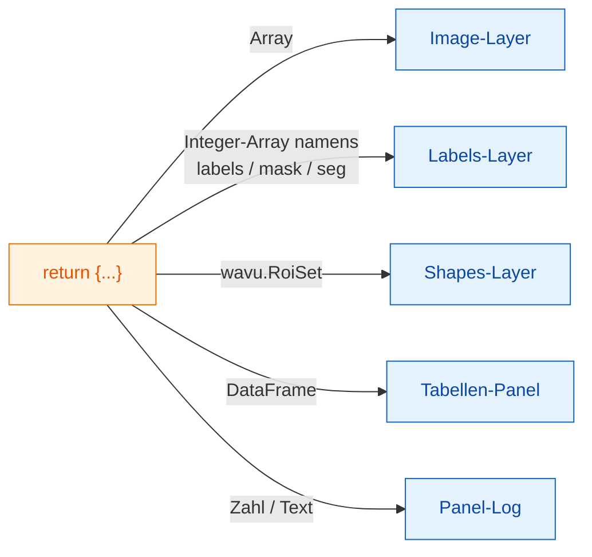

# Was Sie in napari zurückbekommen

## Die Idee in einfachen Worten

Ihr Skript gibt **ein Dictionary beschrifteter Teller** zurück, genau wie
für Fiji ([Was Sie zurückgeben können](../write/outputs.md)). Der
napari-Kellner sieht sich jeden Teller an und stellt ihn dorthin, wo napari
solche Dinge aufbewahrt: Bilder werden zu **Image**-Layern, Segmentierungen
zu **Labels**-Layern, Umrisse zu **Shapes**, Tabellen bekommen ein eigenes
Panel, und einzelne Zahlen landen im Log des Panels. Ihr Skript ändert sich
nicht; nur das Servieren.

## Die Teller-Karte

| Sie geben zurück | napari zeigt |
|---|---|
| ein NumPy-Array (2-D oder mehr) | einen **Image**-Layer, benannt nach dem Schlüssel |
| ein Integer-Array, dessen Schlüssel `label`, `mask`, `seg` oder `instance` enthält (Groß-/Kleinschreibung egal) | einen **Labels**-Layer |
| `wavu.Image(arr, extra={"napari": "labels"})` | einen **Labels**-Layer, egal wie er heißt |
| `wavu.Image(arr, extra={"napari": "image"})` | einen **Image**-Layer, auch wenn der Name `labels` sagt |
| `wavu.Image(arr, axes="CYX", channel_names=["DNA", "Actin"])` | einen Image-Layer pro Kanal: `name [DNA]`, `name [Actin]` |
| ein RGB-Bild (`axes` endet auf `S`, letzte Größe 3 oder 4) | einen RGB-Image-Layer |
| `wavu.RoiSet(path_to_zip)` | einen **Shapes**-Layer mit gelben Polygonen |
| ein pandas-`DataFrame` oder eine Liste von dicts | ein rechts angedocktes **Tabellen-Panel**, benannt nach dem Schlüssel, plus eine Log-Zeile `name: table with N rows` |
| einen Dateipfad (`pathlib.Path`) | eine Log-Zeile `name: path` |
| eine Zahl, einen Text, `True`/`False` | eine Log-Zeile `name = value` |

Die Regel „benannt wie Labels“ ist dieselbe Idee, die Fiji für seine bunte
Label-Farbtabelle (LUT) nutzt, deshalb sehen die meisten Skripte in beiden
Betrachtern ohne Änderung richtig aus. Passt der Name nicht, setzen Sie den
Hinweis mit `extra`.

## Die Pixelgröße kommt mit

Wenn Sie ein Skript ausführen, schickt das Panel die Pixelgröße des
Eingabe-Layers: Sind die letzten beiden **scale**-Werte des Layers gleich
(und nicht 1) und seine Einheiten Mikrometer oder Pixel, wird daraus
`pixel_um`. Jede Bildausgabe, die keine eigene Pixelgröße setzt, bekommt
dieselbe Skalierung, sodass ein zurückgegebenes Array genau über seiner
Eingabe liegt.

Um eine eigene zu setzen, geben Sie `wavu.Image(arr, pixel_um=0.65)` zurück;
die letzten beiden scale-Werte des Layers werden dann `0.65`.

## Was hineingeht

In einem `image`-Feld lassen sich nur **Image**- und **Labels**-Layer
auswählen. Das Panel schickt:

- die Daten des Layers (bei einem Multiskalen-Layer die Ebene mit voller
  Auflösung; verzögert geladene dask-Daten werden zuerst in den
  Arbeitsspeicher geladen);
- den Layer-Namen als Bildtitel;
- bei RGB-Layern `axes="YXS"`, damit Ihr Skript weiß, dass die letzte Achse
  die Farbe ist.

Denken Sie daran: Wavu ist für **kleine Daten** gedacht, ein Bild, das in
den Arbeitsspeicher passt.

## Gut zu wissen

- **Bildtypen.** Wie bei Fiji werden Ausgaben auf dem Rückweg in 8-Bit,
  16-Bit oder 32-Bit-Float umgewandelt. Ja/Nein-Masken kommen als 0/255 an.
  Ein Label-Bild mit Werten über 65535 oder unter 0 kommt als
  32-Bit-Float an und öffnet sich deshalb als Image-Layer.
- **Umrisse brauchen `roifile`.** Shapes werden mit dem Paket roifile aus
  der RoiSet-ZIP gelesen, das in der napari-Umgebung von Wavu enthalten ist.
  Fehlte es, würde Ihnen das Log stattdessen sagen, wo die ZIP-Datei liegt.
- **Nichts zurückgeben** (`return {}`) ist in Ordnung: Es erscheint kein
  Layer.
- **Fehler** erscheinen im Log als `Error: …` mit dem vollständigen
  Traceback, und napari zeigt eine kurze Benachrichtigung.

Sie nutzen Fiji? Dieselben Rückgaben öffnen sich dort als Bildfenster,
Results-Tabellen und im ROI Manager:
[Was Sie zurückgeben können](../write/outputs.md).

## In einem Satz

Geben Sie ein Dictionary zurück, und napari macht aus Arrays Image- oder
Labels-Layer, aus `wavu.RoiSet` Shapes, aus Tabellen ein angedocktes Panel
und aus einfachen Werten Log-Zeilen, wobei die Pixelgröße der Eingabe
übernommen wird.

[Weiter: Interna von wavu-napari (für Fortgeschrittene) :material-arrow-right:](internals.md){ .md-button }
