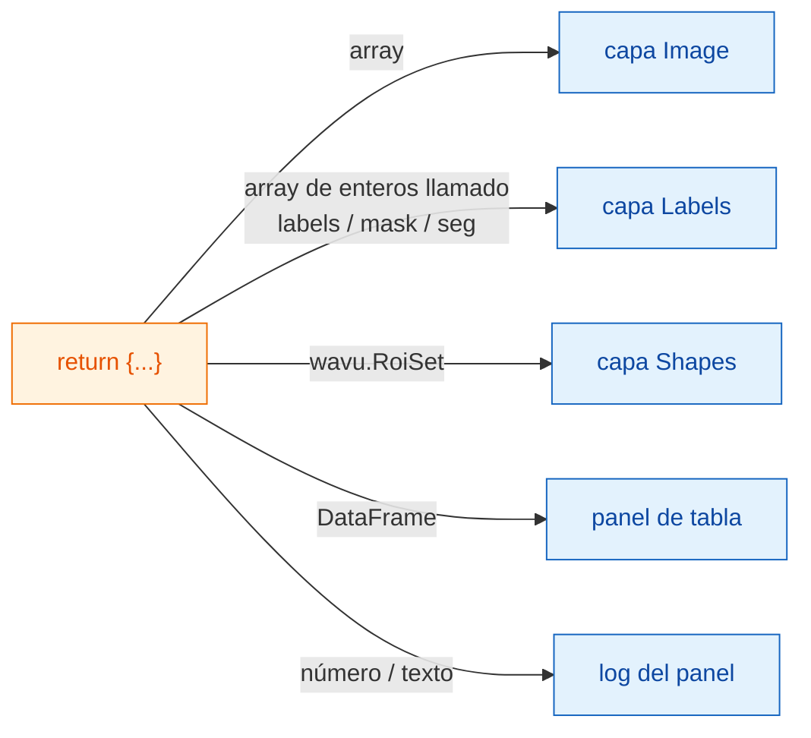

# Lo que recibes en napari

## La idea en palabras sencillas

Tu script devuelve **un diccionario de platos con etiqueta**, exactamente
igual que para Fiji ([Qué puedes devolver](../write/outputs.md)). El
camarero de napari mira cada plato y lo pone donde napari guarda ese tipo de
cosa: las imágenes se convierten en capas **Image**, las segmentaciones en
capas **Labels**, los contornos en **Shapes**, las tablas tienen su propio
panel y los números sueltos van al log del panel. Tu script no cambia; solo
cambia cómo se sirve.

## La carta de platos

| Devuelves | napari muestra |
|---|---|
| un array de NumPy (2-D o más) | una capa **Image** con el nombre de la clave |
| un array de enteros cuya clave contiene `label`, `mask`, `seg` o `instance` (en mayúsculas o minúsculas) | una capa **Labels** |
| `wavu.Image(arr, extra={"napari": "labels"})` | una capa **Labels**, sea cual sea el nombre |
| `wavu.Image(arr, extra={"napari": "image"})` | una capa **Image**, aunque el nombre diga `labels` |
| `wavu.Image(arr, axes="CYX", channel_names=["DNA", "Actin"])` | una capa Image por canal: `name [DNA]`, `name [Actin]` |
| una imagen RGB (`axes` terminado en `S`, último tamaño 3 o 4) | una sola capa Image RGB |
| `wavu.RoiSet(path_to_zip)` | una capa **Shapes** de polígonos amarillos |
| un `DataFrame` de pandas, o una lista de dicts | un **panel de tabla** acoplado a la derecha, con el nombre de la clave, más una línea de log `name: table with N rows` |
| una ruta de archivo (`pathlib.Path`) | una línea de log `name: path` |
| un número, un texto, `True`/`False` | una línea de log `name = value` |

La regla de "nombre de etiquetas" es la misma idea que usa Fiji para su
tabla de colores (LUT) de etiquetas, así que la mayoría de los scripts se ven
bien en los dos visores sin cambiar nada. Cuando el nombre no encaja, pon la
pista con `extra`.

## El tamaño de píxel viaja con la imagen

Cuando ejecutas un script, el panel envía el tamaño de píxel de la capa de
entrada: si los dos últimos valores de **scale** de la capa son iguales (y
distintos de 1), y sus unidades son micrómetros o píxeles, eso se convierte
en `pixel_um`. Toda salida de imagen que no fije su propio tamaño de píxel
recibe la misma escala, así que un array devuelto cae exactamente encima de
su entrada.

Para fijar el tuyo, devuelve `wavu.Image(arr, pixel_um=0.65)`; los dos
últimos valores de escala de la capa pasan a ser `0.65`.

## Lo que entra

Solo se pueden elegir capas **Image** y **Labels** en un campo `image`. El
panel envía:

- los datos de la capa (para una capa multiescala, el nivel de resolución
  completa; los datos dask diferidos se cargan antes en memoria);
- el nombre de la capa como título de la imagen;
- para capas RGB, `axes="YXS"`, para que tu script sepa que el último eje es
  el color.

Recuerda que Wavu es para **datos pequeños**: una imagen que quepa en
memoria.

## Conviene saber

- **Tipos de imagen.** Igual que en Fiji, las salidas se convierten a 8 bits,
  16 bits o 32 bits en coma flotante en el camino de vuelta. Las máscaras
  sí/no llegan como 0/255. Una imagen de etiquetas con valores por encima de
  65535, o por debajo de 0, llega como 32 bits en coma flotante y por eso se
  abre como capa Image.
- **Los contornos necesitan `roifile`.** Las formas se leen del zip del
  RoiSet con el paquete roifile, que incluye el entorno napari de Wavu. Si
  faltara, el log te diría en su lugar dónde está el zip.
- **No devolver nada** (`return {}`) está bien: no aparece ninguna capa.
- **Los errores** aparecen en el log como `Error: …` con la traza completa,
  y napari muestra una notificación breve.

¿Usas Fiji? Las mismas salidas se abren como ventanas de imagen, tablas
Results y el ROI Manager: [Qué puedes devolver](../write/outputs.md).

## En una frase

Devuelve un diccionario, y napari convierte los arrays en capas Image o
Labels, `wavu.RoiSet` en Shapes, las tablas en un panel acoplado y los
valores simples en líneas de log, conservando el tamaño de píxel de la
entrada.

[Siguiente: funcionamiento interno de wavu-napari (avanzado) :material-arrow-right:](internals.md){ .md-button }
