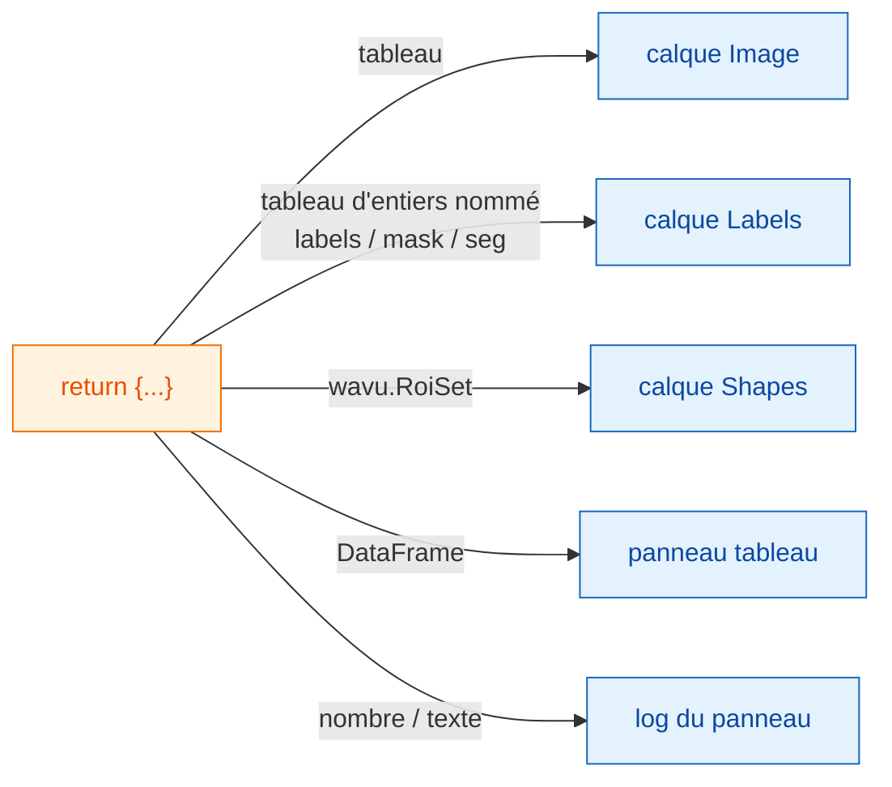

# Ce que vous récupérez dans napari

## L'idée en mots simples

Votre script rend **un dictionnaire d'assiettes étiquetées**, exactement
comme pour Fiji ([Ce que vous pouvez renvoyer](../write/outputs.md)). Le
serveur napari regarde chaque assiette et la pose là où napari range ce
genre de chose : les images deviennent des calques **Image**, les
segmentations des calques **Labels**, les contours des calques **Shapes**,
les tableaux ont leur propre panneau, et les nombres isolés vont dans le
log du panneau. Votre script ne change pas ; seul le service change.

## La carte des assiettes

| Vous renvoyez | napari affiche |
|---|---|
| un tableau NumPy (2-D ou plus) | un calque **Image** nommé d'après la clé |
| un tableau d'entiers dont la clé contient `label`, `mask`, `seg` ou `instance` (majuscules ou minuscules) | un calque **Labels** |
| `wavu.Image(arr, extra={"napari": "labels"})` | un calque **Labels**, quel que soit le nom |
| `wavu.Image(arr, extra={"napari": "image"})` | un calque **Image**, même si le nom dit `labels` |
| `wavu.Image(arr, axes="CYX", channel_names=["DNA", "Actin"])` | un calque Image par canal : `name [DNA]`, `name [Actin]` |
| une image RVB (`axes` finissant par `S`, dernière taille 3 ou 4) | un seul calque Image RVB |
| `wavu.RoiSet(path_to_zip)` | un calque **Shapes** de polygones jaunes |
| un `DataFrame` pandas, ou une liste de dicts | un **panneau tableau** ancré à droite, nommé d'après la clé, plus une ligne de log `name: table with N rows` |
| un chemin de fichier (`pathlib.Path`) | une ligne de log `name: path` |
| un nombre, du texte, `True`/`False` | une ligne de log `name = value` |

La règle « nommé comme des étiquettes » est la même idée que celle qu'utilise
Fiji pour sa table de couleurs (LUT) bariolée des étiquettes ; la plupart
des scripts s'affichent donc correctement dans les deux visualiseurs sans
aucun changement. Quand le nom ne convient pas, donnez l'indication avec
`extra`.

## La taille des pixels suit

Quand vous lancez un script, le panneau envoie la taille des pixels du
calque d'entrée : si les deux dernières valeurs **scale** (échelle) du
calque sont égales (et différentes de 1), et que ses unités sont des
micromètres ou des pixels, elle devient `pixel_um`. Chaque image de sortie
qui ne définit pas sa propre taille de pixel reçoit la même échelle : un
tableau renvoyé se pose donc exactement sur son entrée.

Pour définir la vôtre, renvoyez `wavu.Image(arr, pixel_um=0.65)` ; les deux
dernières valeurs d'échelle du calque deviennent `0.65`.

## Ce qui part en entrée

Seuls les calques **Image** et **Labels** peuvent être choisis dans un champ
`image`. Le panneau envoie :

- les données du calque (pour un calque multi-échelle, le niveau en pleine
  résolution ; les données dask paresseuses sont d'abord chargées en
  mémoire) ;
- le nom du calque comme titre de l'image ;
- pour les calques RVB, `axes="YXS"`, pour que votre script sache que le
  dernier axe est la couleur.

N'oubliez pas que Wavu est fait pour les **petites données** : une image
qui tient en mémoire.

## Bon à savoir

- **Types d'image.** Comme pour Fiji, les sorties sont converties en 8 bits,
  16 bits ou flottant 32 bits au retour. Les masques oui/non arrivent en
  0/255. Une image d'étiquettes avec des valeurs au-dessus de 65535, ou
  en dessous de 0, arrive en flottant 32 bits et s'ouvre donc comme calque
  Image.
- **Les contours ont besoin de `roifile`.** Les Shapes sont lues dans le
  zip RoiSet avec le paquet roifile, que l'environnement napari de Wavu
  inclut. S'il manquait, le log vous indiquerait plutôt où se trouve le zip.
- **Ne rien renvoyer** (`return {}`) ne pose pas de problème : aucun calque
  n'apparaît.
- **Les erreurs** apparaissent dans le log sous la forme `Error: …` avec la
  trace d'appels complète, et napari affiche une courte notification.

Vous utilisez Fiji ? Les mêmes sorties s'ouvrent en fenêtres d'image,
tableaux Results et ROI Manager :
[Ce que vous pouvez renvoyer](../write/outputs.md).

## En une phrase

Renvoyez un dictionnaire, et napari fait des tableaux des calques Image ou
Labels, de `wavu.RoiSet` des Shapes, des tableaux de données un panneau
ancré et des valeurs simples des lignes de log, en reprenant la taille des
pixels de l'entrée.

[Suite : fonctionnement interne de wavu-napari (avancé) :material-arrow-right:](internals.md){ .md-button }
