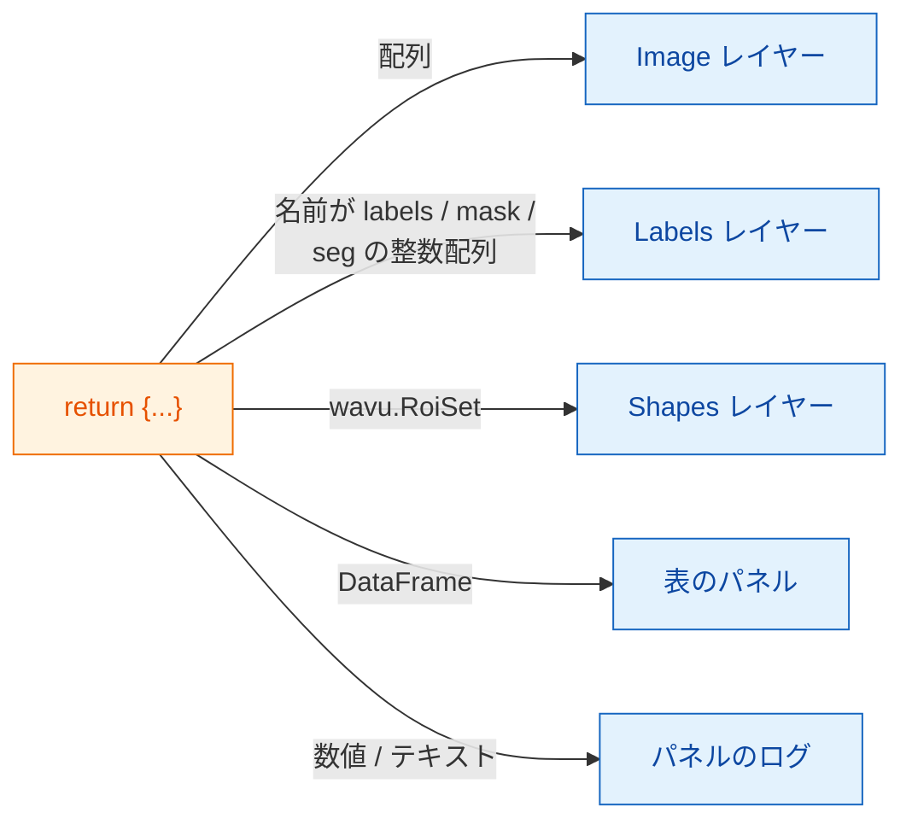

# napari で戻ってくるもの

## やさしく言うと

あなたのスクリプトは、Fiji のときとまったく同じように **ラベル付きの料理の
辞書** を返します（[返せるもの](../write/outputs.md)）。napari のウェイター
は料理を 1 皿ずつ見て、napari がその種類のものを置く場所に並べます。画像は
**Image** レイヤー、セグメンテーションは **Labels** レイヤー、輪郭は
**Shapes** になり、表は専用のパネルに、単独の数値はパネルのログに入ります。
スクリプトは変わりません。変わるのは盛り付けだけです。

## 料理のメニュー

| 返すもの | napari での表示 |
|---|---|
| NumPy 配列（2 次元以上） | キーの名前が付いた **Image** レイヤー |
| キーに `label`、`mask`、`seg`、`instance` のどれかを含む整数配列（大文字・小文字は問わない） | **Labels** レイヤー |
| `wavu.Image(arr, extra={"napari": "labels"})` | 名前に関係なく **Labels** レイヤー |
| `wavu.Image(arr, extra={"napari": "image"})` | 名前が `labels` でも **Image** レイヤー |
| `wavu.Image(arr, axes="CYX", channel_names=["DNA", "Actin"])` | チャンネルごとに 1 つの Image レイヤー：`name [DNA]`、`name [Actin]` |
| RGB 画像（`axes` が `S` で終わり、最後のサイズが 3 か 4） | RGB の Image レイヤー 1 つ |
| `wavu.RoiSet(path_to_zip)` | 黄色い多角形の **Shapes** レイヤー |
| pandas の `DataFrame`、または dict のリスト | 右側にドッキングする **表のパネル**（キーの名前付き）と、ログの 1 行 `name: table with N rows` |
| ファイルパス（`pathlib.Path`） | ログの 1 行 `name: path` |
| 数値、テキスト、`True`/`False` | ログの 1 行 `name = value` |

「ラベルらしい名前」のルールは、Fiji がカラフルなラベル用ルックアップ
テーブルに使うのと同じ考え方です。だから、たいていのスクリプトは何も
変えずに両方のビューアーで正しく表示されます。名前が合わないときは、
`extra` でヒントを指定します。

## ピクセルサイズも一緒に届く

スクリプトを実行すると、パネルは入力レイヤーのピクセルサイズを送ります。
レイヤーの **scale** の最後の 2 つの値が等しく（かつ 1 ではなく）、単位が
マイクロメートルかピクセルなら、それが `pixel_um` になります。自分の
ピクセルサイズを指定していない画像出力はすべて同じ scale を受け取るので、
返した配列は入力のちょうど真上に重なります。

自分で指定するには `wavu.Image(arr, pixel_um=0.65)` を返します。レイヤーの
scale の最後の 2 つの値が `0.65` になります。

## 入力になるもの

`image` 欄で選べるのは **Image** レイヤーと **Labels** レイヤーだけです。
パネルは次のものを送ります。

- レイヤーのデータ（マルチスケールのレイヤーなら最高解像度のレベル。
  遅延読み込みの dask データは先にメモリに読み込みます）
- 画像のタイトルとしてレイヤー名
- RGB レイヤーなら `axes="YXS"`。最後の軸が色だとスクリプトにわかります。

Wavu は **小さなデータ** 用、つまりメモリに収まる画像 1 枚用だということを
覚えておいてください。

## 知っておくと良いこと

- **画像の型。** Fiji と同じく、出力は戻ってくるときに 8 ビット、16 ビット、
  32 ビット浮動小数点のどれかに変換されます。はい/いいえのマスクは 0/255
  で届きます。65535 を超える値や 0 未満の値を持つラベル画像は 32 ビット
  浮動小数点で届くので、Image レイヤーとして開きます。
- **輪郭には `roifile` が必要です。** Shapes は roifile パッケージで RoiSet
  の zip から読み込みます。Wavu の napari 環境には含まれています。もし
  なければ、代わりに zip の場所がログに表示されます。
- **何も返さない**（`return {}`）のも問題ありません。レイヤーは現れません。
- **エラー** はログに `Error: …` と完全なトレースバック付きで表示され、
  napari が短い通知を出します。

Fiji を使いますか？ 同じ戻り値が、画像ウィンドウ、Results の表、ROI
Manager で開きます：[返せるもの](../write/outputs.md)。

## ひとことで言うと

辞書を返せば、napari は配列を Image か Labels のレイヤーに、`wavu.RoiSet` を
Shapes に、表をドッキングしたパネルに、単純な値をログの行にします。入力の
ピクセルサイズも引き継がれます。

[次へ：wavu-napari の内部（上級） :material-arrow-right:](internals.md){ .md-button }
