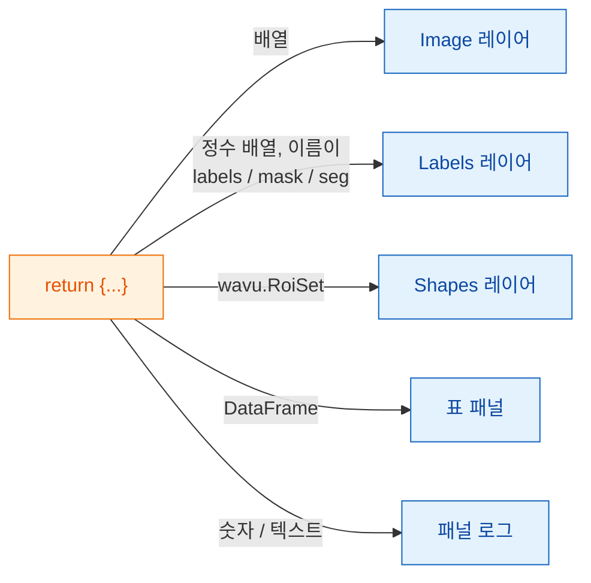

# napari에서 돌려받는 것

## 쉬운 말로 설명하면

스크립트는 Fiji 때와 똑같이 **이름표 붙은 접시들의 딕셔너리**를 돌려줘요
([돌려줄 수 있는 것](../write/outputs.md)). napari 웨이터는 접시를 하나씩
보고, napari가 그런 것을 두는 곳에 놓아요. 그림은 **Image** 레이어,
분할(segmentation) 결과는 **Labels** 레이어, 윤곽선은 **Shapes**가 되고,
표는 자기 패널을 갖고, 숫자 하나는 패널 로그로 가요. 스크립트는 그대로이고,
내놓는 방식만 달라요.

## 접시 메뉴

| 돌려주는 것 | napari가 보여 주는 것 |
|---|---|
| NumPy 배열(2차원 이상) | 키 이름을 딴 **Image** 레이어 |
| 키에 `label`, `mask`, `seg`, `instance`가 들어간(대소문자 무관) 정수 배열 | **Labels** 레이어 |
| `wavu.Image(arr, extra={"napari": "labels"})` | 이름과 상관없이 **Labels** 레이어 |
| `wavu.Image(arr, extra={"napari": "image"})` | 이름이 `labels`라도 **Image** 레이어 |
| `wavu.Image(arr, axes="CYX", channel_names=["DNA", "Actin"])` | 채널마다 Image 레이어 하나: `name [DNA]`, `name [Actin]` |
| RGB 이미지(`axes`가 `S`로 끝나고 마지막 크기가 3 또는 4) | RGB Image 레이어 하나 |
| `wavu.RoiSet(path_to_zip)` | 노란 다각형의 **Shapes** 레이어 |
| pandas `DataFrame` 또는 dict의 리스트 | 오른쪽에 붙는, 키 이름을 딴 **표 패널**, 그리고 로그 한 줄 `name: table with N rows` |
| 파일 경로(`pathlib.Path`) | 로그 한 줄 `name: path` |
| 숫자, 텍스트, `True`/`False` | 로그 한 줄 `name = value` |

"레이블 같은 이름" 규칙은 Fiji가 알록달록한 레이블 룩업 테이블(LUT)을 쓸 때와
같은 생각이에요. 그래서 대부분의 스크립트는 고치지 않아도 두 뷰어에서 모두
제대로 보여요. 이름이 맞지 않으면 `extra`로 힌트를 주세요.

## 픽셀 크기도 함께 와요

스크립트를 실행하면 패널이 입력 레이어의 픽셀 크기를 보내요. 레이어의 마지막
두 **scale** 값이 같고(1이 아니고), 단위가 마이크로미터나 픽셀이면 그게
`pixel_um`이 돼요. 자기 픽셀 크기를 정하지 않은 이미지 출력은 모두 같은
scale을 받아서, 돌려준 배열이 입력 바로 위에 정확히 겹쳐져요.

직접 정하려면 `wavu.Image(arr, pixel_um=0.65)`를 돌려주세요. 레이어의 마지막
두 scale 값이 `0.65`가 돼요.

## 들어가는 것

`image` 필드에서는 **Image**와 **Labels** 레이어만 고를 수 있어요. 패널이
보내는 것은 이래요.

- 레이어의 데이터(멀티스케일 레이어면 최고 해상도 단계, 지연(lazy) dask
  데이터는 먼저 메모리에 불러와요)
- 이미지 제목으로 쓰이는 레이어 이름
- RGB 레이어면 `axes="YXS"`. 그래서 스크립트가 마지막 축이 색이라는 걸 알아요.

Wavu는 **작은 데이터**, 곧 메모리에 들어가는 이미지 한 장을 위한 것임을
기억하세요.

## 알아 두면 좋은 점

- **이미지 형식.** Fiji 때처럼 출력은 돌아오는 길에 8비트, 16비트 또는
  32비트 float로 바뀌어요. 예/아니요 마스크는 0/255로 와요. 값이 65535를
  넘거나 0보다 작은 레이블 이미지는 32비트 float로 와서 Image 레이어로
  열려요.
- **윤곽선에는 `roifile`이 필요해요.** Shapes는 roifile 패키지로 RoiSet
  zip에서 읽고, Wavu의 napari 환경에 들어 있어요. 만약 없다면 로그가 대신
  zip이 어디 있는지 알려 줘요.
- **아무것도 돌려주지 않아도**(`return {}`) 괜찮아요. 레이어가 생기지 않을
  뿐이에요.
- **오류**는 로그에 `Error: …`와 전체 트레이스백으로 나오고, napari가 짧은
  알림을 보여 줘요.

Fiji를 쓰나요? 같은 반환값이 이미지 창, Results 표, ROI Manager로 열려요:
[돌려줄 수 있는 것](../write/outputs.md).

## 한 문장으로

딕셔너리를 돌려주면 napari가 배열은 Image나 Labels 레이어로, `wavu.RoiSet`은
Shapes로, 표는 붙박이 패널로, 단순한 값은 로그 줄로 만들고, 입력의 픽셀
크기도 이어받아요.

[다음: wavu-napari 내부 구조 (고급) :material-arrow-right:](internals.md){ .md-button }
