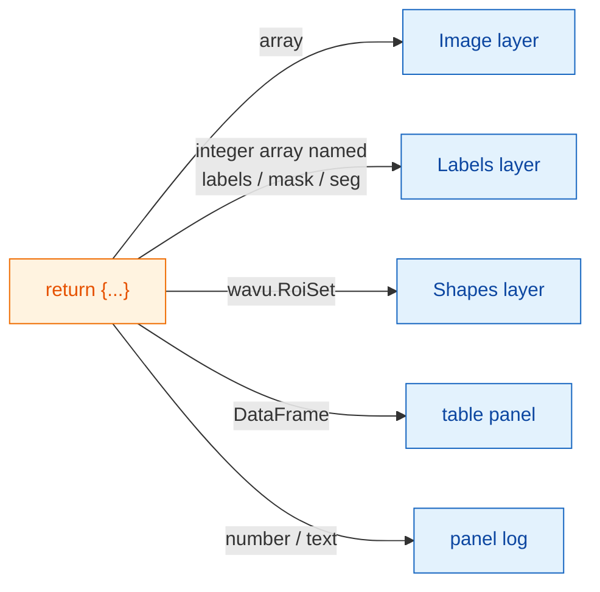

# What you get back in napari

## The idea in plain words

Your script hands back **a dictionary of labelled plates**, exactly as for
Fiji ([What you can return](../write/outputs.md)). The napari waiter looks
at each plate and puts it where napari keeps that kind of thing: pictures
become **Image** layers, segmentations become **Labels** layers, outlines
become **Shapes**, tables get their own panel, and single numbers go to the
panel's log. Your script does not change; only the serving does.

## The menu of plates

| You return | napari shows |
|---|---|
| a NumPy array (2-D or more) | an **Image** layer named after the key |
| an integer array whose key contains `label`, `mask`, `seg` or `instance` (any case) | a **Labels** layer |
| `wavu.Image(arr, extra={"napari": "labels"})` | a **Labels** layer, whatever the name |
| `wavu.Image(arr, extra={"napari": "image"})` | an **Image** layer, even if the name says `labels` |
| `wavu.Image(arr, axes="CYX", channel_names=["DNA", "Actin"])` | one Image layer per channel: `name [DNA]`, `name [Actin]` |
| an RGB image (`axes` ending in `S`, last size 3 or 4) | one RGB Image layer |
| `wavu.RoiSet(path_to_zip)` | a **Shapes** layer of yellow polygons |
| a pandas `DataFrame`, or a list of dicts | a **table panel** docked on the right, named after the key, plus a log line `name: table with N rows` |
| a file path (`pathlib.Path`) | a log line `name: path` |
| a number, text, `True`/`False` | a log line `name = value` |

The "named like labels" rule is the same idea Fiji uses for its colourful
label look-up table, so most scripts look right in both viewers without any
change. When the name does not fit, set the hint with `extra`.

## Pixel size comes along

When you run a script, the panel sends the pixel size of the input layer:
if the layer's last two **scale** values are equal (and not 1), and its
units are micrometres or pixels, that becomes `pixel_um`. Every image
output that does not set its own pixel size gets the same scale, so a
returned array lands exactly on top of its input.

To set your own, return `wavu.Image(arr, pixel_um=0.65)`; the layer's last
two scale values become `0.65`.

## What goes in

Only **Image** and **Labels** layers can be picked in an `image` field. The
panel sends:

- the layer's data (for a multiscale layer, the full-resolution level; lazy
  dask data is loaded into memory first);
- the layer name as the image title;
- for RGB layers, `axes="YXS"`, so your script knows the last axis is
  colour.

Remember that Wavu is for **small data**: one image that fits in memory.

## Good to know

- **Image types.** As for Fiji, outputs are converted to 8-bit, 16-bit or
  32-bit float on the way back. Yes/no masks arrive as 0/255. A label
  image with values above 65535, or below 0, arrives as 32-bit float and
  so opens as an Image layer.
- **Outlines need `roifile`.** Shapes are read from the RoiSet zip with the
  roifile package, which Wavu's napari environment includes. If it were
  missing, the log would tell you where the zip is instead.
- **Returning nothing** (`return {}`) is fine: no layer appears.
- **Errors** appear in the log as `Error: …` with the full traceback, and
  napari shows a short notification.

Using Fiji? The same returns open as image windows, Results tables and the
ROI Manager: [What you can return](../write/outputs.md).

## In one sentence

Return a dictionary, and napari makes arrays into Image or Labels layers,
`wavu.RoiSet` into Shapes, tables into a docked panel and plain values into
log lines, with the input's pixel size carried over.

[Next: wavu-napari internals (advanced) :material-arrow-right:](internals.md){ .md-button }
