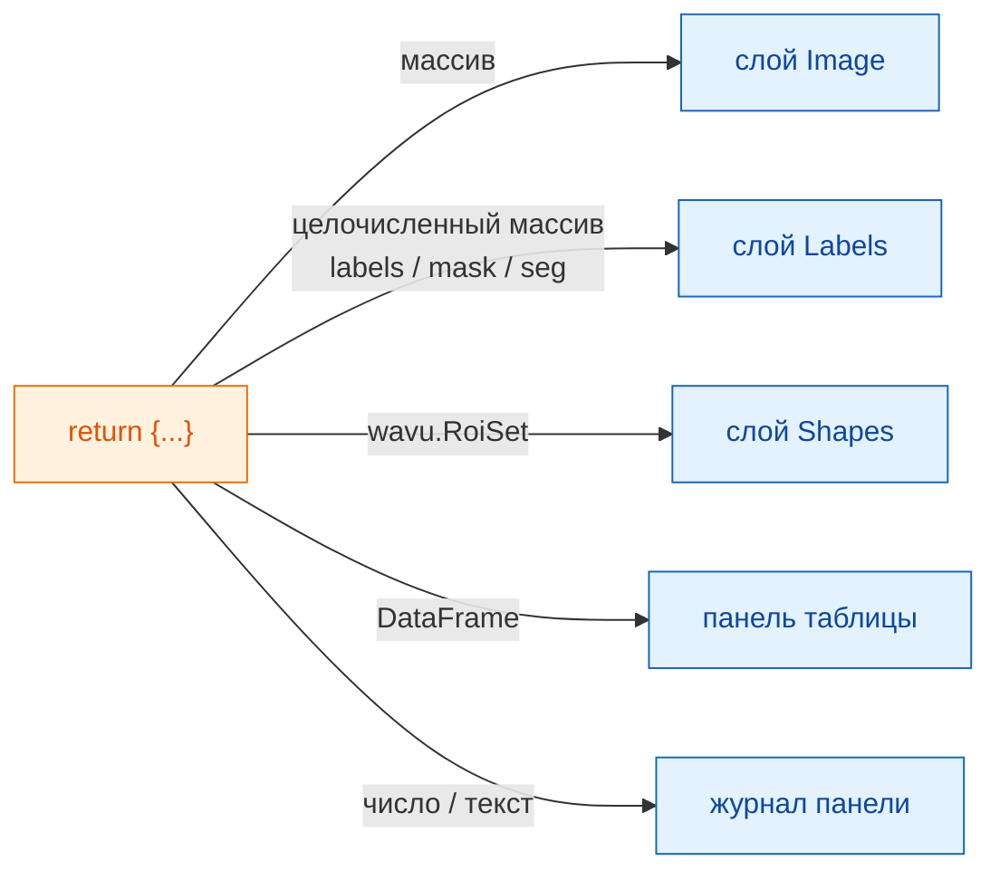

# Что вы получаете в napari

## Идея простыми словами

Ваш скрипт возвращает **словарь подписанных тарелок**, точно так же, как
для Fiji ([Что можно вернуть](../write/outputs.md)). Официант napari
смотрит на каждую тарелку и ставит её туда, где napari хранит такие вещи:
картинки становятся слоями **Image**, сегментации — слоями **Labels**,
контуры — слоем **Shapes**, таблицы получают собственную панель, а
отдельные числа идут в журнал панели. Ваш скрипт не меняется; меняется
только подача.

## Меню тарелок

| Вы возвращаете | napari показывает |
|---|---|
| массив NumPy (2-D или больше) | слой **Image** с именем ключа |
| целочисленный массив, ключ которого содержит `label`, `mask`, `seg` или `instance` (в любом регистре) | слой **Labels** |
| `wavu.Image(arr, extra={"napari": "labels"})` | слой **Labels**, независимо от имени |
| `wavu.Image(arr, extra={"napari": "image"})` | слой **Image**, даже если в имени есть `labels` |
| `wavu.Image(arr, axes="CYX", channel_names=["DNA", "Actin"])` | по слою Image на канал: `name [DNA]`, `name [Actin]` |
| RGB-изображение (`axes` оканчивается на `S`, последний размер 3 или 4) | один RGB-слой Image |
| `wavu.RoiSet(path_to_zip)` | слой **Shapes** из жёлтых многоугольников |
| `DataFrame` pandas или список словарей | **панель таблицы** справа с именем ключа, плюс строка журнала `name: table with N rows` |
| путь к файлу (`pathlib.Path`) | строка журнала `name: path` |
| число, текст, `True`/`False` | строка журнала `name = value` |

Правило «назван как метки» — та же идея, по которой Fiji применяет свою
цветную таблицу поиска (LUT) для меток, поэтому большинство скриптов
выглядят правильно в обоих просмотрщиках без изменений. Если имя не
подходит, задайте подсказку через `extra`.

## Размер пикселя передаётся вместе с изображением

При запуске скрипта панель отправляет размер пикселя входного слоя: если
два последних значения **scale** слоя равны (и не равны 1), а единицы —
микрометры или пиксели, это становится `pixel_um`. Каждое выходное
изображение, которое не задаёт собственный размер пикселя, получает тот же
масштаб, поэтому возвращённый массив ложится точно поверх входного.

Чтобы задать свой, верните `wavu.Image(arr, pixel_um=0.65)`; два последних
значения scale слоя станут `0.65`.

## Что уходит на вход

В поле `image` можно выбрать только слои **Image** и **Labels**. Панель
отправляет:

- данные слоя (для многомасштабного слоя — уровень полного разрешения;
  ленивые данные dask сначала загружаются в память);
- имя слоя как заголовок изображения;
- для RGB-слоёв `axes="YXS"`, чтобы скрипт знал, что последняя ось — цвет.

Помните, что Wavu предназначен для **небольших данных**: одно изображение,
которое помещается в память.

## Полезно знать

- **Типы изображений.** Как и для Fiji, на обратном пути результаты
  преобразуются в 8-бит, 16-бит или 32-бит float. Маски да/нет приходят
  как 0/255. Изображение меток со значениями выше 65535 или ниже 0
  приходит как 32-бит float и поэтому открывается как слой Image.
- **Для контуров нужен `roifile`.** Фигуры читаются из zip-файла RoiSet
  пакетом roifile, который входит в окружение napari из Wavu. Если бы его
  не было, журнал сообщил бы, где лежит zip.
- **Ничего не возвращать** (`return {}`) — нормально: слой не появится.
- **Ошибки** появляются в журнале как `Error: …` с полной трассировкой, а
  napari показывает короткое уведомление.

Пользуетесь Fiji? Те же результаты открываются как окна изображений,
таблицы Results и ROI Manager: [Что можно вернуть](../write/outputs.md).

## Одним предложением

Верните словарь, и napari превратит массивы в слои Image или Labels,
`wavu.RoiSet` — в Shapes, таблицы — в пристыкованную панель, а простые
значения — в строки журнала, сохранив размер пикселя входного изображения.

[Далее: внутреннее устройство wavu-napari (для продвинутых) :material-arrow-right:](internals.md){ .md-button }
