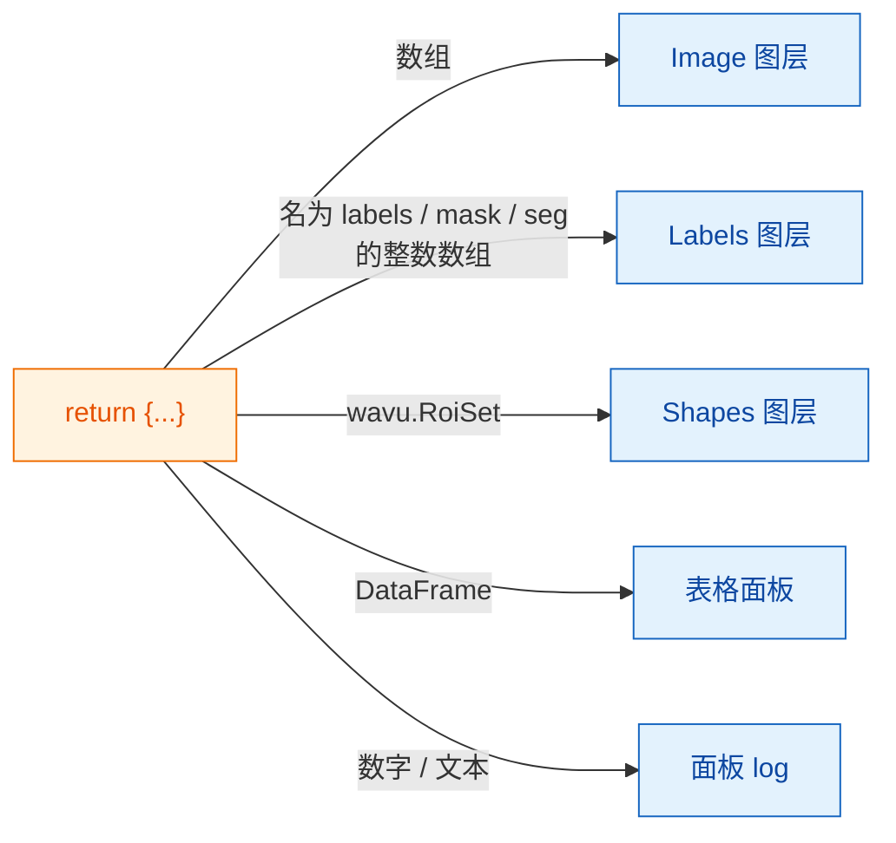

# 在 napari 中会得到什么

## 用大白话说

你的脚本交回的是**一个字典，装着一组贴了标签的餐盘**，和 Fiji 完全一样
（[可以返回什么](../write/outputs.md)）。napari 这位服务员会看看每个盘子，
把它放到 napari 存放那类东西的地方：图片变成 **Image** 图层，分割结果变成
**Labels** 图层，轮廓变成 **Shapes**，表格有自己的面板，单个数值则写进面板
的 log。你的脚本不用改，变的只是上菜的方式。

## 餐盘菜单

| 你返回 | napari 显示 |
|---|---|
| NumPy 数组（2 维及以上） | 以键命名的 **Image** 图层 |
| 键名含有 `label`、`mask`、`seg` 或 `instance`（不区分大小写）的整数数组 | **Labels** 图层 |
| `wavu.Image(arr, extra={"napari": "labels"})` | **Labels** 图层，无论名字是什么 |
| `wavu.Image(arr, extra={"napari": "image"})` | **Image** 图层，即使名字里写着 `labels` |
| `wavu.Image(arr, axes="CYX", channel_names=["DNA", "Actin"])` | 每个通道一个 Image 图层：`name [DNA]`、`name [Actin]` |
| RGB 图像（`axes` 以 `S` 结尾，最后一维大小为 3 或 4） | 一个 RGB Image 图层 |
| `wavu.RoiSet(path_to_zip)` | 由黄色多边形组成的 **Shapes** 图层 |
| pandas `DataFrame`，或由 dict 组成的 list | 停靠在右侧、以键命名的**表格面板**，外加一行 log `name: table with N rows` |
| 文件路径（`pathlib.Path`） | 一行 log `name: path` |
| 数字、文本、`True`/`False` | 一行 log `name = value` |

“名字像 labels”这条规则，和 Fiji 套用五颜六色的标签查找表（LUT）是同一个
思路，所以大多数脚本不用做任何修改，在 Fiji 和 napari 里看起来都正确。
名字不合适时，用 `extra` 设置提示。

## 像素大小会一起带过来

运行脚本时，面板会发送输入图层的像素大小：如果图层 **scale** 的最后两个值
相等（且不为 1），单位又是微米或像素，它就会成为 `pixel_um`。每个没有自行
设置像素大小的图像输出，都会得到同样的 scale，所以返回的数组会正好叠在
输入的上方。

想自己设置的话，返回 `wavu.Image(arr, pixel_um=0.65)`；图层 scale 的最后
两个值就会变成 `0.65`。

## 送进去的是什么

`image` 输入项只能选 **Image** 和 **Labels** 图层。面板会发送：

- 图层的数据（多尺度图层取最高分辨率那一层；延迟加载的 dask 数据会先加载
  到内存）；
- 图层名称，作为图像标题；
- RGB 图层会附上 `axes="YXS"`，让你的脚本知道最后一个轴是颜色。

别忘了 Wavu 是为**小数据**设计的：一张放得进内存的图像。

## 值得了解

- **图像类型。**和 Fiji 一样，输出在返回途中会转换为 8-bit、16-bit 或
  32-bit 浮点。是／否掩膜会以 0/255 返回。值大于 65535 或小于 0 的标签
  图像，会以 32-bit 浮点返回，因此会作为 Image 图层打开。
- **轮廓需要 `roifile`。**Shapes 是用 roifile 包从 RoiSet zip 读出来的，
  Wavu 的 napari 环境已经包含它。万一缺失，log 会改为告诉你 zip 文件在哪里。
- **什么都不返回**（`return {}`）也没问题：不会出现任何图层。
- **错误**会以 `Error: …` 加上完整 traceback 出现在 log 里，napari 也会弹出
  一条简短通知。

用 Fiji 吗？同样的返回值会以图像窗口、Results 表格和 ROI Manager 打开：
[可以返回什么](../write/outputs.md)。

## 一句话总结

返回一个字典，napari 就会把数组变成 Image 或 Labels 图层、把 `wavu.RoiSet`
变成 Shapes、把表格变成停靠面板、把普通值变成 log 消息，并沿用输入的
像素大小。

[下一步：wavu-napari 内部实现（进阶） :material-arrow-right:](internals.md){ .md-button }
