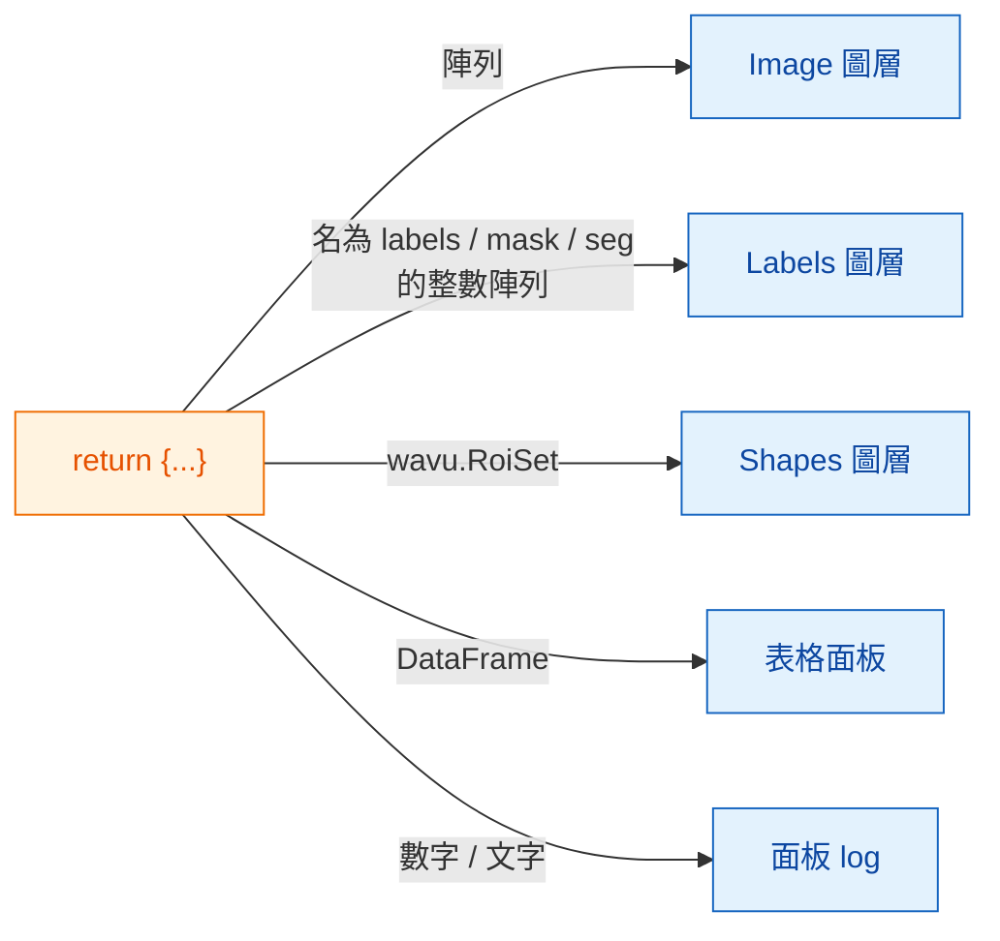

# 在 napari 中會拿回什麼

## 用白話說

你的腳本交回的是**一個字典，裝著一組貼了標籤的餐盤**，和 Fiji 完全一樣
（[可以回傳什麼](../write/outputs.md)）。napari 這位服務生會看看每個盤子，
把它放到 napari 收放那類東西的地方：圖片變成 **Image** 圖層，分割結果變成
**Labels** 圖層，輪廓變成 **Shapes**，表格有自己的面板，單一數值則寫進面板
的 log。你的腳本不用改，改的只是上菜的方式。

## 餐盤菜單

| 你回傳 | napari 顯示 |
|---|---|
| NumPy 陣列（2 維以上） | 以鍵命名的 **Image** 圖層 |
| 鍵名含有 `label`、`mask`、`seg` 或 `instance`（不分大小寫）的整數陣列 | **Labels** 圖層 |
| `wavu.Image(arr, extra={"napari": "labels"})` | **Labels** 圖層，不論名稱為何 |
| `wavu.Image(arr, extra={"napari": "image"})` | **Image** 圖層，即使名稱寫著 `labels` |
| `wavu.Image(arr, axes="CYX", channel_names=["DNA", "Actin"])` | 每個通道一個 Image 圖層：`name [DNA]`、`name [Actin]` |
| RGB 影像（`axes` 以 `S` 結尾，最後一維大小為 3 或 4） | 一個 RGB Image 圖層 |
| `wavu.RoiSet(path_to_zip)` | 由黃色多邊形組成的 **Shapes** 圖層 |
| pandas `DataFrame`，或由 dict 組成的 list | 停駐在右側、以鍵命名的**表格面板**，外加一行 log `name: table with N rows` |
| 檔案路徑（`pathlib.Path`） | 一行 log `name: path` |
| 數字、文字、`True`/`False` | 一行 log `name = value` |

「名稱像 labels」這條規則，和 Fiji 套用色彩繽紛的標籤查找表（LUT）是同一個
想法，所以大多數腳本不用改任何東西，在 Fiji 和 napari 裡看起來都正確。
名稱不合適時，用 `extra` 設定提示。

## 像素大小會跟著一起來

執行腳本時，面板會送出輸入圖層的像素大小：如果圖層 **scale** 的最後兩個值
相等（而且不是 1），單位又是微米或像素，它就會成為 `pixel_um`。每個沒有自行
設定像素大小的影像輸出，都會拿到同樣的 scale，所以傳回的陣列會剛好疊在
輸入的正上方。

想自己設定的話，回傳 `wavu.Image(arr, pixel_um=0.65)`；圖層 scale 的最後
兩個值就會變成 `0.65`。

## 送進去的是什麼

`image` 欄位只能選 **Image** 和 **Labels** 圖層。面板會送出：

- 圖層的資料（多尺度圖層取最高解析度那一層；延遲載入的 dask 資料會先載入
  記憶體）；
- 圖層名稱，作為影像標題；
- RGB 圖層會附上 `axes="YXS"`，讓你的腳本知道最後一軸是顏色。

別忘了 Wavu 是給**小型資料**用的：一張放得進記憶體的影像。

## 值得知道

- **影像類型。**和 Fiji 一樣，輸出在傳回的路上會轉成 8-bit、16-bit 或
  32-bit 浮點數。是／否遮罩會以 0/255 傳回。值大於 65535 或小於 0 的標籤
  影像，會以 32-bit 浮點數傳回，因此會開成 Image 圖層。
- **輪廓需要 `roifile`。**Shapes 是用 roifile 套件從 RoiSet zip 讀出來的，
  Wavu 的 napari 環境已經內含它。萬一缺少，log 會改為告訴你 zip 檔在哪裡。
- **什麼都不回傳**（`return {}`）也沒關係：不會出現任何圖層。
- **錯誤**會以 `Error: …` 加上完整 traceback 出現在 log 裡，napari 也會跳出
  一則簡短通知。

用 Fiji 嗎？同樣的回傳值會開成影像視窗、Results 表格和 ROI Manager：
[可以回傳什麼](../write/outputs.md)。

## 一句話總結

回傳一個字典，napari 就會把陣列變成 Image 或 Labels 圖層、把 `wavu.RoiSet`
變成 Shapes、把表格變成停駐面板、把單純的值變成 log 訊息，並沿用輸入的
像素大小。

[下一步：wavu-napari 內部構造（進階） :material-arrow-right:](internals.md){ .md-button }
