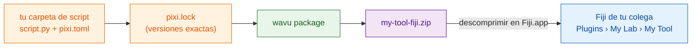
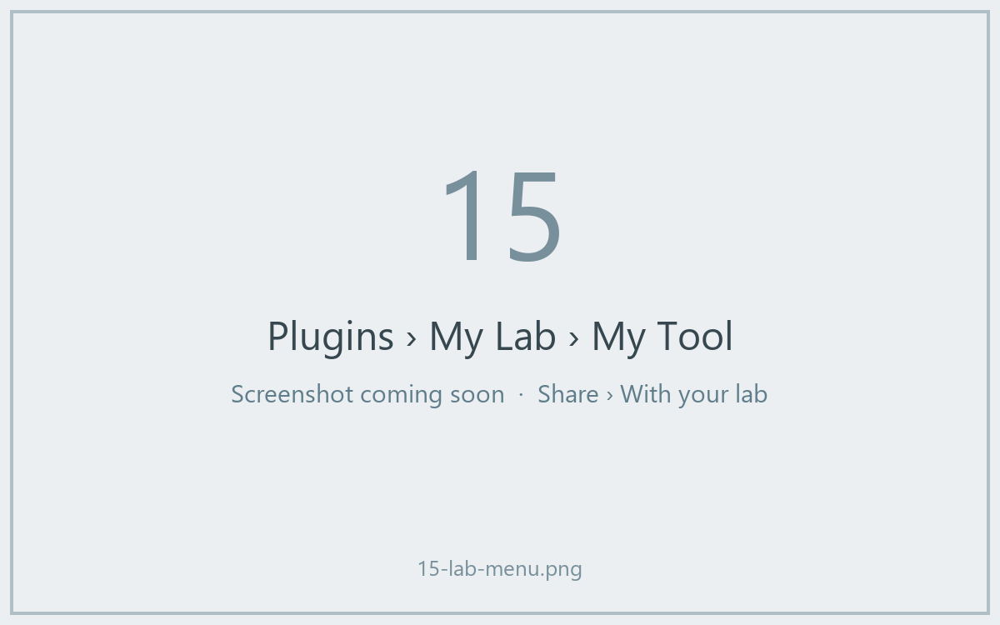
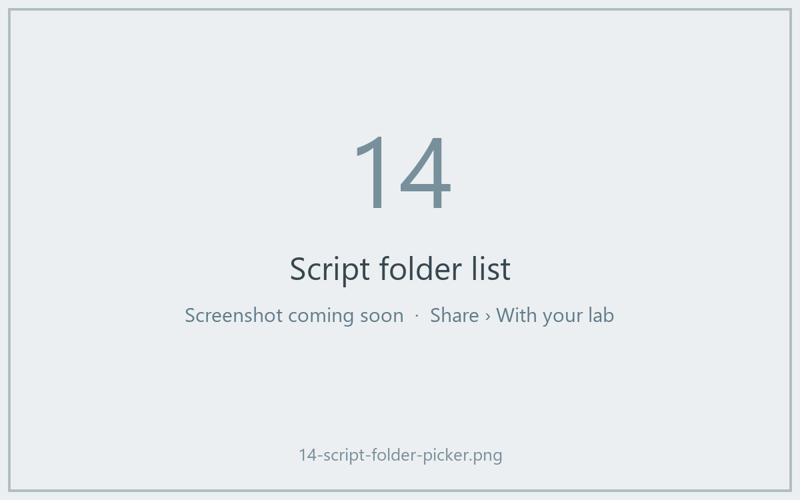

# Compartir con tu laboratorio

## La idea en palabras sencillas

Tu receta funciona. Ahora quieres que tus colegas la usen **sin** elegir
carpetas ni saber nada de Python. Wavu puede empaquetar tu carpeta de script
en **un solo archivo zip**, como un kit de comida: la receta, la lista de la
compra exacta y una entrada de menú. Un colega lo descomprime en Fiji,
reinicia y encuentra tu herramienta en el menú **Plugins**, con el nombre que
tú elijas.

**Para un laboratorio, este zip es todo lo que necesitas.** Sin GitHub, sin
web, sin cuentas. Envíalo por correo, déjalo en una unidad compartida, y
listo.



## ¿Qué es `pixi.lock`?

`pixi.toml` es la lista de la compra ("algo de scikit-image"). `pixi.lock` es
el **tique de compra**: la versión exacta de cada paquete que se compró de
verdad. Enviar el tique significa que tus colegas reciben *exactamente* los
mismos paquetes que tú, así que la herramienta se comporta igual en sus
ordenadores. pixi lo escribe por ti cuando construye el entorno, así que
después de tu primera ejecución desde Fiji ya está en tu carpeta.

## Paso 1: crea el zip

Este paso es en la terminal (mira [cómo tener pixi en una terminal](../write/test-without-fiji.md#run-the-tests)).
En VS Code, abre **Terminal › New Terminal** en tu carpeta de script y
ejecuta:

```sh
pixi install
pixi run wavu package . --name my-tool --menu "My Lab>My Tool"
```

- `--name` es un nombre interno corto: solo letras, dígitos, `_` y `-`.
- `--menu` es dónde aparece la herramienta dentro de **Plugins**. `>` separa
  los submenús, así que `"My Lab>My Tool"` da **Plugins › My Lab › My Tool**.

Deberías ver algo como:

```text
Wrote dist/fiji and …/dist/my-tool-fiji.zip
Users unzip it into Fiji.app (needs Wavu); menu: Plugins > My Lab > My Tool
```

Tu zip es `dist/my-tool-fiji.zip`, dentro de la carpeta del script. Los
tests, `.pixi`, `.vscode` y `.github` se dejan fuera automáticamente.

??? warning "Dice *depends on wavu through a local path*"
    Entonces tu `pixi.toml` apunta a una carpeta de Wavu en *tu* disco, que
    tus colegas no tienen. El mensaje muestra la línea que debes usar en su
    lugar. Pégala en `pixi.toml` y vuelve a ejecutar `pixi install`. Las
    carpetas creadas a partir de la [plantilla](../write/get-the-template.md)
    no tienen este problema.

## Paso 2: tu colega lo instala

Tu colega necesita tener Wavu instalado ([dos minutos](../start/install.md)).
Después:

1. Descomprime `my-tool-fiji.zip` **en `Fiji.app`**, igual que el zip de Wavu
   ([cómo, según el sistema](../start/install.md#step-2-unzip-it-into-your-fiji-folder)).
2. Reinicia Fiji.
3. Abre una imagen y elige **Plugins › My Lab › My Tool**.



El primer arranque descarga los paquetes de tu `pixi.lock` (una vez; el Log
lo avisa), y luego aparece el diálogo. No hay que elegir ninguna carpeta.

La herramienta también aparece en **Plugins › Wavu › Run Python Script** como
*installed: my-tool*.



## Actualizar la herramienta

Cambia tu script, pruébalo, vuelve a ejecutar los dos comandos y envía el zip
nuevo. Tus colegas lo descomprimen encima del antiguo y reinician Fiji.

## En una frase

`wavu package` convierte tu carpeta de script en un solo zip; cualquiera con
Wavu lo descomprime en `Fiji.app` y tiene tu herramienta en el menú Plugins,
sin necesidad de GitHub.

[Siguiente: compartir con el mundo (avanzado) :material-arrow-right:](with-the-world.md){ .md-button }
