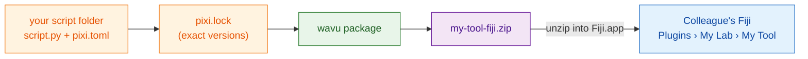

# Share with your lab

## The idea in plain words

Your recipe works. Now you want colleagues to use it **without** picking
folders or knowing anything about Python. Wavu can pack your script folder
into **one zip file**, like a meal kit: the recipe, the exact shopping list,
and a menu entry. A colleague unzips it into Fiji, restarts, and finds your
tool in the **Plugins** menu, under a name you choose.

**For a lab, this zip is all you need.** No GitHub, no website, no accounts.
Email it, put it on a shared drive, done.



## What is `pixi.lock`?

`pixi.toml` is the shopping list ("some scikit-image"). `pixi.lock` is the
**receipt**: the exact version of every package that was actually bought.
Shipping the receipt means your colleagues get *exactly* the same packages
as you, so the tool behaves the same on their computers. pixi writes it for
you when it builds the environment, so after your first run from Fiji it is
already in your folder.

## Step 1: make the zip

This is a terminal step (see [how to get pixi in a terminal](../write/test-without-fiji.md#run-the-tests)).
In VS Code, open **Terminal › New Terminal** in your script folder and run:

```sh
pixi install
pixi run wavu package . --name my-tool --menu "My Lab>My Tool"
```

- `--name` is a short internal name: letters, digits, `_` and `-` only.
- `--menu` is where the tool appears under **Plugins**. `>` separates
  sub-menus, so `"My Lab>My Tool"` gives **Plugins › My Lab › My Tool**.

You should see something like:

```text
Wrote dist/fiji and …/dist/my-tool-fiji.zip
Users unzip it into Fiji.app (needs Wavu); menu: Plugins > My Lab > My Tool
```

Your zip is `dist/my-tool-fiji.zip` inside the script folder. Tests,
`.pixi`, `.vscode` and `.github` are left out automatically.

??? warning "It says *depends on wavu through a local path*"
    Then your `pixi.toml` points to a Wavu folder on *your* disk, which
    colleagues do not have. The message prints the line to use instead.
    Paste it into `pixi.toml`, then run `pixi install` again. Folders from
    the [template](../write/get-the-template.md) do not have this problem.

## Step 2: your colleague installs it

Your colleague needs Wavu installed ([two minutes](../start/install.md)).
Then:

1. Unzip `my-tool-fiji.zip` **into `Fiji.app`**, exactly like the Wavu zip
   ([how, per system](../start/install.md#step-2-unzip-it-into-your-fiji-folder)).
2. Restart Fiji.
3. Open an image and choose **Plugins › My Lab › My Tool**.

The first start downloads the packages from your `pixi.lock` (once; the Log
says so), then the dialog appears. There is no folder to pick.

The tool also appears in **Plugins › Wavu › Run Python Script** as
*installed: my-tool*.

## Updating the tool

Change your script, test it, run the two commands again and send the new
zip. Colleagues unzip it over the old one and restart Fiji.

## In one sentence

`wavu package` turns your script folder into one zip; anyone with Wavu
unzips it into `Fiji.app` and gets your tool in the Plugins menu, with no
GitHub needed.

[Next: share with the world (advanced) :material-arrow-right:](with-the-world.md){ .md-button }
