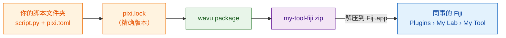

# 分享给实验室

## 用大白话说

你的食谱能用了。现在你希望同事也能用它，**不用**自己选文件夹，也不用懂 Python。Wavu 可以把你的脚本文件夹打包成**一个 zip 文件**，就像一份料理包：里面有食谱、精确的购物清单，还有一个菜单项。同事把它解压到 Fiji 里、重启，就能在 **Plugins** 菜单里按你起的名字找到你的工具。

**对实验室来说，这个 zip 就够了。** 不需要 GitHub、不需要网站、不需要账号。发邮件也好，放到共享盘上也好，就搞定了。



## `pixi.lock` 是什么？

`pixi.toml` 是购物清单（“来点 scikit-image”）。`pixi.lock` 是**收据**：记下实际买到的每个包的精确版本。把收据一起带上，同事拿到的包就和你的*一模一样*，工具在他们电脑上的表现也一样。pixi 在搭建环境时会自动写好它，所以只要你从 Fiji 运行过一次，它就已经在你的文件夹里了。

## 第 1 步：生成 zip 文件

这一步要用终端（参见[如何在终端里使用 pixi](../write/test-without-fiji.md#run-the-tests)）。在 VS Code 里，在你的脚本文件夹中打开 **Terminal › New Terminal**，然后运行：

```sh
pixi install
pixi run wavu package . --name my-tool --menu "My Lab>My Tool"
```

- `--name` 是一个简短的内部名称：只能用英文字母、数字、`_` 和 `-`。
- `--menu` 决定工具出现在 **Plugins** 下的哪个位置。`>` 用来分隔子菜单，所以 `"My Lab>My Tool"` 会变成 **Plugins › My Lab › My Tool**。

你应该会看到类似下面的输出：

```text
Wrote dist/fiji and …/dist/my-tool-fiji.zip
Users unzip it into Fiji.app (needs Wavu); menu: Plugins > My Lab > My Tool
```

你的 zip 文件就是脚本文件夹里的 `dist/my-tool-fiji.zip`。测试文件、`.pixi`、`.vscode` 和 `.github` 会被自动排除。

??? warning "提示 *depends on wavu through a local path*（通过本地路径依赖 wavu）"
    这说明你的 `pixi.toml` 指向的是*你自己*磁盘上的一个 Wavu 文件夹，而同事的电脑上没有。提示信息会打印出应该改用的那一行。把它粘贴到 `pixi.toml` 里，再运行一次 `pixi install`。用[模板](../write/get-the-template.md)创建的文件夹不会有这个问题。

## 第 2 步：同事安装它

同事需要先装好 Wavu（[只要两分钟](../start/install.md)）。然后：

1. 把 `my-tool-fiji.zip` 解压**到 `Fiji.app` 里**，做法和 Wavu 的 zip 完全一样（[各系统的做法](../start/install.md#step-2-unzip-it-into-your-fiji-folder)）。
2. 重启 Fiji。
3. 打开一张图像，选择 **Plugins › My Lab › My Tool**。

第一次启动时会按照你的 `pixi.lock` 下载软件包（只下载一次，Log 窗口里会有提示），然后对话框就会出现。不需要选择任何文件夹。

这个工具也会出现在 **Plugins › Wavu › Run Python Script** 里，显示为 *installed: my-tool*。

## 更新工具

修改脚本、测试一下，再运行一遍上面两条命令，把新的 zip 发出去。同事把它解压覆盖旧的，然后重启 Fiji。

## 一句话总结

`wavu package` 把你的脚本文件夹变成一个 zip 文件；任何装了 Wavu 的人把它解压到 `Fiji.app`，就能在 Plugins 菜单里找到你的工具，完全不需要 GitHub。

[下一步：分享给全世界（进阶） :material-arrow-right:](with-the-world.md){ .md-button }
