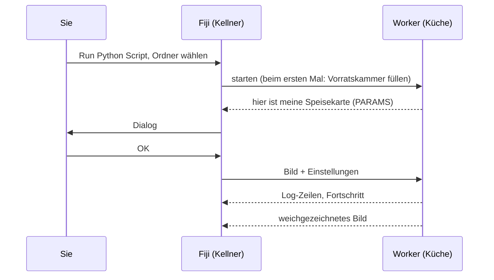
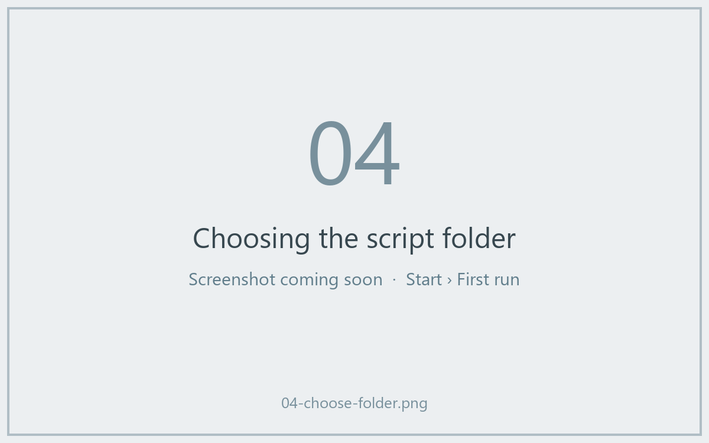
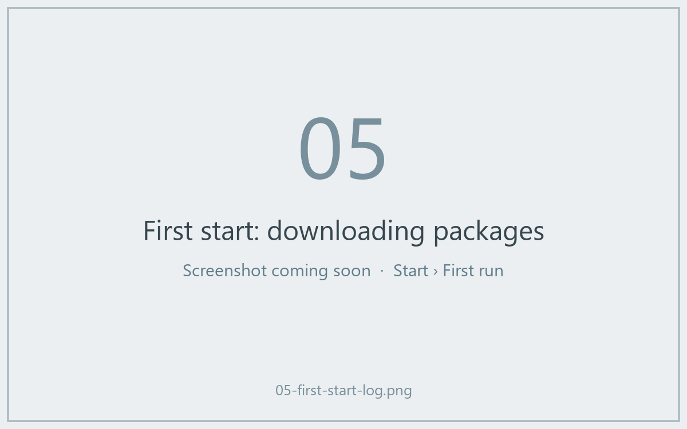
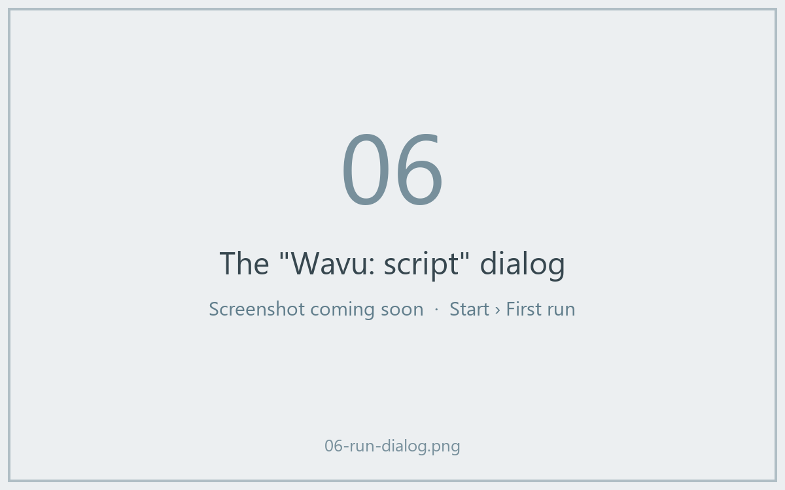
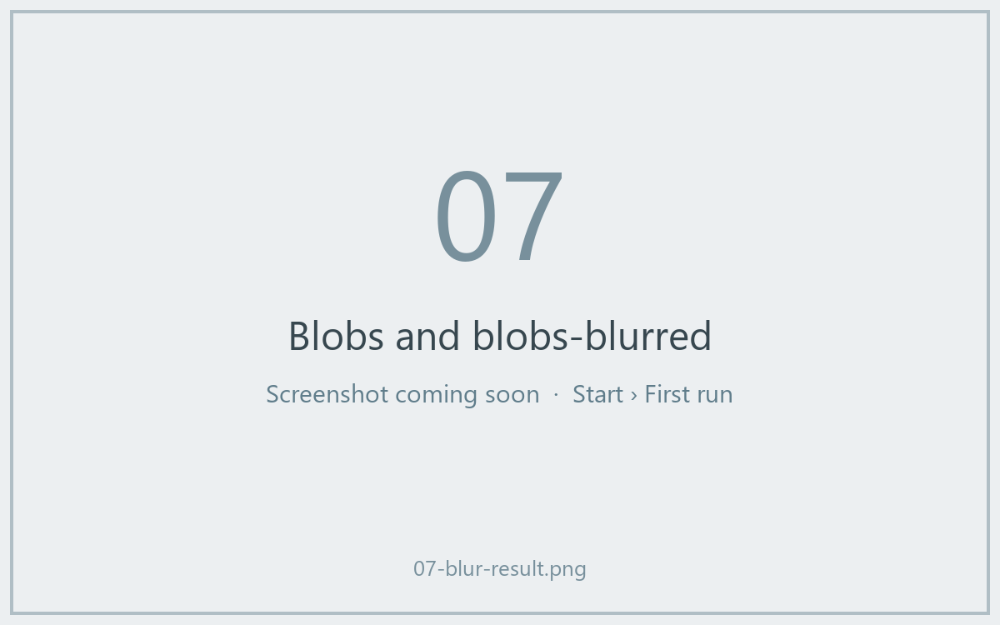

# Ihr erster Durchlauf

## Die Idee in einfachen Worten

Zeit für die erste Bestellung. Wir nehmen das **Vorlagen-Skript**, ein
winziges Rezept, das ein Bild weichzeichnet (ein Gaußscher Weichzeichner),
und wenden es auf Fijis eingebautes Beispielbild *Blobs* an. Der
Weichzeichner selbst ist mit Absicht langweilig: So sehen Sie den ganzen
Weg, vom Dialog in die Küche und zurück, ohne Überraschungen.



## Schritt 1: den Vorlagen-Ordner holen

Laden Sie die Vorlage als ZIP-Datei herunter und entpacken Sie sie an einem
Ort, an dem Sie sie wiederfinden, zum Beispiel unter *Dokumente*:

[ZIP herunterladen](https://github.com/Oxford-Zeiss-Centre-of-Excellence/Wavu-Script-Template/archive/refs/heads/main.zip){ .md-button }

Sie erhalten einen Ordner namens `Wavu-Script-Template-main`. Darin liegen
`script.py` (das Rezept) und `pixi.toml` (die Einkaufsliste für seine
Vorratskammer). Mehr ist ein *Skriptordner* nicht.

!!! tip "Ein Ordner zu tief?"
    *Alle extrahieren* unter Windows legt manchmal einen Ordner in einem
    gleichnamigen Ordner an. Der richtige ist der, der `pixi.toml` direkt
    enthält.

!!! note "Vorerst wird Git gebraucht"
    Die Vorlage lädt den Python-Teil von Wavu von GitHub herunter. Dafür muss
    [Git](https://git-scm.com) auf Ihrem Computer installiert sein.
    Installieren Sie es einmal mit den Standardeinstellungen; *benutzen*
    müssen Sie es nie.

## Schritt 2: das Beispiel Blobs öffnen

In Fiji: **File › Open Samples › Blobs (25K)**.

## Schritt 3: das Skript ausführen

1. Wählen Sie **Plugins › Wavu › Run Python Script**.
2. Ein Ordner-Auswahlfenster öffnet sich mit dem Titel
   *Wavu: choose a script folder (contains pixi.toml)*. Wählen Sie den
   Ordner `Wavu-Script-Template-main` aus und bestätigen Sie.



!!! info "Der erste Start dauert ein paar Minuten, nur einmal"
    Im Log-Fenster steht
    *First start of '…': downloading its Python packages. This happens once
    and can take several minutes…*, und die Statusleiste zählt die Sekunden.
    Das ist pixi, das die Vorratskammer füllt. Lassen Sie es fertig werden;
    beim nächsten Mal startet das Skript in Sekunden.



3. Der Dialog **Wavu: script** erscheint. Seine erste Zeile ist die
   Beschreibung des Skripts, *Gaussian blur -- the Wavu example script.*,
   gefolgt von den Feldern **Image**, **Sigma (pixels)**, **Edges** und
   **Keep the input's pixel type**, dazu ein Kästchen **Debug in VS Code**
   (lassen Sie es aus).



4. Lassen Sie die Standardwerte stehen, prüfen Sie, dass bei **Image**
   `blobs.gif` steht, und klicken Sie auf **OK**.

## Schritt 4: das Ergebnis ansehen

Ein neues Bild namens **blobs-blurred** öffnet sich: dieselben Blobs, nur
weicher. Das Log zeigt, was passiert ist:

```text
[Wavu] Running script [sigma:2.0, mode:reflect, keep_dtype:true]
Blurring a (254, 256) uint8 image with sigma=2.0
[Wavu] script finished
```



Versuchen Sie es noch einmal mit **Sigma (pixels)** auf `8`. Diesmal geht es
sofort los, weil die Küche noch läuft und die Vorratskammer voll ist.

## Was ist gerade passiert?

- Fiji hat `pixi.toml` im Ordner gefunden und wusste deshalb, dass es ein
  Skriptordner ist.
- pixi hat die eigene Umgebung dieses Ordners gebaut (in einem versteckten
  Ordner `.pixi`).
- Ein Worker ist in dieser Umgebung gestartet und hat Fiji gesagt, was im
  Dialog stehen soll.
- Fiji hat das Bild und Ihre Einstellungen geschickt und das zurückgekommene
  Bild geöffnet.

Der Worker läuft weiter, bis Sie Fiji beenden oder
**Plugins › Wavu › Stop Worker** wählen.

## In einem Satz

Wählen Sie in **Run Python Script** einen Skriptordner, warten Sie einmal
auf seine Umgebung, füllen Sie den Dialog aus, und das Ergebnis öffnet sich
in Fiji.

[Weiter: Ihr eigenes Skript schreiben :material-arrow-right:](../write/get-the-template.md){ .md-button }
