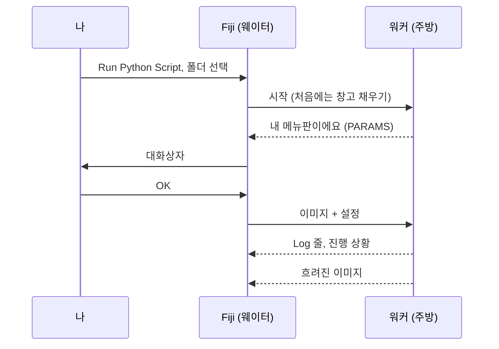
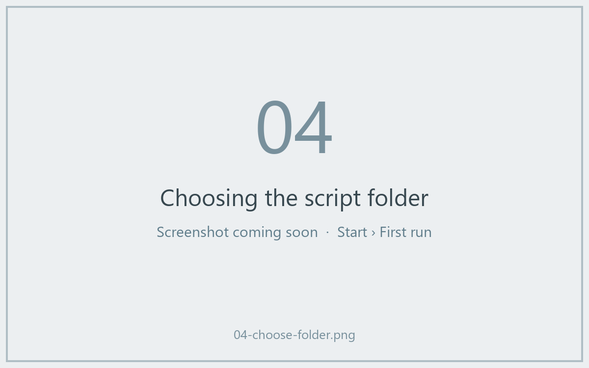
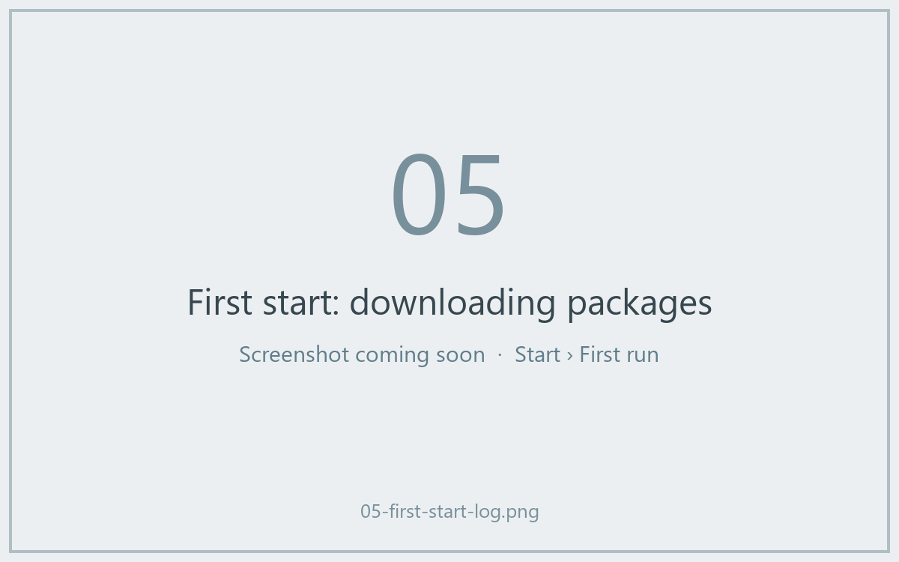
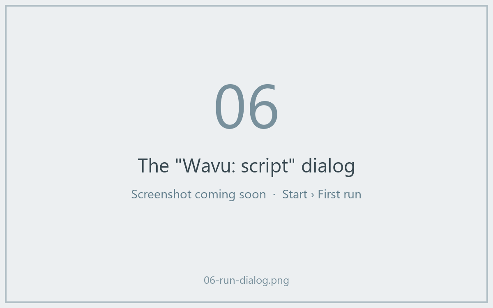
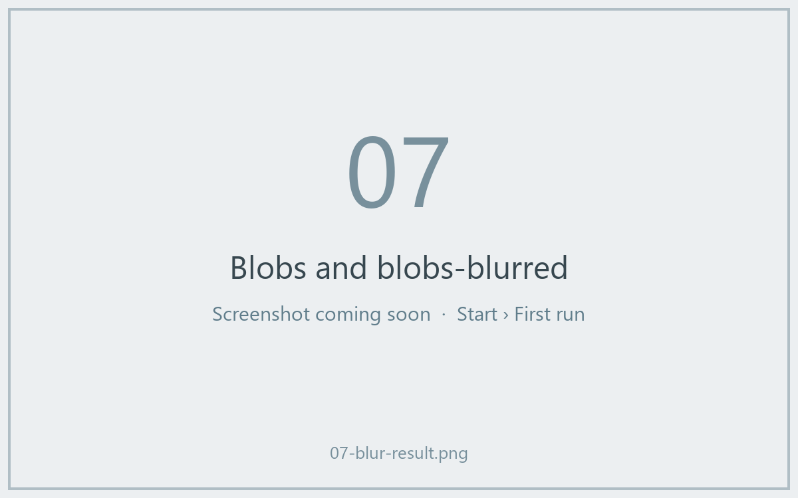

# 첫 실행

## 쉬운 말로 설명하면

첫 주문을 할 시간이에요. 이미지를 흐리게 하는(가우시안 블러) 작은 레시피인
**템플릿 스크립트**를 Fiji에 들어 있는 *Blobs* 샘플에 써 볼 거예요. 블러
자체는 일부러 단순하게 했어요. 그래야 대화상자에서 주방까지 갔다가 돌아오는
전 과정을 놀랄 일 없이 볼 수 있거든요.



## 1단계: 템플릿 폴더 받기

템플릿을 zip으로 내려받아 다시 찾기 쉬운 곳(예: *문서*)에 압축을 푸세요.

[ZIP 내려받기](https://github.com/Oxford-Zeiss-Centre-of-Excellence/Wavu-Script-Template/archive/refs/heads/main.zip){ .md-button }

`Wavu-Script-Template-main`이라는 폴더가 생겨요. 안에는 `script.py`(레시피)와
`pixi.toml`(창고를 위한 장보기 목록)이 있어요. *스크립트 폴더*는 이게 전부예요.

!!! tip "폴더가 한 단계 더 깊나요?"
    Windows의 *Extract All*(압축 풀기)은 같은 이름의 폴더 안에 폴더를 하나
    더 만들 때가 있어요. 맞는 폴더는 `pixi.toml`을 바로 담고 있는 폴더예요.

!!! note "지금은 Git이 필요해요"
    템플릿은 Wavu의 Python 부분을 GitHub에서 내려받기 때문에 컴퓨터에
    [Git](https://git-scm.com)이 설치되어 있어야 해요. 기본 옵션으로 한 번
    설치하면 되고, 직접 *쓸* 일은 없어요.

## 2단계: Blobs 샘플 열기

Fiji에서 **File › Open Samples › Blobs (25K)**를 고르세요.

## 3단계: 스크립트 실행하기

1. **Plugins › Wavu › Run Python Script**를 고르세요.
2. *Wavu: choose a script folder (contains pixi.toml)*라는 제목의 폴더
   선택 창이 열려요. `Wavu-Script-Template-main` 폴더를 선택하고 확인하세요.



!!! info "첫 시작은 몇 분 걸려요, 한 번만요"
    Log 창에
    *First start of '…': downloading its Python packages. This happens once
    and can take several minutes…*라고 나오고, 상태 표시줄에서 초를 세요.
    pixi가 창고를 채우는 중이에요. 끝날 때까지 기다리세요. 다음부터는 몇 초
    만에 시작해요.



3. **Wavu: script** 대화상자가 나타나요. 첫 줄은 스크립트 설명인
   *Gaussian blur -- the Wavu example script.*이고, 그 아래에
   **Image**, **Sigma (pixels)**, **Edges**,
   **Keep the input's pixel type** 입력란과 **Debug in VS Code**
   체크박스가 있어요(꺼 두세요).



4. 기본값은 그대로 두고, **Image**가 `blobs.gif`인지 확인한 뒤 **OK**를
   누르세요.

## 4단계: 결과 보기

**blobs-blurred**라는 새 이미지가 열려요. 같은 방울들이 더 부드러워졌어요.
Log에는 무슨 일이 있었는지 나와요.

```text
[Wavu] Running script [sigma:2.0, mode:reflect, keep_dtype:true]
Blurring a (254, 256) uint8 image with sigma=2.0
[Wavu] script finished
```



**Sigma (pixels)**를 `8`로 바꿔 다시 해 보세요. 이번에는 바로 시작해요.
주방이 아직 열려 있고 창고도 가득 차 있으니까요.

## 방금 무슨 일이 있었나요?

- Fiji가 폴더에서 `pixi.toml`을 찾아서 스크립트 폴더라는 걸 알았어요.
- pixi가 그 폴더만의 환경을 만들었어요(숨김 폴더 `.pixi` 안에).
- 그 환경에서 워커가 시작되어, 대화상자에 무엇이 들어갈지 Fiji에 알려 줬어요.
- Fiji가 이미지와 설정을 보냈고, 돌아온 이미지를 열었어요.

워커는 Fiji를 종료하거나 **Plugins › Wavu › Stop Worker**를 고를 때까지
계속 실행돼요.

## 한 문장으로

**Run Python Script**에서 스크립트 폴더를 고르고, 환경이 만들어지기를 한 번
기다린 다음, 대화상자를 채우면 결과가 Fiji에서 열려요.

[다음: 나만의 스크립트 작성하기 :material-arrow-right:](../write/get-the-template.md){ .md-button }
